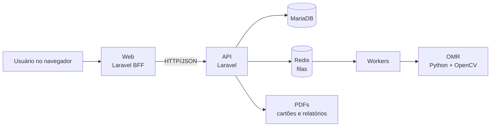

<p align="center">
  <picture>
    <source media="(prefers-color-scheme: dark)" srcset="apps/web/public/brand/gabarito360-email-dark.png">
    
  </picture>
</p>

<p align="center">
  <strong>Gestão completa de avaliações educacionais para redes de ensino.</strong><br>
  Do cadastro da prova à análise pedagógica dos resultados.
</p>

<p align="center">
  <a href="https://github.com/lucasgenial/gabarito360/actions/workflows/verificacao.yml"></a>
</p>

---

## O que é o Gabarito360

O Gabarito360 é uma plataforma web para redes de ensino, escolas e professores. Ela organiza todo o ciclo de uma avaliação:

1. Cadastro da rede, das escolas, das turmas e dos alunos.
2. Criação da prova e do gabarito oficial.
3. Impressão dos cartões-resposta, com QR code para identificar aluno e prova.
4. Correção automática por leitura óptica (OMR), a partir da foto do cartão.
5. Revisão das leituras com dúvida, com histórico de cada tentativa.
6. Notas, relatórios e painéis por aluno, turma, escola, núcleo e rede.

O Gabarito360 não é só um leitor de gabaritos. Ele também organiza o acesso de cada pessoa, protege os dados de alunos e apoia a decisão pedagógica.

Para entender o produto em 15 minutos, leia a [visão geral](docs/visao-geral/README.md).

## Para quem

| Público | O que faz no Gabarito360 |
|---|---|
| Rede de ensino | Acompanha os resultados de todas as escolas e núcleos. |
| Diretor de núcleo | Acompanha as escolas do núcleo. |
| Diretor escolar e vice-diretor | Acompanham a escola, as turmas e as correções. |
| Coordenador | Organiza provas, disciplinas, professores e a correção. |
| Secretaria escolar | Mantém os cadastros de turmas e alunos. |
| Professor | Cria provas, corrige cartões e acompanha as suas turmas. |
| Professor autônomo | Usa o Gabarito360 no seu espaço pessoal, sem vínculo com uma escola. |
| Aplicador | Aplica as provas e envia as fotos dos cartões. |

Cada pessoa pode ter vínculos em mais de uma escola ou espaço. O sistema mostra só o que o vínculo ativo permite. Os perfis e as permissões estão em [identidade, acesso e permissões](docs/arquitetura/04-identidade-acesso-e-permissoes.md).

## Principais funcionalidades

| Área | Funcionalidades |
|---|---|
| Estrutura escolar | Redes, núcleos, escolas, turmas, alunos, disciplinas e áreas do conhecimento |
| Provas | Provas e gabaritos, autoria, duplicação da própria prova |
| Correção | Cartões-resposta com QR code, leitura óptica pela câmera, revisão de leituras, qualidade da imagem |
| Resultados | Notas, resultado por aluno, relatórios consolidados e PDF |
| Painéis | Painéis por perfil, painéis de turmas e da turma, editor pessoal de painéis |
| Acesso | Vínculos, troca de contexto, permissões por perfil, acessos internos |
| Privacidade | Avatares em vez de fotos de alunos, proteção de dados pessoais, auditoria, pedidos dos titulares (LGPD) |
| Catálogo | Catálogo nacional de instituições (escolas e instituições de ensino superior) |

O estado de cada funcionalidade está no [catálogo de funcionalidades](docs/funcionalidades/README.md). O catálogo tem 77 funcionalidades, com documentos de planejamento e casos de uso para cada uma.

## Como funciona



- A **API** é dona do banco e das regras de negócio. Ela responde só JSON.
- O **Web** é a interface. Ele consome a API por HTTP e não acessa o banco.
- O **OMR** lê a foto do cartão-resposta e devolve as marcações para a API.
- As **filas** processam as leituras e os trabalhos demorados fora da requisição.

A referência técnica completa está na [documentação de arquitetura](docs/arquitetura/README.md).

## Tecnologias

| Camada | Tecnologia |
|---|---|
| API | PHP 8.3, Laravel 13, Laravel Sanctum |
| Web | PHP 8.3, Laravel 13 (BFF), Blade, TailwindCSS, JavaScript em arquivos externos |
| Banco | MariaDB 10.11 |
| Filas e cache | Redis |
| Leitura óptica | Python 3, OpenCV, NumPy |
| Documentos | ReportLab (cartões e PDFs) |
| Gráficos e painéis | ECharts, GridStack |
| Testes e CI | PHPUnit, testes Node, GitHub Actions |

## Estrutura do repositório

```
gabarito360/
├── apps/
│   ├── api/            # API Laravel: regras de negócio, OMR (apps/api/omr), relatórios
│   └── web/            # Web Laravel (BFF): telas, painéis e JavaScript da aplicação
├── docs/               # Documentação oficial (comece por docs/README.md)
├── mockups/            # Mockups HTML: fonte de verdade das telas
├── style-system/       # Style system de referência
├── previas/            # Prévias isoladas de interface
├── scripts/            # Build de assets, testes, verificações da CI e operação
├── infra/ e deploy/    # Configuração de servidores e publicação
├── AGENTS.md           # Regras vigentes para pessoas e agentes de IA
└── CLAUDE.md           # Complemento para o Claude Code
```

Os apps móveis estão adiados (FN-010).

## Como executar localmente

### Pré-requisitos

- PHP 8.3 e Composer 2
- MariaDB 10.11
- Node.js 22
- Python 3 com `pip`
- Redis (opcional no desenvolvimento; a fila local pode ser síncrona)

### API

```bash
cd apps/api
cp .env.example .env
composer install
php artisan key:generate
php artisan migrate --seed
php artisan serve --port=8001
```

Configure o banco no `.env` (`DB_DATABASE`, `DB_USERNAME`, `DB_PASSWORD`). Não use credenciais reais em desenvolvimento.

### Leitura óptica (OMR)

```bash
python3 -m pip install -r apps/api/omr/requirements.txt
```

### Web

```bash
cd apps/web
cp .env.example .env
composer install
php artisan key:generate
npm install
php artisan serve --port=8000
```

O Web encontra a API pela variável `API_BASE_URL` (padrão `http://127.0.0.1:8001/api`).

### Testes

```bash
cd apps/api && php artisan test
cd apps/web && php artisan test
```

A CI roda também os testes JavaScript em `scripts/tests` e as verificações de imagens, do catálogo e da documentação.

## Qualidade e publicação

- **CI:** cada PR passa pelos testes da API e do Web, pelos testes de telas, pela integridade com MariaDB e pela recuperação da auditoria. As verificações `verificar_imagens.py`, `verificar_funcionalidades.py` e `verificar_documentacao.py` mantêm o repositório organizado.
- **Homologação primeiro:** toda entrega é publicada antes numa homologação isolada, com backup e comparação de dados e arquivos.
- **Produção:** a produção recebe uma entrega só por decisão expressa do responsável.
- **Dados preservados:** gabaritos, questões, cartões, respostas, notas e imagens nunca são apagados por uma publicação.

Os procedimentos estão em [operação](docs/operacao/README.md). Os ambientes estão em [infraestrutura e ambientes](docs/arquitetura/13-infraestrutura-e-ambientes.md).

## Documentação

| Se você quer… | Leia |
|---|---|
| Entender o produto | [Visão geral](docs/visao-geral/README.md) |
| Conhecer a arquitetura | [Arquitetura](docs/arquitetura/README.md) |
| Ver o estado de cada funcionalidade | [Catálogo de funcionalidades](docs/funcionalidades/README.md) |
| Saber o que é feito agora | [Plano mestre](docs/planejamento/00-plano-mestre.md) |
| Entender uma decisão | [Registros de decisão](docs/decisoes/README.md) |
| Publicar ou recuperar | [Operação](docs/operacao/README.md) |
| Entender um termo | [Glossário](docs/glossario.md) |

A porta de entrada completa é [docs/README.md](docs/README.md).

## Como contribuir

O projeto é desenvolvido por um time de agentes de IA coordenado pelo responsável. As mesmas regras valem para pessoas.

1. Leia o [AGENTS.md](AGENTS.md). Ele resume as regras vigentes.
2. Localize a funcionalidade no [plano mestre](docs/planejamento/00-plano-mestre.md). Só a fila priorizada é executada.
3. Leia o `planejamento.md` e o `casos-de-uso.md` da funcionalidade. Sem os dois aprovados, a execução não começa.
4. Siga os papéis e as revisões do [time de agentes](docs/planejamento/02-agentes.md). Quem implementa não revisa a própria entrega.
5. Faça commits no formato `tipo(escopo): descrição` em português. A autoria é somente do responsável, sem identificação de IA.
6. Não versione prints ou screenshots da aplicação.
7. Escreva a documentação no padrão ASD-STE100 moderado.

## Estado atual

Em 10/11/2026, o catálogo registra:

| Implementação | Funcionalidades |
|---|---|
| Concluída | 20 |
| Em homologação | 9 |
| Parcial | 18 |
| Pendente | 20 |
| Candidata | 6 |
| Adiada | 2 |
| Substituída | 2 |

A próxima etapa é a aprovação do plano mestre e das decisões pendentes. Os próximos módulos propostos são a agenda, as notificações, os períodos letivos, a identidade pessoal e a matrícula.

## Licença

Este repositório ainda não define uma licença de uso.
