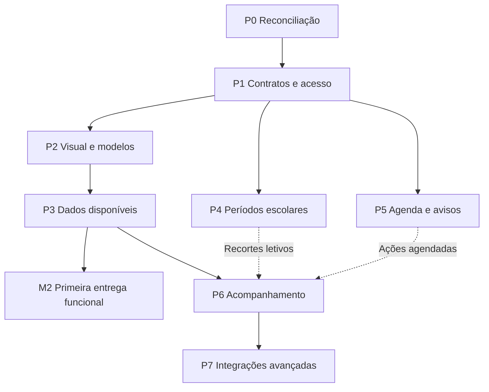

> **Atualização vigente após6444f2c:** linhas podem ter espaço livre. Novo incremento em andamento: botão de arraste com grip, resize proporcional, fixação de posição/tamanho, altura independente, orientação H/V em cinco gráficos e agrupamento pedagógico em Acompanhamento da turma. Seções técnicas e isolamento pessoal preservados, sem DDL. Ver execução179 e contrato de preferências; aprovação/publicação deste incremento ainda pendentes. As regras anteriores conflitantes de preenchimento obrigatório da linha são históricas.

# Gabarito360 Plano dos painéis de turmas e da turma

**Diretriz vigente, conciliada em 07/11/2026:** a correção posterior do responsável, preservada integralmente em [180](180-correcao-dashboards-diretriz.md), substitui as orientações anteriores conflitantes sobre lista principal em cards e modelos neutros. São dois dashboards distintos; a relação de turmas abre em **Tabela**, com **Cards** compactos como alternativa explícita. Modelos têm composição completa, **Em breve** e **Dados demonstrativos**, separados das fontes reais. A decisão humana mais recente retoma a personalização com **GridStack.js e salvamento**, somente no desktop/tablet grande; a decisão mais recente exige linhas completas, alturas iguais por linha e reorganização automática dos membros da mesma linha; o cancelamento intermediário fica como histórico. Abaixo do corte operacional de **1024×700 CSS**, usar composição fixa responsiva, sem controles e sem sobrescrever o layout desktop. A remoção de Saiba mais cadastral e Ver os números permanece. O corte é uma aproximação por área disponível, não medição de polegadas físicas. A decisão posterior à aprovação visual do c772 reabre P2.6/P2.8: cards sem Saiba mais, subtítulos ou parágrafos auxiliares; foco nos alunos da turma e nas turmas da visão agregada, com identificação demonstrativa compacta no cabeçalho. Essa nova composição ainda exige revisão independente própria. As subdivisões P2.6–P2.13 abaixo desdobram essa correção sem renumerar P0–P8 ou criar módulos paralelos.

Referência operacional atual: main `9b65b47` (PR213), árvore publicada na homologação `6444f2c`. PR211 instalou as preferências aditivas; PR212/213 publicaram composição e larguras livres. O novo incremento de controles, agrupamento e H/V está em validação própria, sem nova migration e sem publicação em produção. As referências anteriores abaixo são históricas; situação corrente no fim do [179](179-execucao-paineis-turmas.md).

Este plano organiza a evolução das páginas **Turmas** e **Visão geral da turma** do Gabarito360, com gráficos e cards como apresentação principal para professores e gestão. A secretaria mantém uma experiência administrativa, com cards de resumo e listas operacionais.

A primeira entrega deve apresentar a composição prevista para cada perfil, incluindo **cards de modelo com selo Em breve** para recursos ainda indisponíveis. Cada componente terá conclusão visual e conclusão funcional registradas separadamente. Os módulos futuros alimentarão os mesmos componentes, preservando sua posição e identidade.

**Referência inicial da reconciliação, preservada como histórico:** main c16ceca5342b2313141d690a862ef488400b02bf, consultada em 07/11/2026. A inspeção inicial abrange documentação e código dessa versão; a situação de publicação e conferência autenticada deve ser registrada por ambiente. O documento176 possui um retrato anterior, por isso seus estados devem ser confrontados com entregas posteriores.

**Leitura dos identificadores:** P0 a P8 identificam as fases deste plano; P2.1 é uma subfase e P2.1.1 é uma tarefa. C1, TU1, PF1 e demais identificadores existentes conservam o significado de seus documentos originais. Esta numeração não substitui a dos planos anteriores.

**Marcador de dependência:** [necessario ver atender recurso] acompanha recursos que precisam de implementação, ampliação ou verificação. O motivo aparece junto do marcador.

# Diretrizes da entrega

## Composição visual

Priorizar cards de indicadores, barras, distribuições, pequenos gráficos comparativos, mapas de calor, linhas do tempo e cards de ações nas análises. A relação operacional das turmas tem tabela como padrão em todos os tamanhos de tela; Cards é alternativa explícita, sem mudar registros, permissões ou estado de ordenação/paginação. Tabelas também atendem detalhamento, acessibilidade, exportação e operações administrativas. A preferência por gráficos não transforma a relação de registros no próprio dashboard.

Preservar os tokens, marca, componentes, temas e área útil do produto. Reaproveitar Apache ECharts, distribuído localmente com versão fixa, e o componente compartilhado `<x-grafico>`; qualquer adaptação do painel existente deve convergir para o mesmo padrão. A decisão anterior substituiu roscas de nota por número, barra e referência de meta. A preferência por gráficos não reabre essa decisão. [Plano de gráficos](https://github.com/lucasgenial/gabarito360/blob/c16ceca5342b2313141d690a862ef488400b02bf/docs/27-plano-graficos-echarts.md).

A secretaria continua com lista operacional em `x-tabela`, integrada à superfície principal, e ações administrativas. Na tela principal, pequenos cards podem resumir turmas, matrículas e pendências cadastrais. A preferência por cards não elimina interfaces de operação em lote que dependem de listagem.

## Estados dos componentes

| Estado | Comportamento esperado |
|---|---|
| Modelo com Em breve | Composição completa com gráfico, agenda ou apresentação apropriada, valores e nomes explicitamente fictícios, identificados no próprio card como Dados demonstrativos; nunca apresentados como reais. |
| Carregando | Busca real em andamento, limitada à região afetada; termina em resultado, vazio ou erro. |
| Sem registros | Recurso funcional, mas nenhum registro atende ao recorte. |
| Zero válido | Valor zero efetivamente calculado sobre uma base conhecida. |
| Parcial | Informação utilizável com cobertura, exclusões e situação provisória explícitas. |
| Indisponível por falha | Mensagem de erro e ação segura para nova consulta; nenhum zero substitui a falha. |
| Funcional | Dados reais, recorte correto, origem verificável e ações autorizadas. |
| Sem permissão | O componente e seus dados não são enviados ao usuário; não mostrar um modelo pedagógico à secretaria. |

Os cards de modelo devem parecer finalizados, com título, tamanho e posição definidos, e exibir a representação completa do recurso: gráfico com escala, valores e legenda coerentes; agenda com datas, horários e vínculos fictícios; progresso com numerador e denominador explícitos. Na diretriz mais recente, Em breve e Dados demonstrativos ficam compactos no cabeçalho; retirar parágrafos didáticos/subtítulos/ações Saiba mais. Preservar identificação inequívoca do exemplo e seus dados, unidades e bases, sem explicar o futuro recurso em um bloco de texto. Não usar skeleton permanente, desfoque ilegível ou apenas ícone/frase. A diretriz inicial de exemplos neutros foi substituída pelo doc180; a autorização não permite misturar fontes reais e fictícias no mesmo gráfico, gravar exemplos operacionais ou exportá-los como relatório real.

Não inserir ação Saiba mais ou texto didático sobre o futuro recurso nos cards desta composição. Não simular cadastro, agendamento ou salvamento. Exemplo de estrutura atual: **Agenda da turma · Em breve · Dados demonstrativos**, seguida do calendário/eventos fictícios; estados de erro, vazio e retorno de ação permanecem quando necessários.

## Regras de autorização

Professor autônomo trabalha no espaço pessoal. Escola autônoma é uma modalidade institucional, com os cargos escolares existentes; não constitui um perfil com acesso irrestrito.

Professor escolar vê as turmas e disciplinas autorizadas. Coordenação, pedagógico, direção e vicedireção consultam seu alcance institucional. A vicedireção conserva o acompanhamento escolar previsto no PF1; alterações dependem das concessões existentes.

Secretaria e auxiliar não recebem provas, notas, respostas, participação em avaliações, contadores pedagógicos, recuperação, rankings ou alertas de integridade, inclusive em agenda, busca, notificações e exportações. O auxiliar conserva as restrições adicionais do PF1.

A regra vigente de incompatibilidade entre funções administrativas e pedagógicas na mesma instituição permanece, com a exceção individual auditada já prevista. Selecionar contexto não soma permissões. [PF1 e seus complementos](https://github.com/lucasgenial/gabarito360/blob/c16ceca5342b2313141d690a862ef488400b02bf/docs/135-pf1-c-perfis-escolares.md).

## Regras de disponibilidade

A agenda funcional, o GII, a TRI e os recursos de integridade não bloqueiam a entrega visual. Um indicador só é ativado quando existir fonte adequada e autorização aplicada no servidor.

A API continua com seu contrato independente, consumido pela Web. A futura mudança física de repositórios ou servidores e o M3 Core não são requisitos gerais destes painéis. [AP1](https://github.com/lucasgenial/gabarito360/blob/c16ceca5342b2313141d690a862ef488400b02bf/docs/172-ap1-plano-desempenho-e-contrato-api.md).

# Reconciliação com os planos existentes

| Frente | Evidência e situação encontrada | Tratamento neste plano |
|---|---|---|
| Gráficos e componentes | Doc27 registra G1–G3 concluídas e padronização em ECharts. | Reaproveitar; ampliar o catálogo visual e verificar convergência dos componentes atuais. |
| Organização da turma | TU1/doc175 organiza abas e operações separadas de disciplina, indicação docente, acesso e atribuição. | Preservar navegação e operações; ampliar a Visão geral. |
| Dashboard individual | TU1-R3 e o código atual contêm seis KPIs, três gráficos e grupos Atenção, Dentro do critério e Top5. | Reaproveitar cálculos sustentados e evoluir composição por perfil. |
| Painel de turmas | A view atual é centrada em tabela, com resumo e filtros. | Criar composição principal com gráficos e cards para professores e gestão, mantendo experiência administrativa. |
| Filtro de professor | O painel atual filtra Professor autor; o próprio texto distingue autoria do docente atual. | Desdobrar a semântica de autoria e responsabilidade docente; preservar contratos anteriores. |
| Agenda | C1–C4 do doc28 estão pendentes: prova de conceito, eventos, tela e integração/avisos. | Ampliar os pacotes existentes com cards, perfis e privacidade; evitar outro módulo de agenda paralelo. |
| Notificações | N1–N4 do doc28 estão pendentes. | Integrar avisos ao motor previsto; N4 push continua opcional. |
| Períodos escolares | DC1 tem períodos de vínculo área–disciplina; MT1 trata matrícula/enturmação histórica. Isso não implementa unidades, bimestres ou trimestres. | Criar especificação de calendário e períodos letivos, ligada a C e MT1, com identidade própria. |
| Matrícula e elegibilidade | MT1 é parcial; TU1-R3 registra ausência de snapshot confiável do conjunto esperado de alunos da aplicação. | Ampliar MT1 e o domínio das aplicações; manter indicadores de participação como modelo até haver base confiável. |
| Perfis escolares | PF1 possui matriz e entregas; a consulta não exige recriar autorização. | Reutilizar a política e mapear os novos blocos; validar a representação da equipe pedagógica. |
| Escola autônoma | EI1-A–G prevê adesão e provisionamento; o fluxo completo permanece planejado. | Integrar quando disponível; permitir os painéis em contextos institucionais já autorizados. |
| Intervenções e conselho | Há indicação de recuperação e acompanhamento nominal, mas isso não equivale a um módulo completo de intervenção e conselho. | Criar subplano de acompanhamento ligado ao TU1, sem substituir os registros atuais. |
| Habilidades e GII | São evoluções previstas; não há comprovação de motor GII operacional nas fontes consultadas. | Especificar o consumo de classificações válidas e a futura integração; cadastro manual pode atender a primeira etapa. |
| TRI e integridade | Fazem parte da visão futura documentada. Verificação de integridade de PDF não é detecção de padrões de respostas. | Preservar planos temáticos e acrescentar contratos de consumo pelos painéis. |
| Relatório da turma | TU1-PDF aparece como pendência própria na reconciliação176. | Retomar e ampliar o item existente para o mesmo recorte, bases e grupos do painel. |
| Carregamento e desempenho | UI1 tem estrutura/estados existentes; UI1-R e AP1-L têm lacunas registradas. | Ampliar por regiões, medir consultas e preservar isolamento e limites. |

Fontes principais: [plano mestre28](https://github.com/lucasgenial/gabarito360/blob/c16ceca5342b2313141d690a862ef488400b02bf/docs/28-plano-mestre-proximos-modulos.md), [organização175](https://github.com/lucasgenial/gabarito360/blob/c16ceca5342b2313141d690a862ef488400b02bf/docs/175-tu1-organizacao-da-turma.md), [TU1-R3](https://github.com/lucasgenial/gabarito360/blob/c16ceca5342b2313141d690a862ef488400b02bf/docs/tu1-r3-dashboard-analitico.md), [reconciliação176](https://github.com/lucasgenial/gabarito360/blob/c16ceca5342b2313141d690a862ef488400b02bf/docs/176-reconciliacao-solicitacoes.md), [DC1 temporal](https://github.com/lucasgenial/gabarito360/blob/c16ceca5342b2313141d690a862ef488400b02bf/docs/148-dc1-vinculos-temporais-de-areas.md), [EI1](https://github.com/lucasgenial/gabarito360/blob/c16ceca5342b2313141d690a862ef488400b02bf/docs/163-escolas-independentes.md).

O F2 do plano mestre atual significa Telas do Financeiro. Referências antigas a uma fase F2 de dashboards não devem ser usadas sem identificar documento e versão. A nova estrutura P0–P8 evita essa colisão.

A orientação posterior do TU1-R3 substituiu o quarto gráfico por acompanhamento nominal. A análise por questão permanece nos resultados da prova; seu retorno ao painel seria uma extensão explícita, preferencialmente por detalhamento, sem desfazer a composição aprovada.

# Fase P0 Reconciliação e organização da execução

**Objetivo:** converter a comparação inicial em um plano executável ligado às fontes canônicas. A reconciliação acima é o ponto de partida; mudanças posteriores do repositório devem ser incorporadas antes da implementação.

## Subfase P0 1 Inventário e versão de referência

- **P0.1.1** Fixar commit, branch de trabalho e ambientes consultados; registrar alterações locais e trabalhos concorrentes.
- **P0.1.2** Ler AGENTS, planos28/115/176 e documentos dos pacotes afetados. Usar o quadro atualizado de andamento, sem tratar diagnósticos históricos como estado atual.
- **P0.1.3** Identificar rotas, políticas, serviços, DTOs, componentes, views e testes existentes para os dois painéis.
- **P0.1.4** Registrar separadamente código presente, testes, revisão visual, publicação e conferência autenticada. Não deduzir produção a partir de merge.
- **P0.1.5** Localizar o trabalho concorrente de TU1-PDF e imagens de turmas; reaproveitar o resultado integrado em vez de sobrescrever a mesma tela.

## Subfase P0 2 Tratamento de cada lacuna

- **P0.2.1** Procurar a necessidade por objetivo e terminologia alternativa, não apenas pelo nome novo.
- **P0.2.2** Classificar a implementação: não verificada, ausente, parcial, presente ou validada no ambiente indicado.
- **P0.2.3** Classificar o plano: localizado e compatível, localizado parcialmente compatível, conflitante ou não localizado nas fontes examinadas.
- **P0.2.4** Escolher o tratamento: reaproveitar, ampliar, desdobrar, substituir com histórico ou criar novo item.
- **P0.2.5** Registrar referência anterior, lacuna, alteração proposta, dependências, responsável pela execução e critério de conclusão.
- **P0.2.6** Preservar o item anterior e sua relação com o sucessor. Um plano novo deve apontar para a fonte canônica, evitando duas listas independentes de agenda ou notificações.

## Subfase P0 3 Pacotes e dependências

- **P0.3.1** Separar entregas visuais, consultas de dados e módulos de negócio.
- **P0.3.2** Classificar dependências como obrigatórias, condicionais ao bloco ou evolutivas.
- **P0.3.3** Marcar [necessario ver atender recurso] com motivo e pacote responsável. Ausência confirmada e situação ainda não verificada são registros diferentes.
- **P0.3.4** Identificar arquivos compartilhados e ordenar alterações que possam conflitar.
- **P0.3.5** Atualizar os planos canônicos na execução documental autorizada, preservando decisões e histórico; este documento apresenta a conciliação e os desdobramentos propostos.

**Entrega:** matriz reconciliada, pacotes relacionados e sequência de implementação.

**Critério de conclusão:** todo bloco tem origem, tratamento e dependências identificados; nenhuma referência histórica ambígua vira ordem de execução.

# Fase P1 Contratos dos blocos e regras de acesso

**Base:** TU1, PF1, DC1, AP1, UI1 e política de escopo existente. Novos contratos e refinamentos: **[necessario ver atender recurso]**.

## Subfase P1 1 Cadastro dos componentes

- **P1.1.1** Definir identificador estável, título, finalidade, perfis, página, posição e tamanho de cada card/gráfico.
- **P1.1.2** Definir fonte, campos, unidade, cálculo, denominador, período, atualização e ação de detalhamento.
- **P1.1.3** Definir quais filtros afetam cada bloco. Um filtro de desempenho não pode alterar silenciosamente um total cadastral de outra natureza.
- **P1.1.4** Registrar dois marcos: visual aprovado e funcional validado. Acrescentar o ambiente em que cada versão foi publicada.
- **P1.1.5** Vincular cada componente a um recurso existente ou ao pacote responsável pela futura alimentação.

## Subfase P1 2 Filtros e vínculos

- **P1.2.1** Gestão: professor, disciplina e período, limitados ao vínculo ativo e alcance autorizado.
- **P1.2.2** Professor: apenas suas turmas e disciplinas. Na turma individual, mostrar nome fixo quando houver uma disciplina; seletor quando houver mais de uma.
- **P1.2.3** Distinguir autoria da avaliação, aplicador, docente responsável na aplicação e docente atualmente atribuído. O filtro atual Professor autor não será renomeado para Professor sem mudança de contrato e definição histórica.
- **P1.2.4** Fazer filtros relacionados: professor selecionado restringe as disciplinas pertinentes, preservando o histórico autorizado.
- **P1.2.5** Manter o filtro por ícone que abre o modal compacto e o recorte discreto já aprovados, ampliando os campos conforme o papel. Cancelar mantém o recorte anterior.
- **P1.2.6** Até existir período escolar, manter o intervalo de datas funcional e o seletor de período como modelo. Não inventar unidades a partir de meses.
- **P1.2.7** Ao alternar vínculo, impedir reutilização de respostas do contexto anterior e preservar as regras atuais de sessão/aba.

## Subfase P1 3 Autorização por conteúdo e ação

- **P1.3.1** Mapear permissão para consultar o agregado, consultar nomes, detalhar resultados e executar cada ação.
- **P1.3.2** Aplicar as regras na API, nos arquivos e nos dados enviados ao cliente.
- **P1.3.3** Separar secretaria e auxiliar conforme o PF1, inclusive para importar, arquivar e gerir turmas.
- **P1.3.4** Definir o encaixe de equipe pedagógica no catálogo. Se corresponder à coordenação, compartilhar a política; um cargo textual não concede novas permissões.
- **P1.3.5** Preservar as quatro operações do TU1: adicionar disciplina, indicar professor, conceder acesso e registrar atribuição temporal.
- **P1.3.6** Aplicar autorização também aos cards de modelo. Exibir somente recursos que aquele perfil poderá utilizar.

## Subfase P1 4 Semântica dos indicadores

- **P1.4.1** Distinguir estudantes únicos, matrículas, avaliações, participações, cartões e tentativas de leitura.
- **P1.4.2** Identificar quais métricas usam data de aplicação, correção, devolutiva ou período pedagógico.
- **P1.4.3** Preservar null, zero, parcial, erro, exclusões e bases pequenas; falta de leitura não prova ausência.
- **P1.4.4** Não transformar média bruta entre provas diferentes em ganho de aprendizagem ou qualidade docente.
- **P1.4.5** Identificar avaliações multidisciplinares. O filtro atual seleciona a avaliação inteira; análise por disciplina exige atribuição dos itens e regra de cálculo.
- **P1.4.6** Definir desde esta fase o registro histórico dos estudantes elegíveis por aplicação, com política de dispensa, transferência, ingresso tardio e reaplicação. Separar essa captura do cadastro de períodos letivos para evitar perda de informação nas aplicações futuras.
- **P1.4.7** Distinguir presença confirmada, cartão recebido, cartão processado, resultado válido e ausência registrada; elegibilidade confiável, sozinha, não comprova participação.

## Subfase P1 5 Infraestrutura genérica de preferências dos dashboards

- **P1.5.1** Registrar painéis em catálogo autoritativo do servidor, com componentes, seções, limites, capacidades e padrão por perfil. A infraestrutura deve servir aos futuros dashboards sem duplicar serviço de preferências; registrar painel futuro não ativa sua funcionalidade nem sua fonte.
- **P1.5.2** Derivar o escopo de usuário, vínculo ativo, espaço, perfil e identificador de painel; na visão individual incluir também a **turma autorizada**. Validar acesso ao recurso antes de consultar, salvar, restaurar ou reexecutar recibo. Uma preferência da Turma A não afeta a Turma B, nem outro usuário/contexto/perfil.
- **P1.5.3** Precedência: mapa pessoal válido do escopo atual sobre o padrão vigente do perfil; sem mapa pessoal, usar padrão do perfil. Não confundir padrão visual com autorização, nem restaurar/salvar automaticamente por mudança de viewport. Revogação e catálogo atual continuam superiores ao conteúdo salvo.
- **P1.5.4** Personalização permite somente reordenar e redimensionar os componentes previstos. Não há adicionar, excluir, ocultar ou duplicar widgets pelo usuário. Validar identidade e composição renderizada completa contra o catálogo atual, distinguindo evolução autorizada do catálogo de tentativa de remover componentes. Um mapa técnico salvo parcial/legado pode ser aceito por compatibilidade, mas IDs ausentes devem permanecer renderizados conforme padrão autorizado; omissão não exclui widget do catálogo ou da tela.
- **P1.5.5** Evoluir API/BFF/recibos e chave/hash de escopo para turma individual e registro genérico de padrões; testar isolamento, padrão versus mapa pessoal, recurso não autorizado, catálogo/perfil atual, idempotência e mapa legado. Fonte nova requer revisão independente; não declarar publicação ou migration executada por existir código.

**Entrega:** catálogo de componentes, contratos de filtros e matriz de conteúdo autorizado.

**Critério de conclusão:** cada número e ação têm definição verificável; a composição pode ser implementada sem antecipar permissões ou fontes inexistentes.

# Fase P2 Composição visual completa com cards de modelo

**Objetivo:** entregar a aparência e a organização dos dois painéis antes de todos os módulos funcionais. Depende de P1. A conclusão desta fase é visual, sem marcar agenda, períodos ou análises futuras como implementados.

## Subfase P2 1 Componentes compartilhados

- **P2.1.1** Preparar card de KPI, card de gráfico, card de turma, card de ação, card de agenda e card administrativo.
- **P2.1.2** Implementar todos os estados definidos nas diretrizes, incluindo modelos estáticos com Em breve.
- **P2.1.3** Manter identidade, títulos, posição e dimensões estáveis quando um modelo receber dados reais.
- **P2.1.4** Usar área útil disponível, com grade responsiva e hierarquia. No celular, empilhar componentes; matrizes extensas recebem seleção de recorte, sem texto minúsculo.
- **P2.1.5** Preservar teclado, foco, contraste, texto alternativo aos gráficos e movimento reduzido.
- **P2.1.6** Usar JavaScript externo e dados de configuração escapados. Inicializar gráficos quando o painel estiver visível e dimensionado.

## Subfase P2 2 Página Turmas

- **P2.2.1** Organizar cabeçalho/contexto, resumo em quatro a seis KPIs e busca de turmas.
- **P2.2.2** Manter a relação de turmas em tabela por padrão e oferecer Cards compactos como alternativa, com identificação, brasão/imagem autorizada, série, turno, disciplinas pertinentes e acesso à turma. Esta redação substitui a preferência inicial por coleção de cards, preservando o mesmo identificador de tarefa.
- **P2.2.3** Preparar área de comparação por barras e mapa de cobertura turma × disciplina.
- **P2.2.4** Posicionar cards de prioridades, agenda, devolutivas e intervenções, usando Em breve onde faltar fonte.
- **P2.2.5** Preservar busca, ordenação, paginação e ações existentes. Contagens devem representar o conjunto declarado, não uma página parcial apresentada como total.
- **P2.2.6** Manter a secretaria no fluxo administrativo, com resumo em cards e listagem operacional.

## Subfase P2 3 Página da turma

- **P2.3.1** Evoluir a aba Visão geral do TU1, preservando Alunos, Disciplinas e professores, Provas e Acesso à turma.
- **P2.3.2** Reaproveitar os seis KPIs e três gráficos atuais quando pertinentes ao perfil.
- **P2.3.3** Preservar cálculos, bases, exclusões e empates de Atenção, Dentro do critério e Top5 na API/relatórios. A apresentação antiga com seletor único foi reprovada na decisão posterior ao c772: substituí-la por dois widgets separados, Destaques da turma e Alunos que precisam de atenção, conforme P2.6.7. Dentro do critério permanece disponível no contrato/relatórios, sem reintroduzir o grupo visual antigo. Não restaurar silenciosamente o quarto gráfico antigo.
- **P2.3.4** Posicionar modelos de agenda, períodos, habilidades, intervenções, reavaliação e conselho de classe nos locais definidos. Distribuí-los nas seções pertinentes, mantendo a prioridade do perfil e evitando concentrar todos na primeira área visível.
- **P2.3.5** Preparar aprofundamento por modal, painel lateral ou aba existente. A análise por questão pode permanecer acessível nos resultados da avaliação.
- **P2.3.6** Preservar Editar/Arquivar com texto e ícone, confirmação em modal próprio e ações de impressão/PDF autorizadas.

## Subfase P2 4 Composição por perfil

- **P2.4.1 Professor autônomo:** em Turmas, resumo, relação das próprias turmas em tabela com Cards alternativos, pendências, comparação e agenda. Na turma, retrato, distribuição, grupos de acompanhamento, habilidades e agenda.
- **P2.4.2 Professor escolar:** em Turmas, compromissos institucionais, suas turmas, resultados e agenda pertinente. Na turma, somente suas disciplinas, estudantes e encaminhamentos autorizados.
- **P2.4.3 Coordenação:** em Turmas, cobertura, mapa turma × disciplina, prioridades e ciclo de avaliações. Na turma, panorama entre disciplinas, estudantes que precisam de acompanhamento, intervenções e conselho.
- **P2.4.4 Equipe pedagógica:** em Turmas, demandas atribuídas, retornos e agenda. Na turma, histórico das ações, habilidades e reavaliações autorizadas.
- **P2.4.5 Direção:** em Turmas, situação da escola, distribuição por etapa/turno, prioridades e decisões. Na turma, visão consolidada, responsáveis e encaminhamentos.
- **P2.4.6 Vicedireção:** em Turmas, próximos compromissos, pendências, conflitos e organização. Na turma, fluxo das atividades, participação quando confiável e providências.
- **P2.4.7 Secretaria e auxiliar:** em Turmas, cards administrativos, busca, listagem e solicitações. Na turma, cadastro, estudantes, vínculos consultáveis, movimentações, documentos e agenda administrativa, respeitando as diferenças entre funções.

## Subfase P2 5 Revisão da entrega visual

- **P2.5.1** Consultar direção de UI/UX antes de implementar e realizar revisão independente após a implementação.
- **P2.5.2** Conferir desktop amplo, menu recolhido e celular; nenhum conteúdo ou botão fica encoberto.
- **P2.5.3** Verificar estados real, modelo, vazio, parcial e erro em ambiente de teste apropriado.
- **P2.5.4** Confirmar que modelos não consultam endpoints inexistentes, não contam como pendências reais e não permitem operações simuladas.

**Entrega:** composições completas dos dois painéis, com modelos finais dos recursos futuros.

**Critério de conclusão:** todos os componentes autorizados têm posição, estados e interações definidos; o usuário distingue imediatamente dados reais de recursos Em breve.

## Subfase P2 6 Correção da composição dos dois dashboards

- **P2.6.1** No dashboard de Turmas, separar resumo cadastral, análises agregadas, planejamento e relação operacional em tabela. Os gráficos ocupam área relevante; resumos e títulos isolados não concluem o dashboard.
- **P2.6.2** No dashboard da Turma, preservar os seis KPIs, três análises, dados nominais e operações TU1-R3 autorizados, reorganizando a apresentação dos estudantes conforme P2.6.7; integrar agenda e demais modelos nas seções pertinentes, sem trocar dados funcionais por demonstração.
- **P2.6.3** Manter a composição administrativa sem análises, resultados, rankings ou modelos pedagógicos. Cada perfil respeita suas capacidades efetivas; nenhum cargo textual amplia permissão.
- **P2.6.4** Ativar na visão agregada somente fontes cadastrais atuais sustentadas; comparar desempenho entre turmas com modelo demonstrativo até P3.3 ter base comparável e contrato validado. [necessario ver atender recurso] P3.3: média bruta legada não fornece esse indicador.
- **P2.6.5** O bloco de resumo/KPIs dos dois dashboards (Turmas e Turma) é **fixo**, mantendo a composição padrão de cada perfil: sem mover, redimensionar ou alças de teclado/ponteiro. Fixo refere-se à composição, não a CSS sticky. Renderizar resumo pelo padrão autorizado do perfil, fora do catálogo editável de preferências. IDs de KPIs/resumo enviados como layout editável recebem422; `padrao.desktop` representa somente componentes editáveis fora desse bloco.

- **P2.6.6** Reabrir a composição agregada com foco nas turmas. Proposta encaminhada à pré-consulta de UI/UX e Product Design: resumo fixo, relação operacional Tabela/Cards e depois análises/modelos e planejamento. Não colocar demonstrações à frente da operação principal. Esta ordem proposta ainda precisa da consulta e aprovação visual do novo candidato.
- **P2.6.7** Reabrir a composição individual com foco nos alunos: seção `estudantes` imediatamente após o resumo fixo, com dois widgets editáveis separados **Destaques da turma** (`alunos-destaques`, Top5 real) e **Alunos que precisam de atenção** (`alunos-atencao`). Retirar `alunos-recorte` e seus botões de grupo; sem abas internas ou seletor de grupo. Na composição padrão desktop, os dois cards ficam lado a lado pelo GridStack; no celular em retrato, empilhados. Os dois widgets mantêm exatamente os gates nominais anteriores (`relatorio.turma` + `aluno.ver` + `resultado.ver`, veto administrativo e exclusões aplicáveis); não expandir alcance ou alterar DTO/cálculos/relatórios. Ambos têm altura técnica mínima10/padrão12. Atualizar catálogo/padrão do perfil e reconciliar preferências antigas sem renderizar o ID retirado ou perder os demais componentes autorizados.
- **P2.6.8** Reabrir aprovação após a nova implementação e conferir desktop/celular, perfis, foco real em estudantes/turmas e limpeza dos cards. A aprovação histórica do HEADc772 não aprova a nova composição, IDs, defaults ou quaisquer commits posteriores. Preservar seu parecer e evidências com escopo histórico; emitir parecer novo somente com QA atual.

## Subfase P2 7 Relação Tabela e Cards

- **P2.7.1** Exibir Tabela efetivamente aberta ao entrar na tela; controle Tabela | Cards afeta apenas a relação de registros.
- **P2.7.2** Usar a mesma coleção autorizada, preservando busca, filtros, ordenação, paginação, seleção e ações ao alternar, sem executar nova ordenação implícita.
- **P2.7.3** Alternância local de apresentação Tabela/Cards; não confundir esse controle com o layout personalizado dos widgets. Celular não força Cards. Adaptar a tabela sem perder controles; ordenar, filtrar e paginar continuam sendo estados da coleção operacional.
- **P2.7.4** Reutilizar x-tabela e a lógica operacional existente. O comportamento antigo de tabela em details recolhido com cards principais é histórico e será substituído.

## Subfase P2 8 Demonstrações completas e isoladas

- **P2.8.1** Alimentar os modelos com fábrica estática separada, IDs conhecidos e bases coerentes; desconhecidos não geram conteúdo. Não ler sessão, banco ou nomes selecionados pelos filtros para inventar resultados.
- **P2.8.2** Renderizar comparação entre turmas, cobertura por disciplina, períodos, habilidades e reavaliação com gráficos; agenda com eventos fictícios e horários; devolutivas/metas com progresso; intervenções/conselho com responsáveis e prazos ilustrativos.
- **P2.8.3** Manter Em breve e Dados demonstrativos visíveis, compactos no cabeçalho, em todos os tamanhos de tela. Exemplos não representam o filtro global e não alimentam relatórios, notificações, indicadores reais ou operações dos módulos futuros.
- **P2.8.4** Distinguir modelo de erro, null, zero, vazio e parcial. A fonte real, quando ativada, mantém o identificador de composição e a seção prevista; não há fallback automático para demonstração em caso de erro real.
- **P2.8.5** Orientação posterior do responsável: utilizar **Calendar.js** nos três modelos de agenda (Agenda da turma, Próximos compromissos e Agenda administrativa), com adaptador demonstrativo, distribuição local/licença conferida e configuração somente leitura. Não simular cadastro ou salvamento. Este adaptador visual amplia C1/P5.1; não implementa o domínio de eventos C2/C3 nem notificações C4/N1–N3. [necessario ver atender recurso] conectar o calendário operacional aos mesmos widgets após esses contratos, mantendo a projeção administrativa sem pedagogia.

- **P2.8.6** Aplicar limpeza visual a todos os cards dos dois dashboards: somente título e conteúdo de dados; remover todos os Saiba mais, subtítulos e parágrafos auxiliares/didáticos. Cabeçalho demonstrativo compacto continua obrigatório para honestidade; não substituir a identificação por tooltip oculto. Unidades, eixos, valores, bases e estados necessários fazem parte do conteúdo, sem textos explicativos longos.
- **P2.8.7** Preservar feedback de ação, erro, vazio, parcial e indisponibilidade necessários para a operação; limpeza não pode transformar falta emzero, remover estados de falha ou fazer um exemplo parecer real. Alternativas acessíveis de dados, origem e bases continuam, sem reintroduzir botões ou parágrafos visuais removidos.

- **P2.8.8** Direção prévia de Design para a composição limpa: todos os gráficos reais/demonstrativos passam a altura técnica mínima8/padrão9, máxima20; os novos widgets nominais mantêm10/12 e agendas12/14. Retirada de cabeçalhos didáticos deve liberar área de plotagem legível, mas valores técnicos e estimativa de área não substituem a revisão visual final dos mínimos em desktop/celular.

## Subfase P2 9 Movimento manual e troca — RETOMADA com GridStack.js

Histórico de 07/11/2026: a personalização foi cancelada e, em decisão posterior, retomada explicitamente com GridStack.js e salvamento. O cancelamento intermediário não define a entrega vigente.

- **P2.9.1** Integrar GridStack.js distribuído localmente com adaptador de linhas. A decisão humana mais recente substitui a exigência anterior de vizinhos imóveis: agora o reflow/compactação dentro das regras de linha é expressamente solicitado. Prova de conceito deve demonstrar o algoritmo antes da integração final.
- **P2.9.2** Oferecer organização somente quando a área disponível for pelo menos 1024×700 CSS. Essa aproximação operacional para desktop/tablet grande deve ser revista se o responsável ajustar o corte; não afirmar detectar polegadas físicas.
- **P2.9.3** Cada linha horizontal deve preencher as 12 colunas, sem lacunas. Arrastar permite inserir em linha acima/abaixo ou criar nova linha após a última ocupada; linha vazia é destruída. Manter seções autorizadas e ausência de colisão, reequilibrando membros da linha de destino e origem. Testes antigos de terceiro imóvel/swap isolado não são gates desta versão.
- **P2.9.4** Em telas menores, composição fixa fluida, sem controles de organização e sem gravação/restauração automática sobre o layout desktop. Novo widget autorizado não concede permissão por constar de preferência salva. Não usar modal para gerenciar posição/tamanho; oferecer alças e controles de teclado, Salvar visível e confirmação inline de restauração.

## Subfase P2 10 Redimensionamento — RETOMADA em área grande

- **P2.10.1** Resize somente na área grande definida em P2.9.2. Redimensionar empurra/reorganiza os membros da mesma linha e redistribui larguras para completar as 12 colunas sem gaps ou colisão. A altura da linha é a do maior widget e todos os seus membros recebem essa mesma altura. Respeitar mínimos legíveis/conteúdo e seção; verificar algoritmo com tamanhos mistos.
- **P2.10.2** Gráficos ajustam-se integralmente à área útil sem rolagem horizontal/vertical, corte ou perda de legibilidade. GridStack não dispensa mínimo legível nem validação visual real.
- **P2.10.3** Preservar alternativa de teclado nas alças, sem modal de gerenciamento; controles de arrasto/resize não interferem em gráficos ou navegação. Matrizes operacionais móveis podem ter a rolagem local necessária.
- **P2.10.4** Manter removidos Ver os números/Consultar valores visuais e Saiba mais cadastral. Preservar valores alternativos acessíveis para leitores de tela; paginação explícita de gráfico não elimina dados.

## Subfase P2 11 Preferências pessoais e restauração — RETOMADA

- **P2.11.1** Retomar API/BFF/migration aditivos isolados já revisados; restauração de código não equivale à publicação ou migration executada. Revalidar todo delta atual contra f02c337/15a04de e o catálogo efetivo.
- **P2.11.2** Identidade, vínculo, espaço, perfil e painel derivados no servidor; versão/idempotência e recibos preservados. IDs salvos não concedem acesso. Layout salvo inválido não pode ser parcialmente aplicado ou restaurado silenciosamente.
- **P2.11.3** O cliente usa apenas o mapa desktop na área grande; adaptação a telas menores não salva nem sobrescreve esse mapa. Se o contrato preservar mapa mobile, não ativá-lo por consequência nem ampliá-lo sem revisão.
- **P2.11.4** Restaurar exige intenção e alvo explícitos com confirmação inline, sem modal de gerenciamento. Conflito 409 não permite replay automático; resposta idempotente histórica exige consulta antes de nova edição. Migration continua não executada até o gate de publicação homologada.
- **P2.11.5** Preservar no JSON o campo técnico opcional `altura_desejada`: inteiro, `minH <= altura_desejada <= h <= maxH`; `h` é a altura efetiva uniforme da linha, e a demanda individual evita perder a capacidade de reduzir o maior widget após recarregar. Ausência usa `h` como fallback no cliente sem inventar campo legado. Nenhuma coluna SQL extra; payload continua somente IDs/geometria técnica, nunca conteúdo/HTML. Telas menores não fazem GET/PUT de preferências.
- **P2.11.6** Aplicar P1.5 à integração, excluindo o resumo fixo P2.6.5 do catálogo editável e dos padrões `desktop`: chave por usuário/vínculo/espaço/perfil/painel e turma quando individual; mapa pessoal válido sobre padrão do perfil. Reordenar/redimensionar somente: não oferecer excluir, adicionar ou duplicar widget. Registry e catálogo do servidor são autoritativos; alterações de escopo/recurso e recibos têm testes e revisão próprios.

## Subfase P2 12 Revisão e acessibilidade da correção

- **P2.12.1** Aplicar P2.5 e P8 à versão efetiva: revisar dois dashboards, desktop/celular, tema, foco, teclado, gráficos, estados e permissões.
- **P2.12.2** Conferir que o resumo/KPIs dos dois dashboards não tem alças, ações de teclado/ponteiro ou endpoints capazes de mover/redimensionar seus IDs, que são rejeitados com422. Conferir GridStack/adaptador de linhas dos demais blocos na área grande: soma horizontal12 sem gaps, reflow de resize na mesma linha, altura de todos pelo maior widget, drag para linha anterior/posterior/nova após última, destruição de linha vazia, ausência de colisão, gerenciamento sem modal, teclado e persistência isolada. Abaixo do corte, composição fixa sem controles nem gravação sobre desktop. Conferir ausência de Saiba mais cadastral/Ver números, Tabela/Cards com a mesma coleção, gráficos sem rolagem, Calendar.js nos três modelos e alternativas acessíveis. Revalidar os estados de erro e a projeção administrativa.
- **P2.12.3** Separar aprovação de dados, segurança, código e visual. Implementador não aprova o próprio delta; testes de motor não comprovam interação DOM ou qualidade visual.

## Subfase P2 13 Integração e homologação da correção

- **P2.13.1** Cumprir P8.4, CI e pareceres atuais; integrar a versão aprovada e publicar somente na homologação após verificar destino, backup e preservação de dados.
- **P2.13.2** Conferir ambas as páginas, perfis representativos, gráficos demonstrativos, tabela padrão, alternância local e composição responsiva no ambiente publicado. Migration de preferências somente se integrar o candidato revisado e após gate explícito do operador; ainda não executada. Produção permanece excluída.
- **P2.13.3** Registrar modelo visual concluído, integração pendente/concluída, revisão, publicação e conferência separadamente. Ausência de conferência autenticada permanece pendência explícita.

Estas subdivisões são execução da correção do doc180 dentro de P2, com contratos P1 e gates P8; não recriam C/N/MT1 nem tornam seus módulos funcionais. P2.9/P2.10/P2.11 foram retomadas com GridStack após cancelamento intermediário, preservado como histórico. Integração conjunta, revisão e publicação continuam pendentes. Marcadores [necessario ver atender recurso] pertencem à documentação, nunca à interface.

# Fase P3 Ativação dos dados já disponíveis

**Base:** consultas e serviços atuais de turmas, TU1-R3, relatórios e OMR. Depende de P1/P2; cada bloco pode ser ativado individualmente.

## Subfase P3 1 Cadastros e resumo

- **P3.1.1** Conectar turmas, estudantes, disciplinas e vínculos existentes às composições.
- **P3.1.2** Contar estudantes distintos quando o rótulo disser estudantes; identificar separadamente matrículas ou participações.
- **P3.1.3** Integrar brasões/imagens usando o componente autorizado e o trabalho TU-IMG/IMG-L vigente.
- **P3.1.4** Disponibilizar resumo administrativo sem métricas de avaliação.
- **P3.1.5** Manter importação XLSX e outras operações ausentes como modelo autorizado, sem botão que simule conclusão.

## Subfase P3 2 Indicadores e gráficos atuais

- **P3.2.1** Reaproveitar avaliações aplicadas, resultados concluídos, alunos com resultado, acerto médio, mediana e faixa observada.
- **P3.2.2** Conectar distribuição por faixas, média/mediana por avaliação e situações registradas.
- **P3.2.3** Preservar acompanhamento de leituras: revisão, processamento, falhas, não identificados e aguardando leitura, onde autorizado.
- **P3.2.4** Manter os grupos nominais com o significado atual: Atenção por indicação de recuperação registrada; Dentro do critério quando todos os resultados abrangidos estiverem aprovados; Top5 por acertos médios válidos, com posições empatadas e outros empatados no corte. Quem não possui resultados não é classificado como dentro do critério. Preservar a expansão da lista de Atenção.
- **P3.2.5** Identificar população, instrumentos, atualização e exclusões em cada gráfico. Resultados por avaliação são descrições daquele instrumento.
- **P3.2.6** Em provas multidisciplinares sem separação válida por itens, conservar o resultado global identificado; manter a análise disciplinar específica em modelo.

## Subfase P3 3 Painel agregado de turmas

- **P3.3.1** Definir consultas agregadas por escopo e filtros, sem somar médias de turmas automaticamente.
- **P3.3.2** Consolidar razões a partir de numeradores e denominadores coerentes; explicitar a ponderação.
- **P3.3.3** Ativar comparações descritivas por avaliação e permitir comparação pedagógica apenas quando houver base adequada.
- **P3.3.4** Manter modelos para participação, cobertura completa, tempo de devolutiva e atraso quando faltarem os registros necessários.
- **P3.3.5** Antecipar a captura de elegibilidade das novas aplicações quando o contrato P1.4.6 estiver validado, como subentrega do domínio de aplicação conciliada com MT1. Essa captura pode avançar antes dos períodos letivos; não ativa a taxa de participação sem evidência do numerador.

## Subfase P3 4 Desempenho e estados por região

- **P3.4.1** Reaproveitar UI1 e ampliar UI1-R para as regiões necessárias, preservando a casca da aplicação.
- **P3.4.2** Agrupar consultas e evitar requisição/consulta repetida para cada card. Independência visual não exige um endpoint por componente.
- **P3.4.3** Medir API, Web, consultas e renderização antes/depois no mesmo recorte. Preservar as garantias de AP1 e AP1-L.
- **P3.4.4** Uma falha em agenda ou gráfico não elimina os blocos já disponíveis.
- **P3.4.5** Preservar revalidação de acesso e isolamento; não introduzir cache de concessões ou reaproveitamento de autorização de outro contexto.

**Entrega:** painéis úteis com dados reais disponíveis e modelos dos recursos pendentes.

**Critério de conclusão:** números conciliados com a origem, filtros corretos, ausência de vazamento e desempenho medido. Esta é a primeira entrega funcional, sem esperar P4–P7.

**Dependências ainda pendentes:** participação, calendário, devolutiva e análises curriculares avançadas — [necessario ver atender recurso].

# Fase P4 Calendários e períodos escolares

**Tratamento:** nova especificação de período letivo, vinculada a C2, DC1 e MT1 sem fundir conceitos. Nome sugerido para o pacote próprio: PL1, sujeito à reserva do identificador no plano canônico. **[necessario ver atender recurso]**.

## Subfase P4 1 Modelo acadêmico

- **P4.1.1** Definir ano/ciclo letivo, calendário aplicável e sua associação à turma/oferta.
- **P4.1.2** Permitir unidades, bimestres, trimestres, semestres, meses e organização própria da EJA.
- **P4.1.3** Registrar nome, ordem, início, fim, situação e eventual relação entre períodos maiores e subdivisões.
- **P4.1.4** Permitir calendários diferentes na mesma escola e configuração própria no espaço pessoal.
- **P4.1.5** Definir comportamento quando o agregado incluir turmas com períodos distintos: filtrar calendário, usar intervalo comum ou comparar por grupos; não equiparar nomes iguais automaticamente.

## Subfase P4 2 Configuração e histórico

- **P4.2.1** Definir quem configura, revisa, encerra e reabre períodos.
- **P4.2.2** Validar datas, sobreposições e hierarquia sem impedir subdivisões legítimas.
- **P4.2.3** Preservar versão e histórico de alterações após uso.
- **P4.2.4** Planejar associação dos registros anteriores com prévia de impacto; não converter datas em períodos silenciosamente.
- **P4.2.5** Exibir Sem período definido para registros ainda não classificados.

## Subfase P4 3 Integração com avaliações e painéis

- **P4.3.1** Separar período pedagógico, data da aplicação e data de correção/devolutiva.
- **P4.3.2** Associar recuperação ao período recuperado, mesmo se aplicada depois.
- **P4.3.3** Ativar o seletor já desenhado e os mesmos componentes visuais.
- **P4.3.4** Distinguir período selecionado, intervalo livre e acumulado do ciclo.
- **P4.3.5** Evitar dupla contagem entre semestre e suas subdivisões.

## Subfase P4 4 Elegibilidade e participação

- **P4.4.1** Reconciliar com MT1-A/B/C os intervalos de matrícula, transferência e histórico.
- **P4.4.2** Definir o conjunto esperado de estudantes por aplicação e registrar uma referência histórica confiável.
- **P4.4.3** Registrar participação, dispensa, ausência confirmada e estados ainda sem informação.
- **P4.4.4** Definir política para ingresso tardio, transferência e reaplicação, sem reescrever relatórios históricos.
- **P4.4.5** Ativar participação e cobertura somente após os respectivos critérios. Nos períodos antigos sem evidência, manter indisponibilidade explicada em vez de reconstrução presumida.

**Entrega:** períodos configuráveis e indicadores temporais confiáveis.

**Critério de conclusão:** cada turma usa seu calendário; recuperação, matrícula histórica e recortes não geram duplicidade; os modelos são substituídos pela integração real sem redesenho.

# Fase P5 Agenda e notificações

**Tratamento:** ampliar C1–C4 e N1–N3 do plano28. A aparência dos cards já foi entregue em P2. N4 push permanece opcional. **[necessario ver atender recurso]**.

## Subfase P5 1 Reconciliar C1

- **P5.1.1** Retomar a prova de conceito prevista, conferindo a decisão atual sobre CalendarJS.
- **P5.1.2** Validar agenda, linha do tempo, calendário mensal quando necessário, repetição, pt-BR, temas e celular.
- **P5.1.3** Registrar a solução aprovada sem condicionar o card resumido à biblioteca usada pela página completa.

## Subfase P5 2 Ampliar C2

- **P5.2.1** Definir eventos de aplicação, correção, devolutiva, recuperação, reunião e atividades administrativas.
- **P5.2.2** Registrar início/fim, fuso, responsável, participantes autorizados, situação e vínculos com espaço, turma, disciplina e período quando aplicáveis.
- **P5.2.3** Separar permissões de consultar, criar, alterar e cancelar.
- **P5.2.4** Modelar público pedagógico e administrativo. Uma tarefa logística compartilhada contém somente campos administrativos autorizados.
- **P5.2.5** Tratar alteração, cancelamento, repetição e exceções sem duplicar eventos ou apagar histórico relevante.

## Subfase P5 3 Ampliar C3 e ativar os cards

- **P5.3.1** Conectar Agenda e Próximos compromissos aos mesmos cards de P2.
- **P5.3.2** Atender professor autônomo, professor escolar, coordenação, pedagógico, direção, vice e secretaria administrativa.
- **P5.3.3** Aplicar filtros e preservar a seleção ao abrir o evento.
- **P5.3.4** Ativar concentração de avaliações e conflitos somente quando existirem horários/recursos confiáveis.
- **P5.3.5** Um recorte sem eventos deve mostrar estado vazio funcional, sem continuar com selo Em breve.

## Subfase P5 4 Ampliar C4 e N1 a N3

- **P5.4.1** Criar, atualizar e cancelar eventos a partir das aplicações, de forma idempotente.
- **P5.4.2** Derivar pendências vencidas de obrigações efetivamente previstas.
- **P5.4.3** Reaproveitar destinatários, central e preferências do motor de notificações.
- **P5.4.4** Revalidar destinatários no envio e respeitar revogação, contexto, preferências e cancelamento.
- **P5.4.5** Separar a consulta da agenda dos lembretes: a agenda pode funcionar antes do envio de notificações, conforme o desdobramento registrado de C4.
- **P5.4.6** Reservar push para etapa própria, sem bloquear os painéis.

**Entrega:** cards de agenda funcionais, página completa e avisos integrados aos pacotes existentes.

**Critério de conclusão:** datas, alterações e destinatários corretos; secretaria recebe apenas conteúdo administrativo; lembrete não é confundido com evento e não é enviado em duplicidade.

**Paralelismo:** o modelo de eventos com datas explícitas pode avançar em paralelo com P4. A integração por período depende de P4.

# Fase P6 Acompanhamento pedagógico e cruzamentos

**Tratamento:** ampliar o acompanhamento do TU1 e criar os subitens ainda não localizados como módulos completos. Relacionar classificações ao futuro GII. **[necessario ver atender recurso]**.

## Subfase P6 1 Habilidades e planejamento

- **P6.1.1** Definir cadastro/versionamento de habilidades e descritores, sem presumir que área do conhecimento equivale a habilidade.
- **P6.1.2** Associar itens às habilidades com revisão e proveniência; admitir cadastro manual antes da automação.
- **P6.1.3** Registrar habilidades planejadas por turma, disciplina e período.
- **P6.1.4** Definir evidência mínima e regras para itens com múltiplas habilidades, pesos ou anulação.
- **P6.1.5** Ativar mapa habilidade × turma e estudante × habilidade quando houver base suficiente.

## Subfase P6 2 Intervenções e recuperação

- **P6.2.1** Registrar necessidade observada, evidências, estudantes envolvidos, responsável, estratégia, prazo e situação.
- **P6.2.2** Transformar uma seleção no gráfico em proposta de acompanhamento, com revisão humana.
- **P6.2.3** Vincular a ação à agenda existente; evitar um segundo calendário.
- **P6.2.4** Preservar avaliação original e reavaliação. Definir se a nova nota substitui, complementa ou compõe o resultado segundo a regra aplicável.
- **P6.2.5** Separar ação executada de resultado observado depois da ação.
- **P6.2.6** Manter indicação de recuperação registrada no TU1 sem presumir que exista plano de intervenção para todos esses estudantes.

## Subfase P6 3 Cruzamentos e ordenações

- **P6.3.1** Ativar participação × resultado somente após P4.4.
- **P6.3.2** Ativar turma × disciplina e estudante × disciplina com atribuições e resultados disciplinares válidos.
- **P6.3.3** Relacionar habilidades planejadas × avaliadas e intervenção × reavaliação.
- **P6.3.4** Comparar os mesmos estudantes antes/depois quando o objetivo for acompanhamento longitudinal; mostrar base e perdas de acompanhamento. A mudança observada não comprova, por si só, que a intervenção causou o resultado.
- **P6.3.5** Ordenar prioridades por prazo, lacuna de evidência, habilidade ou necessidade de retorno.
- **P6.3.6** Preservar o Top5 descritivo com suas regras; qualquer ranking de evolução exige comparabilidade própria e nunca representa automaticamente eficácia docente.

## Subfase P6 4 Conselho e metas

- **P6.4.1** Preparar visão de conselho com avanços, dificuldades, pendências e encaminhamentos.
- **P6.4.2** Registrar decisões, responsáveis, prazos e retornos conforme a função.
- **P6.4.3** Definir metas com situação inicial, critério, período e responsável.
- **P6.4.4** Restringir observações reservadas e detalhamento nominal às pessoas autorizadas.
- **P6.4.5** Ativar cards de metas, intervenções e conselho gradualmente, conforme cada fonte.

**Entrega:** análises associadas a próximos passos e acompanhamento de seus resultados.

**Critério de conclusão:** o profissional consegue partir de uma evidência, planejar uma ação e registrar o retorno; as conclusões não ultrapassam os dados disponíveis.

# Fase P7 Integrações com as evoluções do produto

**Tratamento:** preservar o planejamento temático dos motores e acrescentar seus pontos de integração. Esta fase não exige construir todos os motores para concluir os painéis.

## Subfase P7 1 GII e elaboração de provas

- **P7.1.1** Localizar e relacionar os planos vigentes do GII, acervo e editor. Se o detalhamento não estiver formalizado, criar subplano próprio com referência às decisões existentes.
- **P7.1.2** Preservar a sequência acordada de consolidar geração/correção, desenvolver GII com início pelo ENEM e conectar a elaboração de provas.
- **P7.1.3** Definir como itens e classificações chegam aos cards de habilidades, planejamento e retomada.
- **P7.1.4** Oferecer sugestões de itens para uma necessidade selecionada, sujeitas à revisão do professor.
- **P7.1.5** Manter os cards correspondentes com Em breve até a integração real; não bloquear a classificação manual válida de P6.

## Subfase P7 2 Medidas psicométricas

- **P7.2.1** Reconciliar o plano de TCT/TRI e identificar as medidas realmente suportadas.
- **P7.2.2** Definir escala, requisitos, população, versão do método e limites de interpretação.
- **P7.2.3** Apresentar medidas psicométricas separadas de nota e percentual de acertos.
- **P7.2.4** Ativar comparações entre instrumentos somente após validação específica; converter para percentual não torna provas equivalentes.
- **P7.2.5** Usar modelos restritos aos perfis autorizados enquanto o motor não atender aos critérios.

## Subfase P7 3 Integridade e mapa da sala

- **P7.3.1** Relacionar o plano de padrões anômalos, similaridade, distratores raros, mapa de sala, presença e análise de grupos.
- **P7.3.2** Definir permissão própria, evidências e fluxo de revisão humana.
- **P7.3.3** Não reaproveitar verificação de arquivo/PDF como prova de que esse motor está implementado.
- **P7.3.4** Prever acesso contextual a casos para revisão, sem placar de suspeitos na abertura.
- **P7.3.5** Documentar versão do método, validação e rastreabilidade para o trabalho acadêmico previsto.
- **P7.3.6** Manter a secretaria sem acesso a esse conteúdo.

## Subfase P7 4 Sínteses automáticas

- **P7.4.1** Planejar agentes especializados que produzam resultados estruturados, mantendo a orientação do produto sem chatbot.
- **P7.4.2** Criar resumo de mudanças desde o último acesso e sugestões vinculadas às evidências autorizadas.
- **P7.4.3** Informar bases e permitir conferência; não produzir diagnósticos ou encaminhamentos conclusivos sem revisão.
- **P7.4.4** Separar limite de uso/custo do processamento das permissões pedagógicas.
- **P7.4.5** Usar o mesmo contrato dos cards já desenhados.

**Entrega:** integrações incrementais com os motores, cada uma com aceite próprio.

**Pendência:** GII, TRI, análise de integridade e agentes especializados — [necessario ver atender recurso].

# Fase P8 Relatórios e validação de cada entrega

Esta fase acompanha P1–P7. Os critérios correspondentes são aplicados antes de liberar cada incremento; a segurança e a revisão visual não ficam para o fim do projeto.

## Subfase P8 1 Retomar TU1 PDF

- **P8.1.1** Reconciliar a versão do TU1-PDF com a implementação vigente e o trabalho já em andamento. Preservar a geração e a coerência dos relatórios existentes a cada alteração de filtro ou dado; ampliação de layout e conteúdo mantém aceite próprio.
- **P8.1.2** Usar o mesmo recorte, bases, exclusões e autorização dos componentes funcionais.
- **P8.1.3** Conferir seis KPIs, três análises e grupos nominais, preservando todas as linhas autorizadas e informação de empates.
- **P8.1.4** Manter retrato/paisagem, paginação, identidade e verificação documental.
- **P8.1.5** Excluir modelos e ilustrações dos relatórios reais. Uma demonstração visual, se exportada para revisão, deve ser um documento separado identificado como demonstração.
- **P8.1.6** A secretaria recebe somente documentos administrativos autorizados.

## Subfase P8 2 Validação funcional e de dados

- **P8.2.1** Conferir cálculos com casos de zero, null, resultado parcial, anulação, múltiplas disciplinas e tentativas antigas.
- **P8.2.2** Verificar matrículas, transferências, períodos, professor substituído e autoria histórica.
- **P8.2.3** Provar isolamento alterando filtros e referências, incluindo exportações e respostas de blocos.
- **P8.2.4** Confirmar que não há dados de avaliações na resposta administrativa.
- **P8.2.5** Testar ativação de modelo para funcional, inclusive quando o módulo existe mas ainda não contém registros.
- **P8.2.6** Verificar que falha em uma região não converte valores em zero nem paralisa todo o painel.

## Subfase P8 3 Revisão visual e acessibilidade

- **P8.3.1** Obter revisão independente da interface efetivamente implementada.
- **P8.3.2** Conferir desktop amplo, celular, temas, foco, teclado, legendas e alternativa textual aos gráficos.
- **P8.3.3** Conferir filtros em modal, cancelamento, retorno da navegação e ações de documento.
- **P8.3.4** Registrar evidências atuais; aprovação conceitual do planejamento não substitui a revisão da tela.

## Subfase P8 4 Homologação e ativação gradual

- **P8.4.1** Cumprir os gates de testes e CI exigidos pelo projeto, proporcionais ao pacote e preservando regressões pertinentes.
- **P8.4.2** Publicar primeiro na homologação conforme o fluxo vigente, preservando dados e trabalhos concorrentes.
- **P8.4.3** Conferir os pontos de uso com perfis representativos, sem executar operações destrutivas em dados reais apenas para obter evidência.
- **P8.4.4** Registrar separadamente aprovação visual, validação funcional e conferência autenticada.
- **P8.4.5** Habilitar cada recurso por sua disponibilidade real; permissões continuam independentes da ativação.
- **P8.4.6** Atualizar o plano canônico e manter o modelo Em breve dos recursos ainda pendentes.
- **P8.4.7** Promoção para produção segue a autorização explícita prevista no projeto.

**Entrega:** incrementos verificáveis, com rastreabilidade e relatórios coerentes.

**Critério de conclusão por incremento:** a tela, seus dados, ações e documentos atendem ao escopo publicado; recursos em modelo continuam classificados como dependências pendentes.

# Catálogo resumido dos blocos

| Componente | Apresentação principal | Página e público | Dependência para ativação |
|---|---|---|---|
| Resumo do contexto | Cards de KPI | Ambas, conforme papel | Cadastros e contratos atuais. |
| Turmas | Tabela pesquisável como padrão; Cards compactos alternativos | Turmas, conforme capacidades | Mesma listagem, escopo, imagem, ações e paginação/ordenação; alternância local sem preferências persistidas. |
| Distribuição dos resultados | Barras por faixa | Turma, perfis pedagógicos | Resultados válidos; base explícita. |
| Resultados por avaliação | Barras comparativas | Turma e agregados autorizados | TU1-R3 e cálculo por instrumento. |
| Situações registradas | Barras por categoria | Turma | Critérios das avaliações. |
| Atenção e Top5 | Cards/listas com contexto | Turma, perfis autorizados | Acompanhamento nominal existente. |
| Cobertura | Barras e mapa de calor | Turmas/gestão | População elegível e definição de cobertura. |
| Agenda | Lista cronológica em card | Ambas | C2/C3; variante administrativa própria. |
| Devolutivas e atrasos | Cards de prazos | Ambas, perfis pedagógicos | Obrigação, datas e estados registrados. |
| Habilidades | Mapa de calor e barras | Ambas | Classificação validada, planejamento e evidências. |
| Intervenções | Cards de ações | Ambas | Plano de acompanhamento, responsável e retorno. |
| Conselho e metas | Cards de síntese e progresso | Gestão/pedagógico | Decisões e metas cadastradas. |
| Movimentações | Cards e lista histórica | Administração | Cadastro e MT1 conforme o tipo de informação. |
| Documentos pendentes | Cards de ação | Administração | Módulo administrativo correspondente. |
| Integridade | Acesso contextual restrito | Turma, papéis específicos | Motor validado e revisão humana. |

As representações de desempenho são descritivas até haver fundamento para comparação. Frequência escolar, risco de evasão ou outros indicadores novos não serão deduzidos da ausência de cartões ou da nota.

# Marcos de entrega e dependências

## Marco M1 Composição visual

P0, P1 e P2 entregam o catálogo e os dois painéis com os cards de modelo. Ao cumprir revisão e aceite, os modelos de agenda, habilidades e intervenções serão classificados como entregas visuais concluídas; seus recursos permanecem pendentes. A definição deste marco não comprova sua conclusão atual nem a publicação da correção.

## Marco M2 Painéis com dados atuais

P3, com os critérios aplicáveis de P8, ativa os componentes sustentados pelo sistema atual. Este marco oferece uso real e mantém os demais blocos com Em breve.

## Marco M3 Tempo escolar e agenda

P4 e P5 substituem progressivamente os modelos de período, participação e agenda. As duas frentes podem avançar em paralelo nos trechos independentes.

## Marco M4 Acompanhamento pedagógico

P6 ativa habilidades, intervenções, conselho e cruzamentos conforme cada fonte. Parte do trabalho pode começar antes da conclusão integral de P4/P5, mas o aceite de cada bloco respeita sua dependência.

## Marco M5 Integrações avançadas

P7 ativa recursos individuais dos motores futuros. Cada integração possui critério próprio e não redefine a conclusão dos marcos anteriores.

P8 é aplicado a cada entrega do fluxo. A conferência de um módulo pendente não deve impedir o avanço de componentes independentes já autorizados.

# Registro de cada componente

Para acompanhar a execução, cada componente deve conter: ID, página, perfis, referência do plano anterior, situação da implementação, entrega visual, dependência funcional, tratamento da lacuna, filtros, fonte, critérios de aceite, versão e ambiente de publicação.

Exemplo: **Agenda da turma** — origem C1–C4; visual P2.8; integração P5; selos Em breve e Dados demonstrativos enquanto C2/C3 não atenderem aos critérios, com eventos fictícios preenchidos; secretaria recebe somente a variante administrativa. A ativação funcional substitui o exemplo por eventos reais no mesmo componente, mantendo ID, posição e dimensões pessoais; recorte vazio real vira vazio, nunca outra demonstração.

Outro exemplo: **Participação na avaliação** — visual P2; fonte depende de P4.4/MT1 e do conjunto esperado da aplicação; o card atual de alunos com resultado permanece útil, com significado próprio. A ativação não converte retrospectivamente ausência de leitura em falta.

# Fontes e decisões preservadas

- [AGENTS do projeto](https://github.com/lucasgenial/gabarito360/blob/c16ceca5342b2313141d690a862ef488400b02bf/AGENTS.md): JavaScript externo, área útil, padrões de componentes, revisão independente e fluxo de publicação.
- [Plano mestre28](https://github.com/lucasgenial/gabarito360/blob/c16ceca5342b2313141d690a862ef488400b02bf/docs/28-plano-mestre-proximos-modulos.md): agenda C1–C4, notificações N1–N4 e dependências gerais.
- [Planejamento115](https://github.com/lucasgenial/gabarito360/blob/c16ceca5342b2313141d690a862ef488400b02bf/docs/115-replanejamento-provas-identidade-transferencias.md): identidade, vínculos, matrícula, transferência e preservação histórica.
- [Matriz134](https://github.com/lucasgenial/gabarito360/blob/c16ceca5342b2313141d690a862ef488400b02bf/docs/134-pf1-b-matriz-perfis-prioritarios.md) e [implementação135](https://github.com/lucasgenial/gabarito360/blob/c16ceca5342b2313141d690a862ef488400b02bf/docs/135-pf1-c-perfis-escolares.md): perfis e complementos.
- [Gráficos27](https://github.com/lucasgenial/gabarito360/blob/c16ceca5342b2313141d690a862ef488400b02bf/docs/27-plano-graficos-echarts.md), [TU1-R3](https://github.com/lucasgenial/gabarito360/blob/c16ceca5342b2313141d690a862ef488400b02bf/docs/tu1-r3-dashboard-analitico.md) e [view atual do painel](https://github.com/lucasgenial/gabarito360/blob/c16ceca5342b2313141d690a862ef488400b02bf/apps/web/resources/views/turmas/_painel.blade.php): composição, métricas e semântica dos filtros.
- [Listagem atual de turmas](https://github.com/lucasgenial/gabarito360/blob/c16ceca5342b2313141d690a862ef488400b02bf/apps/web/resources/views/turmas/index.blade.php): ponto de partida do painel agregado.
- [DC1 temporal148](https://github.com/lucasgenial/gabarito360/blob/c16ceca5342b2313141d690a862ef488400b02bf/docs/148-dc1-vinculos-temporais-de-areas.md): histórico de classificação, distinto do período letivo.
- [Escolas independentes163](https://github.com/lucasgenial/gabarito360/blob/c16ceca5342b2313141d690a862ef488400b02bf/docs/163-escolas-independentes.md): EI1.
- [AP1](https://github.com/lucasgenial/gabarito360/blob/c16ceca5342b2313141d690a862ef488400b02bf/docs/172-ap1-plano-desempenho-e-contrato-api.md), [UI1](https://github.com/lucasgenial/gabarito360/blob/c16ceca5342b2313141d690a862ef488400b02bf/docs/174-ui1-carregamento-e-estados-de-erro.md), [TU1](https://github.com/lucasgenial/gabarito360/blob/c16ceca5342b2313141d690a862ef488400b02bf/docs/175-tu1-organizacao-da-turma.md) e [reconciliação176](https://github.com/lucasgenial/gabarito360/blob/c16ceca5342b2313141d690a862ef488400b02bf/docs/176-reconciliacao-solicitacoes.md): evolução recente e pendências.
- [Visão futura consolidada em 05/11/2026](https://chatgpt.com/library?file_id=libfile_b5b9a8f721ec8191a0d29ce534a4acf7&account_id=personal): GII, elaboração, TRI, integridade e indicação Em breve.
- Decisões deste pedido em 07/11/2026: dois níveis de painel, prioridade para gráficos/cards, composição por perfil, secretaria sem avaliações, filtros disciplinares do professor e cards de modelo antes da implementação das dependências.

