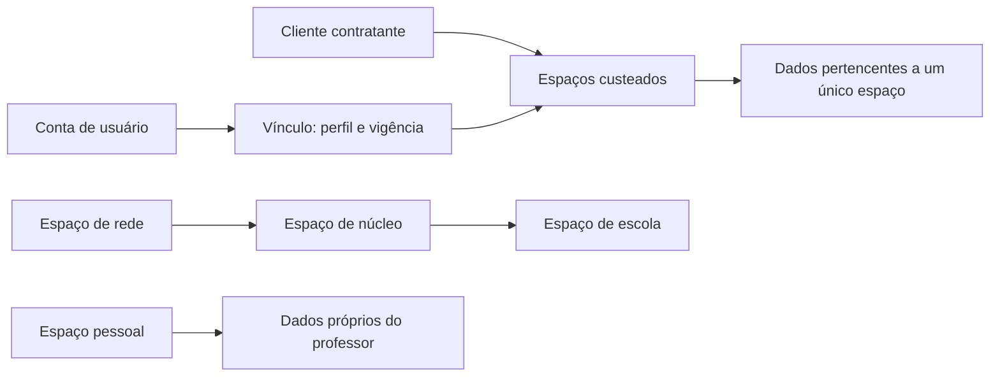

# 40 — T1: clientes, espaços e vínculos

Status: **aprovado pelo responsável em 31/10/2026**, PR #73 incorporado em `294f7078f4c5bb089d82165f9d03aa9dcc42cfe9`. Base da análise: main `54bf83454a8ad1b3a17cd4050be18ddee46a3597`, após L6 e seu registro de publicação. O responsável autorizou iniciar T2. Este documento não cria tabelas, não executa migrações e não autoriza publicação.

Referências: [plano mestre](28-plano-mestre-proximos-modulos.md), [perfis](03-perfis-e-permissoes.md), [privacidade](33-lgpd-privacidade-e-consentimento.md), [decisões de retenção](39-validacoes-l2.md), [inventário de pontos de consulta](41-t1-mapa-de-consultas.md). A numeração 40 substitui o nome previsto em T1, pois 35 já identifica as prévias jurídicas.

## 1. Decisão proposta

Manter MariaDB compartilhado e separar três conceitos:

- **Cliente**: contratante/pagador e modalidade comercial. Um cliente pode custear vários espaços; pagar não concede acesso a dados pedagógicos.
- **Espaço**: unidade de propriedade e isolamento dos registros. Tipos: pessoal, escola, núcleo e rede. Cada registro pedagógico tem exatamente um espaço proprietário.
- **Vínculo**: relação de uma conta com um espaço e um perfil, com vigência e situação. A mesma conta pode ser professora em uma escola e diretora em outra, usando um vínculo ativo por contexto.

Rede → núcleo → escola continua sendo a estrutura institucional; cliente não substitui essa hierarquia. Gestão superior recebe acesso explicitamente calculado aos espaços descendentes da sua instituição. Isso não transfere propriedade dos registros nem concede acesso a outras instituições do mesmo pagador.

O diagrama expressa relações lógicas; a hierarquia entre espaços é derivada das FKs institucionais, sem manter uma segunda árvore editável divergente.

## 2. Alternativas e consequências

| Alternativa | Vantagem | Custo/limite | Decisão |
|---|---|---|---|
| Banco por cliente | Separação física | Multiplica migrações/backups e complica relatórios institucionais e cópias | Não adotar nesta fase |
| Usar apenas escola/rede existentes | Pouca mudança inicial | Não representa espaço pessoal, vários vínculos e clientes diferentes | Insuficiente |
| Banco compartilhado com espaço explícito | Preserva operação atual e permite cópias rastreáveis | Exige filtros em consultas, jobs, arquivos e validações; uma FK simples não basta | Proposta |

Consequência: não depender apenas de um global scope Eloquent. O sistema usa extensamente Query Builder, agregações e tarefas em fila. O filtro precisa ser explícito e testado nesses caminhos, inclusive em operações internas.

## 3. Modelo relacional proposto

Convenções: IDs `BIGINT UNSIGNED`, FKs com tipos compatíveis; instantes em UTC e apresentação no fuso do usuário; estados como strings validadas por catálogo. Exclusão institucional por procedimento, com `RESTRICT` nas relações de propriedade. Não usar exclusão de cliente/usuário como gatilho de cascata para dados escolares.

| Tabela | Campos principais | Chaves e índices |
|---|---|---|
| `clientes` | id, tipo (professor/escola/nucleo/rede/secretaria/governo), nome, documento cifrado opcional, documento_hash opcional, modalidade (pagante/presenteado/teste/interno), situacao (ativo/suspenso/encerrado), criado_por, timestamps | PK id; índices (situacao,id), (tipo,documento_hash). Documento não deduplica automaticamente contratos/órgãos; revisar duplicados antes de criar |
| `espacos` | id, cliente_id, tipo, nome, situacao, rede_id?, nucleo_id?, escola_id?, usuario_proprietario_id?, criado_por?, timestamps | PK id; FKs cliente e instituição/usuário; UNIQUE em cada referência institucional e proprietário pessoal; índices (cliente_id,situacao,id), (tipo,situacao,id) |
| `usuario_vinculos` | id, usuario_id, espaco_id, perfil, situacao (convidado/ativo/suspenso/encerrado), inicio_em, fim_em?, versao_autorizacao, criado_por, timestamps | FKs usuário/espaço; UNIQUE (usuario_id,espaco_id,perfil); índices (usuario_id,situacao,id), (espaco_id,perfil,situacao,id). Reativação reaproveita a linha e registra histórico |
| `vinculo_turmas` | vinculo_id, espaco_id, turma_id | UNIQUE (vinculo_id,turma_id); FKs compostas para turma e vínculo no mesmo espaço. Professor continua limitado às turmas atribuídas |
| `vinculo_alunos` | vinculo_id, espaco_id, aluno_id | UNIQUE (vinculo_id,aluno_id); vínculo de aluno consulta apenas seus próprios registros; não vincular por nome ou CPF sem validação |
| `vinculo_permissoes` | id, vinculo_id, permissao, efeito, valida_ate?, definida_por, timestamps | UNIQUE (vinculo_id,permissao); FK ao catálogo; concessões individuais não atravessam vínculos |
| `vinculo_eventos` | id, vinculo_id, acao, ator_id?, ocorrido_em, motivo técnico | Índice (vinculo_id,ocorrido_em,id); histórico mínimo de convite, ativação, suspensão e encerramento, sem tokens ou dados livres sensíveis; integrar AU1 |
| `vinculo_convites` | id, vinculo_id, token_hash, expira_em, aceito_em?, recusado_em?, convidado_por | UNIQUE token_hash; índice (vinculo_id,expira_em); token em hash, uso único. Conta existente não precisa redefinir senha para aceitar um novo vínculo |
| `copias_lotes` | id, chave UUID, origem_espaco_id, destino_espaco_id, solicitado_por, autorizado_por, motivo, referencia_autorizacao, politica_versao, situacao, contadores, iniciado_em?, concluido_em? | UNIQUE (destino_espaco_id,chave); índice (origem_espaco_id,destino_espaco_id,situacao,id); origem diferente de destino; fila sem payload com dados pessoais |
| `registros_origem` | id, lote_id, entidade, origem_espaco_id, origem_id, destino_espaco_id, destino_id, autor_origem_id?, copiado_por, created_at | UNIQUE (origem_espaco_id,entidade,origem_id,destino_espaco_id); UNIQUE (destino_espaco_id,entidade,destino_id); FK lote. Entidade em lista fechada, nunca nome livre de tabela |

`espacos` exige exatamente uma referência compatível com o tipo: pessoal→usuario_proprietario_id, escola→escola_id, núcleo→nucleo_id, rede→rede_id; as demais ficam nulas. Validar no serviço e por constraints compatíveis com a versão instalada. Secretaria/governo são tipos de contratante; sua operação usa espaços das redes e vínculos explícitos nessas redes, sem inventar uma escola fictícia.

Não inferir contrato ativo, modalidade pagante ou retenção a partir da existência de uma rede. No backfill, cliente provisório `interno` só após conciliação aprovada; sem cobrança, sem envio e sem atribuir titularidade jurídica automaticamente. Uma planilha/manifesto de mapeamento deve registrar cada decisão e pendência antes de produção.

`registros_origem` usa referências polimórficas: não oferece FK SQL para toda entidade. O serviço verifica existência, propriedade, mapeamento e integridade em transação; auditoria detecta órfãos. A exclusão da origem não apaga o destino nem seu histórico. Acesso ao histórico de origem também é restrito, pois IDs podem identificar pessoas.

Contratos e suas versões permanecem no escopo T4/F1; `referencia_autorizacao` aponta para evidência controlada, não presume um contrato novo implementado por T2. Sem evidência aplicável, T5 bloqueia cópia identificada.

## 4. Propriedade dos dados existentes

| Grupo | Dono no novo modelo / regra de migração |
|---|---|
| `secretarias`, `redes`, `nucleos`, `escolas` | Rede/núcleo/escola ligam-se aos respectivos espaços; secretaria conserva sua relação com redes, acessadas por vínculos explícitos. FKs existentes formam a hierarquia. Nenhuma relação é inferida por nome |
| `turmas` | Espaço da escola atual; turma pessoal passa a permitir escola_id nulo somente em T3, nunca para turma escolar |
| `alunos` | Mesmo espaço da turma. Cadastro pessoal mínimo em T3, sem CPF, nascimento ou responsável. Avatar preservado |
| `provas` | Espaço da escola da prova; `criado_por` é autoria, não propriedade. Prova pessoal com escola_id nulo apenas em T3 |
| `prova_turmas` | Mesmo espaço da prova e da turma; associação entre espaços é recusada. Prova de rede aplicada em escolas requer cópias locais em T5 |
| `gabaritos`, `gabarito_questoes` | Espaço da prova/gabarito; filhos não aceitam contexto independente |
| `cartoes`, `cartao_respostas`, `notas`, `ambiguidade_logs`, `cartao_envios` | Espaço da prova/cartão. Aluno, turma e gabarito envolvidos precisam concordar; divergência interrompe migração |
| `visitas` | Espaço da escola visitada; núcleo atua pelo escopo institucional autorizado |
| `sincronizacoes_seges` | Espaço da instituição de destino da execução; se um lote abrange várias instituições, desmembrar o registro de execução por espaço com correlação de lote |
| `usuarios`, `personal_access_tokens`, `password_reset_tokens` e `trocas_email` | Identidade global da pessoa; conta não pertence a uma escola. Tokens ganham contexto em V2; recuperação continua global. Dados de identidade não ficam listáveis entre instituições por conhecer ID/e-mail |
| `usuario_escopos`, `usuario_permissoes`, `usuario_permissoes_log` | Compatibilidade até V1; converter por vínculo com revisão de concessões, preservar histórico |
| `permissoes`, `perfil_permissoes`, `planos`, `censo_escolas` | Catálogos globais. Alterá-los requer permissão de plataforma; consulta ao Censo não dá acesso ao cadastro escolar privado |
| `assinaturas`, `pagamentos` | Dados comerciais por cliente em fase financeira, sem autorização pedagógica implícita; manter IDs/gateway e não ativar cobranças em T2 |
| `leads`, `emails_enviados`, filas/falhas, sessões/cache | Operação da plataforma; quando ligados a instituição, carregar contexto mínimo para autorização/retentativa, sem torná-los visíveis a outros clientes |

Nas tabelas pedagógicas raiz e filhos, adicionar `espaco_id` obrigatório ao final da migração. Manter `criado_por` onde já existe; para autoria ausente, adicionar `criado_por` nullable e `origem_autoria` (`registrada`, `legado_desconhecido`, `sistema`). Não atribuir falsamente dados legados ao administrador que executou a migração. Ações automáticas registram o ator solicitante e executor técnico separadamente.

Adicionar UNIQUE (espaco_id,id) nas tabelas pai necessárias e FKs compostas nos filhos, além da FK de espaço. Exemplo: `notas(espaco_id,aluno_id)` → `alunos(espaco_id,id)`; o mesmo para turma/prova/cartão. Para cartão sem aluno, aluno_id permanece nullable; ao vincular, validar espaço e turma da prova. Integridade de número de questão e unicidade de nota/cartão permanecem.

Matrícula muda de UNIQUE global para UNIQUE (espaco_id,matricula), depois de adaptar validações e importações. CPF de aluno, quando presente, mantém cifra e busca L3, mas unicidade passa a (espaco_id,cpf_hash); nenhuma deduplicação automática entre escolas. Conta `usuarios` mantém identidade global e unicidade existente de e-mail/CPF. Mensagens de duplicidade não revelam contas fora da gestão autorizada.

## 5. Autorização e contexto

1. Autenticar a conta, validar ativo e resolver vínculo pertencente à conta, ativo e vigente. Espaço suspenso/encerrado recusa uso comum, inclusive por gestor superior; exportação autorizada usa fluxo próprio.
2. Calcular permissões do perfil e ajustes **do vínculo**. Cache inclui usuario_id, vinculo_id e versao_autorizacao; invalidar ao alterar vínculo ou concessões, inclusive workers persistentes.
3. Calcular espaços legíveis pela hierarquia institucional do vínculo. Pessoal só ele próprio; escola só ela; núcleo/rede apenas descendentes autorizados. `admin_rede` deixa de significar todo o banco. Administração de plataforma é contexto separado de A1, explícito e auditado.
4. Para escrita, resolver um único espaço alvo permitido e verificar o objeto dentro dele. Receber `espaco_id` do cliente não é autorização. Criação usa contexto validado; alteração não permite mudar proprietário da linha.
5. Aplicar ainda as restrições atuais de turma, autoria, perfil, data de aplicação e correção fechada. Espaço não substitui permissão nem amplia acesso de professor/aplicador.
6. Relações, eager loading, contagens, filtros, `exists`/`unique`, relatórios e downloads precisam do mesmo limite. ID fora de escopo retorna resposta indistinguível de inexistente; não consultar globalmente primeiro para depois filtrar a saída.

V2 deve ligar tokens ao contexto e validar a vigência a cada requisição. Preserva-se a decisão de não impor validade máxima de oito horas. A sessão web continua com 120 minutos de inatividade. No código atual, o token está na sessão compartilhada: apenas mudar `auth_token` dessa sessão não isola abas. Proposta V2: identificador opaco por aba em sessionStorage, enviado em header/form; servidor associa contexto, sessão e vínculo, mantendo o token API no servidor. Abas novas escolhem ou recebem um contexto explícito, sem reutilizar silenciosamente o último vínculo global. GETs e downloads também precisam resolver esse contexto. Testar duas abas com vínculos distintos e revogação durante o uso.

Convite passa a convidar um vínculo, não desativar a conta inteira. Recusar vínculo de escola B preserva o vínculo de escola A. Reenvio invalida só o convite correspondente; recuperação de senha continua global. Migração dos convites existentes preserva vencimento e só converte quando houver destino inequívoco.

## 6. Consultas, filas, arquivos e integrações

O [mapa de consultas](41-t1-mapa-de-consultas.md) lista os pontos atuais por método e classifica as exceções globais. É baseline de revisão, não prova de isolamento implementado.

- Jobs B6 recebem espaço, ator/vínculo e IDs; antes de ler/gravar, conferem relações e autorização vigente. Revogação/suspensão bloqueia processamento novo e deixa resultado técnico rastreável, sem trocar contexto ou concluir recibo indevido. Agendamentos de sistema usam autorização de serviço explícita.
- Chave de idempotência B6 passa a considerar espaço + usuário + chave; polling/retentativa não expõe resultados de outro contexto. `sessionStorage` também particiona estado por espaço/vínculo.
- Redis, locks, nomes de arquivos, PDFs temporários e artefatos de cópia incluem espaço. Caminho não substitui autorização. Imagens existentes precisam de mapeamento, sem mover/apagar arquivos neste documento.
- Links assinados devem limitar objeto, espaço, tipo e validade, e respeitar suspensão/revogação por versão de acesso ou checagem autenticada. Assinatura sozinha não comprova vínculo atual. Evitar registrar URL assinada em logs.
- Webhooks resolvem cliente pela assinatura armazenada, após autenticação do evento; ignoram espaço fornecido pelo remetente como autoridade. Imports CLI exigem espaço alvo e modo de simulação, nunca o primeiro registro de rede/escola.
- Logos/cabeçalhos, meta mínima e configurações usam a instituição do espaço. Remover `redes->first()` da resolução funcional; espaço pessoal terá parâmetros próprios aprovados em T3.

## 7. Cópias entre espaços — T5

Cópia cria novos IDs e remapeia todas as FKs; não altera `espaco_id` da origem. Ordem: turmas/alunos permitidos → provas → associações → gabaritos/questões → cartões/respostas/notas, apenas se autorizados. Artefatos físicos copiados têm caminhos independentes. Não copiar tokens, convites, permissões, recibos de fila ou credenciais.

Cada item é transacional com registro de origem e chave única. Tentativa repetida retorna mapeamento existente; não sobrescreve alterações feitas no destino. Concorrência é resolvida por chave única e lock de lote. Falha parcial deixa lote incompleto e retomável; dados incompletos não ficam disponíveis como prova pronta. Conferir contagens, relações e checksums antes de liberar o lote. Se não houver publicação atômica, manter os objetos do lote em estado de preparação oculto aos fluxos normais.

Matrícula coincidente não prova identidade: origem conhecida reutiliza mapeamento; matrícula já ocupada por outra origem pede conciliação, sem mesclar por nome. Não mover turma de uma escola para outra como edição simples: isso é cópia/transferência autorizada com novo registro.

Sem cláusula para notas identificadas, não criar alunos/copiar cartões para transportar notas supostamente anônimas. T5 deve produzir saída agregada com avaliação de reidentificação e supressão de grupos pequenos; retirar nome ou substituir ID não basta. Até validar essa saída, oferecer somente provas e materiais sem dados pessoais. Espaço pessoal recebe sempre cadastro mínimo, mesmo quando houver autorização contratual para notas identificadas.

## 8. Simulação dos seis casos aprovados

Dados fictícios: professor U1, espaço pessoal P1, escolas E1/E2. Prova PR1 e aluno A1 pertencem a P1; PR2/A2 pertencem a E1.

| Caso | Operação e resultado esperado | Verificação negativa |
|---|---|---|
| 1. Autônomo entra em E1 | Criar vínculo convidado; após aceite e autorização, copiar PR1/A1 para novos IDs em E1, mantendo P1 e origem registrada | Repetir lote não duplica; vínculo E2 não acessa P1/E1 |
| 2. Professor trabalha em E1 | Contexto E1 cria prova/turma/aluno em E1, autoria U1 | Selecionar escola E2 no payload é recusado; autoria U1 não concede leitura pelo contexto P1 |
| 3. Sai e quer continuar | Encerrar vínculo E1; P1 permanece. Com cláusula válida, cópia permitida para P1 com minimização; sem cláusula, materiais e saída anonimizada validada | Não reabrir acesso escolar para permitir a cópia; executor institucional autorizado faz o lote |
| 4. Sai sem continuidade | Revogar vínculo/tokens contextuais; PR2/A2 permanecem em E1 | Não apagar dados por FK de usuário/vínculo; jobs pendentes não continuam usando autorização revogada |
| 5. Escola encerra | Suspender acesso E1, preservar conforme contrato, exportação sob procedimento próprio e retomada possível antes da eliminação | Rede/núcleo não contornam suspensão; encerrar pagador não apaga outras escolas sem mapear contratos |
| 6. Professor da escola encerrada continua | Contratação pessoal e acesso a P1; transferência sob as mesmas condições do caso 3, com autorização institucional | Pagamento pessoal não desbloqueia E1 nem concede notas identificadas automaticamente |

Outros testes obrigatórios: usuário diretor em E1/professor em E2 sem união de poderes; convite recusado não encerra conta; duas abas independentes; matrícula igual em escolas distintas; tentativa de associar nota/cartão/aluno de espaços diferentes; relatório superior inclui apenas descendentes; URLs/arquivos/cache não atravessam contexto.

## 9. Migração em etapas e volta segura

| Etapa | Entrega | Critério para avançar / retorno |
|---|---|---|
| T1 | Aprovação desta proposta | Não iniciar T2 sem decisão registrada |
| T2-A: inventariar | Manifesto de instituição→cliente→espaço, contagens, relações cruzadas, usuários e autoria desconhecida; simulação sem dados pessoais em relatórios | Ambiguidade bloqueia o lote; nunca inferir dono por primeiro administrador |
| T2-B: expandir | Criar clientes/espaços e colunas nullable, índices iniciais; manter campos antigos | Backup recente, restauração com chaves L3, manutenção pelo B5 e fila drenada. Código antigo compatível apenas enquanto sem uso de novos espaços |
| T2-C: preencher | Backfill em lotes por PK, retomável; escola→turma/prova→filhos; registrar checkpoint e contagens | Zero órfãos/divergências; soma por espaço igual à origem; índices e dados cifrados preservados; autoria desconhecida explicitada |
| T2-D: escrever/ler | Escritas sempre preenchem espaço; leituras usam adaptador de escopo legado sobre espaços existentes; comparar resultados antes de ativar | Nenhum novo cliente/pessoal liberado nesta fase. Revogar caminho que omita contexto; tarefas antigas drenadas |
| T2-E: restringir | Tornar espaço NOT NULL, adicionar FKs compostas e unicidade por espaço após adaptar consumidores | Testes MariaDB e regressões; plano de DDL medido em cópia, orçamento de manutenção definido pelo ensaio |
| V1/V2/T3 | Converter vínculos/permissões, contexto por aba e pessoal mínimo; liberar novos espaços progressivamente | Comparar matriz de permissões antes/depois; administração global legada explicitamente remapeada, sem vínculo universal por padrão |
| T5/T6/L4 | Cópias, encerramento e retenção | Gates contratuais, auditoria e testes próprios; não embutir exclusão em T2 |

O adaptador T2 aceita somente o mapeamento conciliado dos escopos existentes. `admin_rede` atual recebe os espaços da rede formalmente atribuída; se hoje abrange redes distintas, o responsável aprova os vínculos equivalentes antes da ativação. Não tentar preservar vazamento como requisito de compatibilidade. `PerfisTest` deve continuar passando para seus cenários originais, com testes adicionais entre instituições.

Convites e permissões não migram por multiplicação cega: listar concessões por usuário, determinar em quais vínculos se aplicam e registrar a decisão; efeito de retirada também precisa ser preservado. Turmas e alunos explícitos em `usuario_escopos` viram restrições do vínculo correspondente. Referência sem instituição inequívoca bloqueia conversão.

Volta segura: antes da ativação de novos espaços, voltar apenas ao release compatível com as colunas adicionais, preservando os dados adicionados e conferindo escritas posteriores. Depois de novas matrículas iguais entre espaços, escola_id nulo ou cópias, o código antigo não é compatível: suspender acesso e usar correção progressiva ou restauração coordenada de banco/arquivos/chaves, aprovada com análise das escritas perdidas. Não executar rollback destrutivo automático. MariaDB DDL não deve ser tratado como uma transação única; ensaiar retomada de cada passo.

## 10. Índices e crescimento

Índices candidatos, sujeitos ao plano de consulta medido em T2/X1: turmas (espaco_id,ano_letivo,id); alunos (espaco_id,turma_id,ativo,id), UNIQUE (espaco_id,matricula); provas (espaco_id,status,data_aplicacao,id), (espaco_id,criado_por,id); cartões (espaco_id,prova_id,status,id); notas (espaco_id,prova_id,turma_id,id), (espaco_id,aluno_id,prova_id); envios (espaco_id,usuario_id,chave) único e (espaco_id,prova_id,status,id). Paginação por chave onde adequada; medir agregações superiores e evitar materializar todos os IDs de alunos em memória.

Particionamento por tempo não entra automaticamente em T2. MariaDB restringe FKs em tabelas particionadas e exige que colunas da expressão de partição participem de todas as chaves únicas. Isso conflita com as FKs e unicidades propostas para notas/cartões. Preservar integridade e medir antes de particionar. Em X1, considerar tabelas derivadas de eventos/estatísticas por mês, sem FKs, com reconstrução e retenção explícitas, após confirmar a versão instalada. [Limitações oficiais do MariaDB](https://mariadb.com/docs/server/server-usage/partitioning-tables/partitioning-limitations), consultadas em 31/10/2026.

Não prometer ganho sem medição: baseline de latência p95, linhas examinadas, tamanho de índices, tempo de migração e carga de fila para as 100 instituições previstas. Alterações de índices/partições exigem ensaio, backup e aprovação operacional.

## 11. Aprovação e limites

Aprovar T1 significa aceitar: propriedade por espaço, hierarquia institucional sem acesso pelo simples pagamento, vínculos com permissões próprias, cópias independentes, unicidade de aluno por espaço, convites por vínculo e migração gradual acima. Novos detalhes que mudem acesso, retenção ou titularidade voltam para decisão; escolhas rotineiras de implementação seguem os critérios aprovados.

Permanecem: identificação contratual dos clientes reais no manifesto T2, prazos por instituição, contratos dos terceiros e decisões L2, campos da empresa em L1. Não há exclusão de fotos/coluna legada, alteração de TTL de API, publicação jurídica ou ativação financeira nesta proposta. L3/L6 publicados e decisões anteriores continuam válidos.

Critério de pronto de T1 atendido: documento e mapa revisados, seis casos cobertos, CI do PR aprovado e aprovação explícita do responsável. T2 iniciado pelo diagnóstico e conciliação T2-A; os gates de implantação e aprovação do manifesto continuam aplicáveis.
