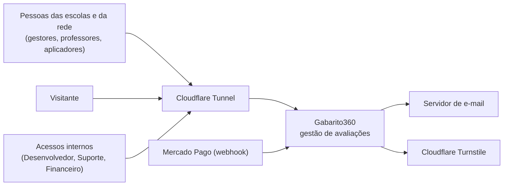
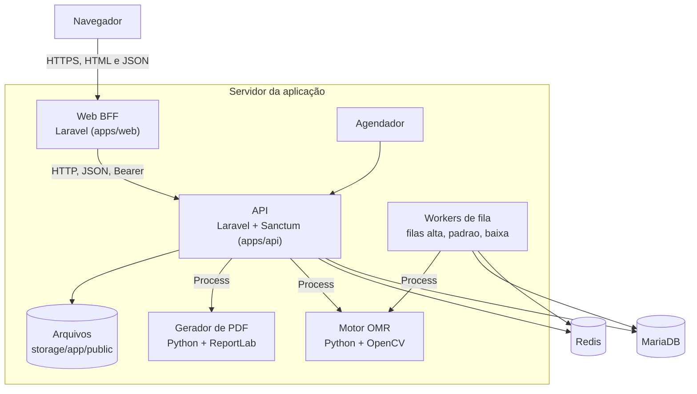

# Contexto e containers

**Atualizado em:** 12/11/2026, por lucasgenial

Este documento descreve o Gabarito360 como o modelo C4 mostra: o contexto do sistema (nível 1) e seus containers (nível 2). Os fatos vêm do código da branch `docs/planejamento-centralizado`.

## 1. Contexto do sistema (C4, nível 1)

O Gabarito360 gerencia o ciclo de avaliação escolar. Pessoas criam provas, imprimem cartões-resposta, fotografam os cartões preenchidos e consultam resultados.

### Atores

| Ator | O que faz no sistema |
|---|---|
| Administrador da rede, diretor de núcleo, diretor escolar, vice-diretor | Gerem estrutura, equipe e relatórios do seu alcance. |
| Coordenador e secretário | Gerem turmas, alunos, provas e correção. |
| Professor e professor autônomo | Criam provas, fotografam cartões e consultam resultados das suas turmas. |
| Aplicador | Fotografa cartões durante a aplicação da prova. |
| Aluno | Tem painel próprio. O acesso próprio completo é a FN-020 (pendente). |
| Acessos internos (Desenvolvedor, Suporte, Financeiro) | Operam a plataforma. Veja [04](04-identidade-acesso-e-permissoes.md). |
| Visitante | Vê a página pública, os planos, o Fale Conosco e o validador de documentos. |

Os perfis, os vínculos e as permissões estão em [04 Identidade, acesso e permissões](04-identidade-acesso-e-permissoes.md).

### Sistemas externos

| Sistema | Uso | Observação |
|---|---|---|
| Servidor de e-mail | Convites, recuperação de senha, confirmação de e-mail. | Configurado em `config/mail.php`. Em desenvolvimento, o e-mail vai para o log. |
| Cloudflare Turnstile | Verificação anti-robô em formulários públicos. | Desligado por padrão (`TURNSTILE_ENABLED=false`). |
| Cloudflare Tunnel | Entrega o tráfego HTTPS ao servidor. | O Web confia no cabeçalho `X-Forwarded-Proto`. |
| Mercado Pago | Webhook de cobrança. | A contratação é assistida (FN-030, substituída). A rota do webhook ainda existe na API (legado do MP-027). |
| Aplicativo financeiro (futuro) | Autoriza e contabiliza o consumo tarifado; dono de saldo, créditos, planos e pagamentos. | Ainda não existe. Código, banco, credenciais e implantação separados. A API fala com ele só pela porta `BillingClient` ([14](14-integracao-financeira.md), [ADR-0061](../decisoes/0061-arquitetura-de-billing-e-porta-billingclient.md)). |
| Arquivos públicos do Censo, do IBGE e do catálogo nacional | Cadastro de escolas e instituições. | São importados por comandos Artisan. Não há consulta externa em tempo de uso. |

### Diagrama de contexto

## 2. Containers (C4, nível 2)

Um container é um bloco que executa ou guarda dados. O sistema tem dois aplicativos Laravel, um banco, um Redis e um motor de leitura em Python.

| Container | Tecnologia | Responsabilidade |
|---|---|---|
| Web (BFF) | Laravel 13, PHP 8.3, em `apps/web` | Telas HTML, sessão do navegador, regras de URL (UR1 a UR4). Chama a API por HTTP. |
| API | Laravel 13, PHP 8.3, Sanctum, em `apps/api` | Autenticação, autorização, regras de negócio, relatórios. Responde só JSON (exceções: arquivos e PDFs). |
| MariaDB | MariaDB | Único banco de dados aprovado. Só a API acessa os dados de negócio. |
| Redis | Redis | Fila de trabalhos, trava de envios e fila de auditoria. |
| Workers de fila | `php artisan queue:work redis`, filas `alta`, `padrao`, `baixa` | Processam leitura de cartões, auditoria e cópias entre espaços. |
| Agendador | `schedule:run` | Executa a verificação diária de inadimplência e as rotinas de cópias. |
| Motor OMR | Python, OpenCV, NumPy, em `apps/api/omr` | Lê a foto do cartão. Chamado pela API como processo local. |
| Gerador de PDF | Python, ReportLab, em `apps/api/omr` | Gera cartões-resposta, resultado do aluno e painel da turma. |
| Armazenamento de arquivos | Disco `public` do Laravel (`storage/app/public`) | Fotos dos cartões e arquivos gerados. Sempre entregues por rota autenticada. |

Os aplicativos Android e iOS estão adiados (FN-010). Os diretórios `apps/android` e `apps/ios` não existem.

### Diagrama de containers

### Regras de fronteira

1. O navegador fala só com o Web. Ele nunca recebe o token da API.
2. O Web guarda o token na sessão do servidor e o envia à API no cabeçalho `Authorization`.
3. O Web não acessa o banco de negócio nem importa modelos da API.
4. A API não renderiza telas. Ela responde JSON, ou arquivo binário em downloads.
5. Cada aplicativo tem `composer.json`, lock, bootstrap e configuração próprios.

O contrato entre os dois aplicativos está em [05 Contratos da API e do Web](05-contratos-api-web.md).

## 3. Fluxos principais

### Consulta de uma tela

1. O navegador pede uma página ao Web.
2. O Web confere sessão, vínculo e revisão de acesso.
3. O Web chama a API com o token do vínculo ativo.
4. A API valida permissão e escopo, consulta o MariaDB e devolve JSON.
5. O Web monta o HTML e responde ao navegador.

### Leitura de um cartão

1. O usuário envia a foto pela tela de correção.
2. A API confere a qualidade da foto e grava um registro de envio.
3. A API coloca o trabalho `ProcessarCartaoJob` na fila `alta`.
4. O worker executa o motor OMR e grava as respostas e a nota.
5. A tela consulta o estado do envio até a conclusão.

Com `QUEUE_CONNECTION=sync` (padrão do `.env.example`), o trabalho roda na própria requisição. O detalhe está em [06 OMR e documentos](06-omr-e-documentos.md).

## 4. Processos no servidor

A publicação usa servidores PHP separados para o Web e para a API. A configuração dos processos fica fora do repositório. Os serviços de apoio versionados são:

| Arquivo | Função |
|---|---|
| `infra/systemd/gabarito360-worker@.service` | Worker da fila Redis (`--queue=alta,padrao,baixa`, `--max-time=3600`). |
| `infra/systemd/gabarito360-agendador.service` e `.timer` | Executa o agendador do Laravel. |
| `deploy/nginx/` e `infra/nginx.conf` | Configuração de borda e da página pública. |
| `infra/homologacao/` | Publicação e configuração da homologação isolada. |

Ambientes, hosts e publicação estão em [13 Infraestrutura e ambientes](13-infraestrutura-e-ambientes.md) e em [Operação](../operacao/README.md).

## 5. Decisões de arquitetura vigentes

| Decisão | Efeito |
|---|---|
| API e Web separados | A mesma API pode atender o Web e, no futuro, aplicativos móveis. |
| MariaDB como único banco | Toda a persistência de negócio usa MariaDB. |
| Sanctum para tokens | O token de identidade e o token do vínculo são tokens Sanctum. |
| Motor OMR por driver | A interface `OmrDriverInterface` permite trocar o motor (`nativo` ou `simulado`). |
| Leitura pela fila | O envio da foto não bloqueia a tela. |
| Atualização por consulta (polling) | A tela consulta o estado. Não há WebSocket. |
| Financeiro em aplicativo externo | O Gabarito360 não guarda saldo, carteira nem preço. Ele pede autorização pela porta `BillingClient` ([ADR-0061](../decisoes/0061-arquitetura-de-billing-e-porta-billingclient.md)). |

Os registros completos estão em [Decisões (ADRs)](../decisoes/README.md).

## Divergências encontradas

| Documento antigo | Afirmação | Situação no código |
|---|---|---|
| `12-arquitetura.md` | O Web e a API mostram aplicativos `apps/android` e `apps/ios` no diagrama. | Os diretórios não existem. Os aplicativos estão adiados (FN-010). |
| `12-arquitetura.md` | Autenticação por Sanctum ou JWT (`10-rotas-api.md` cita JWT). | Só Sanctum existe. |
| `12-arquitetura.md` | Estrutura sugerida `Services/OmrService.php`, `NotaService.php`, `RelatorioService.php`. | Esses arquivos não existem. A lógica está em `Services/Omr/*`, `Support/*` e nos controladores. |
| `12-arquitetura.md` | A tela de acompanhamento usa polling a cada 5 segundos e prevê WebSocket. | Há consulta por polling. Não há WebSocket nem Laravel Echo. |
| `12-arquitetura.md` | O Web usa um `ApiClient` simples com token em cookie `httpOnly`. | O token fica na sessão do servidor, dentro do contexto do vínculo. O navegador não o recebe. |
| `12-arquitetura.md` | Estrutura-alvo `apps/api/plataforma/`. | O diretório não existe. É a FN-009 (candidata). |
