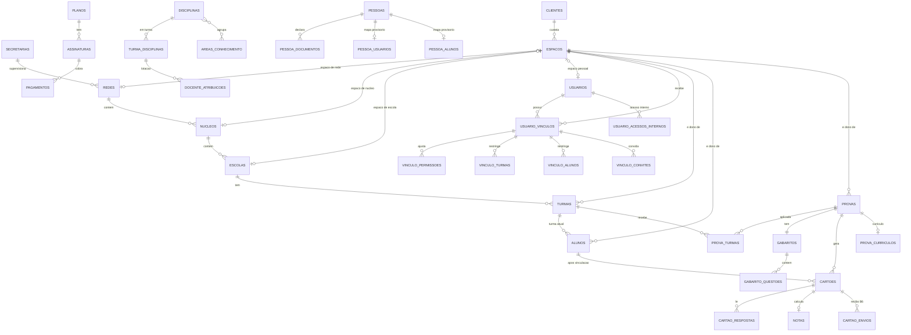

# Modelo de dados

**Atualizado em:** 10/11/2026, por lucasgenial

Este documento descreve as entidades e as tabelas do banco MariaDB do Gabarito360 como existem hoje nas migrations de `apps/api/database/migrations`. Ele agrupa as tabelas por domínio, mostra as relações principais e lista as regras de integridade.

Para acesso, perfis e permissões, leia [04 — Identidade, acesso e permissões](04-identidade-acesso-e-permissoes.md). Para clientes, espaços e vínculos, leia [07 — Clientes, espaços e vínculos](07-clientes-espacos-e-vinculos.md).

## 1. Princípios do modelo

1. O sistema usa um único banco MariaDB compartilhado. Não existe banco por cliente.
2. Cada registro pedagógico pertence a exatamente um espaço (`espaco_id`). O espaço é a unidade de propriedade e de isolamento.
3. Pagar não concede acesso. O cliente (contratante) é separado do espaço (dono dos dados) e do vínculo (acesso de uma pessoa).
4. As chaves estrangeiras de propriedade usam `RESTRICT`. Excluir uma conta ou um vínculo nunca apaga dados escolares.
5. Cadastros de pessoa e de contato usam cifra autenticada e índice HMAC (proteção L3, FN-063). Veja a seção 12.
6. Tabelas de histórico e de eventos são append-only. Gatilhos (triggers) do banco recusam `UPDATE` e `DELETE` nelas.
7. As migrations são aditivas e retomáveis. O método `down()` das migrations críticas recusa remover dados.
8. Restrições de corte (NOT NULL, chaves compostas, unicidade por espaço) são aplicadas por comando operacional, não por `migrate`. Veja a seção 11.

## 2. Diagrama de entidades

O diagrama mostra as relações principais. Ele omite colunas e tabelas de apoio.

## 3. Estrutura institucional e cadastros escolares

| Tabela | Finalidade | Chaves e integridade |
|---|---|---|
| `secretarias` | Nível opcional acima da rede. Existe quando uma secretaria supervisiona várias redes. | Campos: nome, tipo (estadual, federal, consórcio), UF, titular. |
| `redes` | Rede de ensino. | `secretaria_id` opcional. `modalidade` (institucional ou individual), `titular`, metas de média e de nota mínima. |
| `nucleos` | Núcleo regional da rede. | `rede_id`. |
| `escolas` | Escola ou anexo. | `nucleo_id`. INEP único. Colunas de censo, logo e `sigla` opcional (40 caracteres). `tipo` (sede, anexo, unidade_vinculada) e `escola_sede_id` ligam o anexo à sede. |
| `censo_escolas` | Catálogo público global do Censo Escolar. | Não concede acesso ao cadastro privado da escola. |
| `turmas` | Turma da escola ou do espaço pessoal. | `escola_id` é nulo somente em espaço pessoal. Colunas de cadastro: sala, capacidade, etapa de ensino, observações, avatar e foto com `imagem_versao`. |
| `alunos` | Cadastro local do aluno na turma atual. | `turma_id` aponta para a turma atual. `avatar_id` (1 a 36) e retrato privado com `imagem_versao`. CPF e contatos cifrados. Cadastro pessoal aceita só o mínimo. |
| `aluno_movimentacoes` | Histórico de mudança de turma. | Registro por intenção (`chave`, `pedido_hash`), ator, motivo e instante. |
| `cadastro_arquivamentos` | Histórico de ativar e desativar turma ou aluno. | Versão, sequência, estado antes e depois, ator e motivo. |

Notas:

- A tabela `alunos` guarda a turma atual. A turma onde cada prova foi aplicada fica em `cartoes.turma_aplicacao_id` (seção 5). Mudar o aluno de turma não move notas nem cartões antigos.
- A coluna `alunos.foto_path` é legado. Novos envios de foto de aluno usam o retrato privado reprocessado (FN-019, FN-066).

## 4. Clientes, espaços e vínculos

| Tabela | Finalidade | Chaves e integridade |
|---|---|---|
| `clientes` | Contratante e pagador. | `tipo`: professor, escola, nucleo, rede, secretaria, governo. `modalidade`: pagante, presenteado, teste, interno. `situacao`: ativo, suspenso, encerrado. Documento, nome e e-mail de contato, telefone e referência contratual são opcionais. Documento e contatos são cifrados. Documento tem índice HMAC. |
| `cliente_eventos` | Histórico comercial do cliente. | Guarda ator, valor anterior e valor novo da modalidade. Não guarda documento, contato nem contrato. |
| `espacos` | Unidade de propriedade e de isolamento. | `cliente_id` obrigatório. `tipo`: pessoal, escola, nucleo, rede. Exatamente uma referência por tipo (`rede_id`, `nucleo_id`, `escola_id` ou `usuario_proprietario_id`), cada uma única. `situacao` própria. |
| `usuario_vinculos` | Acesso de uma pessoa a um espaço com um perfil. | Único por (`usuario_id`, `espaco_id`, `perfil`). `situacao`: convidado, ativo, suspenso, encerrado. `inicio_em` inclusivo e `fim_em` exclusivo. `versao_autorizacao` sobe a cada mudança de acesso. Índice único (`espaco_id`, `id`) para chaves compostas. |
| `vinculo_permissoes` | Extras e retiradas de permissão por vínculo. | Único por (`vinculo_id`, `permissao`). `efeito`: conceder ou retirar. `valida_ate` opcional. |
| `vinculo_eventos` | Histórico do vínculo. | Ação, ator, instante e motivo técnico curto. Sem texto livre sensível. |
| `vinculo_turmas` | Restrição de turmas do vínculo de professor. | Chave (`vinculo_id`, `turma_id`). Chave composta com `espaco_id` impede cruzar espaços. |
| `vinculo_alunos` | Registros de aluno acessíveis ao vínculo de aluno. | Mesma regra de `vinculo_turmas`. |
| `vinculo_convites` | Convite de novo vínculo para conta existente. | Token guardado como hash SHA-256. Validade de 7 dias. Aceite e recusa registrados. Chave composta liga o convite ao vínculo emissor da pessoa emissora. |
| `usuario_funcoes_excecoes` | Exceção individual ao bloqueio de grupos funcionais. | Única por (`usuario_id`, `espaco_id`). Exige chamado e motivo. |
| `usuario_funcoes_eventos` | Histórico das exceções. | Append-only. |

As tabelas `vinculo_turmas` e `vinculo_alunos` são criadas dentro da migration `2026_11_01_000002_restricoes_dos_vinculos`, por um laço. Elas não aparecem como `Schema::create` isolado.

## 5. Provas, gabaritos, cartões e resultados

| Tabela | Finalidade | Chaves e integridade |
|---|---|---|
| `provas` | Prova de uma escola ou de um espaço pessoal. | `escola_id` é nulo somente em espaço pessoal. `criado_por` registra autoria. `perfil_criacao`, `vinculo_criacao_id` e `autoria_origem` registram o contexto de criação. `status`: rascunho, publicada, em_correcao, corrigida. `correcao_fechada_em` fecha a correção. |
| `prova_turmas` | Turmas onde a prova é aplicada. | Chave composta (`prova_id`, `turma_id`). Prova e turma precisam estar no mesmo espaço. |
| `gabaritos` | Gabarito da prova. | Uma prova tem um gabarito. |
| `gabarito_questoes` | Alternativa, peso e anulação por questão. | Único por (`gabarito_id`, `numero_questao`). |
| `cartoes` | Cartão-resposta de um aluno em uma prova. | `aluno_id` fica nulo até a vinculação. `turma_aplicacao_id` é um snapshot da turma de aplicação, com chave composta ao espaço. `qualidade` (JSON) e `tentativa_id` ligam o cartão à tentativa. |
| `cartao_respostas` | Respostas lidas pelo OMR por questão. | Único por (`cartao_id`, `numero_questao`). Guarda confiança e alternativas detectadas. |
| `notas` | Nota calculada do cartão. | Uma nota por cartão. Guarda acertos, total, nota final e situação. |
| `ambiguidade_logs` | Resolução manual de leitura ambígua. | Liga cartão, resposta e usuário. |
| `cartao_envios` | Recibo do envio de foto pela fila (B6). | Idempotência por (`espaco_id`, `usuario_id`, `chave`). `vinculo_id` com chave composta (`usuario_id`, `vinculo_id`). `chave_cliente` guarda o UUID público. |
| `cartao_tentativas` | Todas as tentativas de leitura preservadas. | UUID. Guarda prova, aluno, número, autor, vínculo, imagem e cartão anterior. |
| `cartao_tentativa_eventos` | Eventos das tentativas. | Append-only. |
| `documento_emissoes` | Emissões de documentos verificáveis (selo). | Guarda hash do código, modelo, emissor, vínculo e espaço. |
| `prova_duplicacoes` | Origem das provas duplicadas (CP1). | Guarda prova original, raiz, autor original, ator e instante. |
| `visitas` | Visita pedagógica agendada pelo núcleo. | `nucleo_id`, `escola_id` e `agendado_por`. Pertence ao espaço da escola visitada. |
| `sincronizacoes_seges` | Registro de execuções de sincronização SEGES. | Exige espaço de destino. Linhas sem destino bloqueiam o corte. |

Regras sobre esses dados:

- Cartão, nota e resposta pertencem ao espaço da prova. Aluno, turma e gabarito envolvidos precisam concordar. A divergência interrompe a operação.
- Nota e cartão consultam `turma_aplicacao_id` quando ele existe. Assim, o relatório da turma antiga mantém as avaliações feitas lá.
- Um cartão sem aluno e um recibo sem cartão são válidos.

## 6. Disciplinas, áreas e currículo das provas (FN-038)

Estas tabelas são criadas pelas migrations `2026_11_04_000003` a `000007`. A flag `DISCIPLINAS_ATIVAS` está desligada por padrão (`config/disciplinas.php`).

| Tabela | Finalidade |
|---|---|
| `disciplinas` | Componente curricular local do espaço, com `nome_chave`, sigla, referência opcional e versão. |
| `disciplina_professores` | Habilitação de um vínculo de professor em uma disciplina. |
| `turma_disciplinas` | Disciplina ofertada em uma turma. |
| `docente_atribuicoes` | Lotação: vínculo, turma-disciplina, início, fim, papel e situação. Registra `chave` e `pedido_hash` para idempotência. |
| `disciplina_eventos` | Histórico das mudanças. |
| `areas_conhecimento` | Áreas que agrupam disciplinas. |
| `disciplina_areas` e `disciplina_area_vinculos` | Ligação temporal entre disciplina e área, com vigência. |
| `prova_area_vinculos` | Área registrada na prova. |
| `prova_curriculos` e `prova_disciplinas` | Currículo publicado da prova, com versão e snapshot do nome e da sigla. |
| `vinculos_docentes_compostos` | Registro de vínculos docentes compostos por intenção. |

## 7. Identidade pessoal (FN-016)

| Tabela | Finalidade | Integridade |
|---|---|---|
| `pessoas` | Pessoa canônica, com `uuid` estável. `situacao`: provisoria ou documentada. | Sem CPF fictício. |
| `pessoa_documentos` | Documento declarado (hoje só CPF, país BR), cifrado. | Imutável. Estado `declarado`. Não indica titular verificado. |
| `pessoa_documento_indices` | Índice HMAC do documento, com versão. | Único por (tipo, país, versão, índice). Impede CPF duplicado sob concorrência. |
| `pessoa_identidade_eventos` | Eventos de criação e declaração. | Append-only. Chave composta impede usar documento de outra pessoa. |
| `pessoa_usuarios` | Mapa provisório pessoa e conta. | Uma conta tem uma pessoa. Criado só pelo comando `g360:identidades-provisorias`. |
| `pessoa_alunos` | Mapa provisório pessoa e cadastro local de aluno. | Um cadastro tem uma pessoa. Nenhuma fusão por nome, matrícula ou CPF. |

As tabelas de identidade começam vazias. Nenhuma coluna de `usuarios` ou `alunos` aponta para `pessoas`.

## 8. Catálogo nacional de instituições (FN-031)

| Grupo | Tabelas |
|---|---|
| Carga pública retomável (CI1-B) | `catalogo_geografias`, `catalogo_importacoes`, `catalogo_observacoes`, `catalogo_ufs`, `catalogo_municipios` |
| Identidade pública e publicação (CI1-B3) | `catalogo_instituicoes`, `catalogo_identificadores`, `catalogo_unidades`, `catalogo_publicacoes`, `catalogo_fontes`, `catalogo_entradas`, `catalogo_publicacao_eventos` |
| Relações e lacunas (CI1-C) | `catalogo_relacao_conjuntos`, `catalogo_relacao_vigencia`, `catalogo_relacoes`, `catalogo_relacao_lacunas`, `catalogo_relacao_eventos` |
| Referência pessoal (CI1-D) | `referencias_instituicoes_pessoais`, `catalogo_referencia_eventos` |
| Solicitações e manutenção (CI1-E) | `catalogo_solicitacoes`, `catalogo_solicitacao_eventos`, `catalogo_solicitacao_avisos`, `catalogo_gestao_autoridades`, `catalogo_manutencao_eventos` |

Regras:

- Geografia, observações, projeções, eventos e identificadores são append-only por gatilhos. Uma publicação finalizada também recusa alteração.
- Chaves compostas impedem uma entrada com importação, geografia ou unidade incompatível.
- O catálogo é público e global. Ele não cria escola operacional, vínculo nem acesso.
- A referência pessoal tem chave única por espaço e unidade. A chave composta prova o proprietário pessoal.

## 9. Auditoria, cópias, titulares e comercial

| Domínio | Tabelas | Observação |
|---|---|---|
| Auditoria (FN-004) | `auditoria_eventos` | Registro técnico das requisições. |
| Acessos internos (FN-013) | `usuario_acessos_internos`, `acessos_internos_controle`, `acesso_interno_eventos` | O controle serializa as escritas. Veja o documento 04. |
| Cópias entre espaços (FN-024, substituída) | `copias_lotes`, `copias_itens`, `copias_autorizacoes`, `registros_origem`, `copias_outbox`, `copias_revisoes`, `copias_execucoes`, `copias_staging`, `copias_cadastros`, `copias_evidencias`, `copias_resultados`, `copias_resultados_decisoes`, `copias_recebimentos`, `acervo_resultados`, `acervo_resultados_itens` | O mecanismo existe e permanece desligado. A política nova de transferências (FN-025) o substitui. |
| Pedidos de titulares (FN-064) | `pedidos_titulares`, `pedido_titular_eventos`, `pedido_titular_recibos`, `pedido_titular_verificacoes`, `pedido_titular_sujeitos`, `pedido_exportacao_autorizacoes`, `pedido_exportacao_eventos`, `pedido_exportacao_recibos`, `pedido_exportacao_artefatos`, `pedido_exportacao_artefato_eventos` | Relato, identificação e motivos são cifrados. O par espaço e cliente tem chave composta. Sem exclusão automática. |
| Comercial (FN-030, substituída) | `planos`, `assinaturas`, `pagamentos`, `leads` | Guardam só IDs de referência do gateway, nunca dados de cartão. Não concedem acesso pedagógico. |
| Comunicação | `emails_enviados`, `trocas_email` | `trocas_email` guarda o e-mail novo pendente de confirmação. |
| Painéis (FN-054) | `preferencias_paineis`, `preferencias_painel_eventos` | Preferência única por usuário, contexto e painel. Eventos são append-only. Guardam só geometria, sem conteúdo. |

## 10. Tabelas de identidade e acesso

As tabelas `usuarios`, `usuario_escopos`, `personal_access_tokens`, `password_reset_tokens`, `permissoes`, `perfil_permissoes`, `usuario_permissoes` e `usuario_permissoes_log` estão descritas no documento [04](04-identidade-acesso-e-permissoes.md), seção 3.

## 11. Regras de integridade

1. **Um dono por registro.** Todo registro pedagógico tem `espaco_id`. Turmas, provas e alunos também têm `espaco_tipo`, com chave composta para `(espacos.id, espacos.tipo)`.
2. **Escola nula só no espaço pessoal.** Gatilhos de insert e update exigem escola preenchida em espaço escolar e escola ausente em espaço pessoal.
3. **Aluno pessoal mínimo.** O banco recusa CPF, nascimento, gênero e responsável em aluno de espaço pessoal. O retrato privado é permitido.
4. **Chaves compostas por espaço.** Filhos apontam para `(espaco_id, id)` do pai. Uma nota não aponta para aluno de outro espaço.
5. **Autoria explícita.** `origem_autoria` vale `registrada`, `legado_desconhecido` ou `sistema`. Autoria `registrada` exige autor existente. Autoria desconhecida mantém o autor nulo.
6. **Unicidade por espaço.** Depois do corte T2-E, matrícula é única por (`espaco_id`, `matricula`). O CPF do aluno é único por (`espaco_id`, `cpf_hash`). A chave do envio é única por (`espaco_id`, `usuario_id`, `chave`).
7. **Vínculo único.** Uma pessoa tem no máximo um vínculo por (espaço, perfil).
8. **Referências de espaço exclusivas.** Cada referência institucional de `espacos` é única.
9. **Exclusão restrita.** Usuário, vínculo, cliente e instituição não disparam exclusão de dados pedagógicos. Cascatas internas existem só na exclusão autorizada de provas e cartões e na substituição de respostas.
10. **Histórico imutável.** Eventos, documentos de identidade, mapas e publicações finalizadas recusam `UPDATE` e `DELETE`.
11. **Relações mutáveis ficam no código.** A identificação atual do cartão e o aluno ou turma da prova são verificados pelos consumidores e por `g360:auditar-espacos`. Uma chave estrangeira não pode impedir a correção autorizada.

### Comandos de integridade

| Comando | Função |
|---|---|
| `g360:inventariar-espacos` | Lê contagens e inconsistências, sem alterar dados. |
| `g360:preencher-espacos` | Cria clientes e espaços do manifesto e preenche `espaco_id`. |
| `g360:auditar-espacos` | Audita cobertura, autoria e relações. Falha se houver bloqueio. |
| `g360:restringir-espacos` | Aplica NOT NULL, chaves compostas e unicidade por espaço. Exige manutenção. |
| `g360:verificar-corte-espacos` | Confere o estado do corte. |
| `g360:inventariar-vinculos`, `g360:converter-vinculos`, `g360:conciliar-vinculos` | Inventário, conversão e conciliação dos vínculos. |
| `g360:identidades-inventariar`, `g360:identidades-provisorias` | Inventário agregado e criação de referências provisórias. |

Os comandos que gravam simulam por padrão. Eles exigem `--aplicar`, manutenção e escritores parados.

## 12. Dados protegidos

O mecanismo L3 (`App\Support\DadoProtegido`) protege estes dados:

| Dado | Proteção |
|---|---|
| CPF de aluno e de usuário, contatos de usuário | Cifra autenticada e índice HMAC. |
| Documento e contatos do cliente | Cifra. Documento com índice HMAC. |
| CPF de pessoa (`pessoa_documentos`) | Cifra e índice HMAC com versão e domínio próprio. |
| Relato, identificação e motivos de pedidos de titulares | Cifra. |
| Artefatos de exportação | Cifra, com hash SHA-256 do texto cifrado. |
| Fotos de cartão e retratos | Arquivo privado. Servido só com autorização. Nunca por URL pública. |

## Divergências encontradas

| Assunto | Documento antigo | Código atual |
|---|---|---|
| Natureza do modelo | `docs/09` descreve um modelo conceitual com tipos "a definir". | As migrations definem o esquema. Este documento prevalece. |
| Ligação usuário e escola | `docs/09` usa `usuario_escopos` como vínculo principal. | O acesso real usa `usuario_vinculos`. `usuario_escopos` é legado e fica intacta. |
| Matrícula e CPF do aluno | `docs/09` e T1 citam unicidade global. | A unicidade é por espaço depois do corte T2-E. |
| Docs 40 a 48 (T2) | O adaptador de espaços fica desligado (`ativo = false`). | `config/espacos.php` tem `ativo = true` e `pessoal = true`. O corte T2 foi publicado em 01/11/2026 (FN-021). |
| Doc 64 (T3-B) | `espacos.pessoal` permanece falso. | Vale `true` desde T3-C, condicionado a espaço, cliente e conta ativos. |
| Tabelas `vinculo_turmas` e `vinculo_alunos` | Docs 56 a 59 sugerem migrations próprias. | Elas nascem dentro da migration `2026_11_01_000002`. |
| Tabelas T1 não criadas | `docs/40` previa `copias_lotes` com `registros_origem` como núcleo da cópia entre espaços. | As tabelas existem, mas o produto trocou a política (doc 115, FN-024 substituída, FN-025 pendente). |
| `alunos.foto_path` | `docs/09` descreve foto de aluno. | A coluna é legado. O L6 proíbe novos envios no formato antigo (FN-066). |
| Entidades futuras | `docs/09` cita banco de questões, múltiplas versões de prova e `acertos_por_tema`. | Não existem tabelas `questoes`, `alternativas_questao` nem `prova_versoes`. O editor de provas é candidata (FN-043). |
| Planos e preços | `docs/09` registra preços de tabela e o seed de planos. | As tabelas existem. O autocadastro SaaS é a funcionalidade substituída FN-030. Não use o preço antigo como regra vigente. |
| Perfil de `usuarios` | `docs/09` lista oito perfis. | O enum de `usuarios.perfil` tem onze valores. `professor_autonomo` existe só em `usuario_vinculos.perfil`. Veja o documento 04. |
