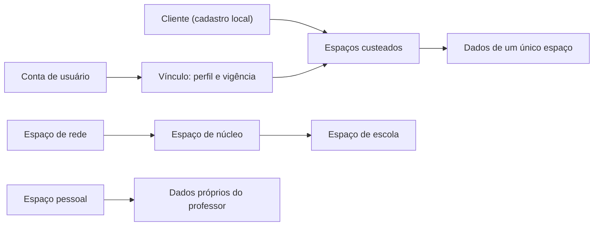

# Clientes, espaços e vínculos

**Atualizado em:** 12/11/2026, por lucasgenial

Este documento descreve como o Gabarito360 separa o cadastro local do cliente, onde os dados ficam (espaço) e quem acessa (vínculo). Ele cobre os espaços de rede, núcleo, escola e pessoal, as instituições, o espaço pessoal do professor autônomo, o cadastro de clientes (T4) e o corte T2 que isolou os dados por espaço.

O cliente é um cadastro local. Ele não é a conta contratante, que fica no aplicativo financeiro externo. Veja [04, seção 1](04-identidade-acesso-e-permissoes.md#1-conceitos).

Para tabelas e colunas, leia [03](03-modelo-de-dados.md). Para perfis, permissões e contexto ativo, leia [04](04-identidade-acesso-e-permissoes.md). Funcionalidades relacionadas: FN-021, FN-022, FN-023, FN-015, FN-024, FN-025, FN-027, FN-028, FN-031.

## 1. Os três conceitos

| Conceito | Definição | Regra principal |
|---|---|---|
| Cliente | Cadastro local de quem o sistema atende. Tem modalidade comercial. Não é a conta contratante. | Um cliente pode custear vários espaços. Pagar não concede acesso a dados pedagógicos. |
| Espaço | Unidade de propriedade e de isolamento dos registros. Tipos: pessoal, escola, núcleo, rede. | Cada registro pedagógico tem exatamente um espaço proprietário. |
| Vínculo | Relação de uma conta com um espaço e um perfil, com vigência e situação. | A mesma conta pode ser professora numa escola e diretora em outra. Cada contexto usa um vínculo por vez. |

A hierarquia institucional continua sendo rede, núcleo, escola. O cliente não a substitui. A gestão superior recebe acesso calculado aos espaços descendentes da sua instituição. Esse acesso não transfere a propriedade dos registros. Ele também não alcança outras instituições do mesmo pagador.

A hierarquia entre espaços deriva das chaves estrangeiras institucionais. O sistema não mantém uma segunda árvore editável.

## 2. Por que um banco compartilhado

| Alternativa | Resultado | Decisão |
|---|---|---|
| Banco por cliente | Separação física. Multiplica migrações e backups. Complica relatórios institucionais. | Rejeitada. |
| Só escola e rede existentes | Pouca mudança. Não representa espaço pessoal, vários vínculos nem clientes diferentes. | Insuficiente. |
| Banco compartilhado com espaço explícito | Preserva a operação. Exige filtro explícito em consultas, jobs, arquivos e validações. | Adotada (T1, aprovado em 31/10/2026). |

O filtro por espaço não depende só de um global scope Eloquent. O sistema usa Query Builder, agregações e tarefas em fila. O limite é explícito e testado em todos esses caminhos.

## 3. Clientes

### 3.1 Cadastro

| Campo | Regra |
|---|---|
| `tipo` | professor, escola, nucleo, rede, secretaria ou governo. |
| `modalidade` | pagante, presenteado, teste ou interno. |
| `situacao` | ativo, suspenso ou encerrado. Suspensão e encerramento pertencem ao ciclo de encerramento (FN-028, pendente). |
| `nome` | Até 200 caracteres. |
| `documento` | Opcional. Cifrado. Tem índice HMAC. Documento repetido não une clientes. |
| `contato_nome`, `contato_email`, `contato_telefone` | Opcionais. Cifrados. |
| `contrato_referencia` | Texto opcional. Aponta evidência externa. Não é contrato, assinatura, prazo de retenção nem cobrança. |

Regras do serviço `CadastroCliente`:

1. Aceita só uma lista fechada de campos. Situação, espaço, vínculo e autor enviados no payload são recusados.
2. Define a autoria pelo ator e a situação inicial como ativa.
3. Exige ator ativo e a habilidade `gerir-clientes`. A política vem de `ContextoInterno::pode(..., 'cliente.gerir')`.
4. Grava cadastro e evento na mesma transação. A mudança de modalidade registra ator, valor anterior, valor novo e instante em `cliente_eventos`. O evento não guarda documento, contato nem contrato.
5. Dados protegidos não aparecem na serialização comum.
6. O serviço não cria espaço, vínculo, assinatura nem cobrança.

### 3.2 API e interface (T4-B)

Só os contextos internos (Desenvolvedor, Suporte, Financeiro) acessam clientes. Vínculos escolares e pessoais não autorizam estas rotas. A flag `ACESSOS_INTERNOS_ATIVOS` precisa estar ligada.

| Rota da API (`/api/v1`) | Função | Limite |
|---|---|---|
| `GET clientes` | Lista paginada, sem documento nem contatos. | — |
| `POST clientes` | Cadastra cliente. | 20/min |
| `GET clientes/{id}` | Detalhe com os campos da edição comercial. | — |
| `PUT clientes/{id}` | Edita cliente. | 20/min |
| `GET clientes/{id}/espacos` | Espaços do cliente (20 por página), com contagem de vínculos por situação. | — |

Rotas web: `/clientes`, `/clientes/novo`, `/clientes/{id}`.

A consulta de espaços não devolve usuários, CPF, e-mail, alunos, provas ou notas. A interface não cria, transfere nem altera espaços ou vínculos.

### 3.3 Limites

- Contratos completos, cobrança e faturas pertencem ao aplicativo financeiro externo. A área Plano e uso (FN-068) só exibe informações autorizadas dele ([ADR-0062](../decisoes/0062-plano-e-uso-e-central-do-cliente.md)).
- O cadastro de clientes não substitui a auditoria geral (FN-004).
- Cliente provisório `interno` só existe após conciliação aprovada. Ele não implica contrato jurídico nem titularidade.

## 4. Espaços

### 4.1 Tipos

| Tipo | Referência obrigatória | Quem acessa |
|---|---|---|
| Rede | `rede_id` | Vínculo `admin_rede`. Alcança os núcleos e escolas descendentes. |
| Núcleo | `nucleo_id` | Vínculo `dir_nucleo`. Alcança as escolas do núcleo. |
| Escola | `escola_id` | Vínculos escolares (diretor, vice-diretor, coordenador, professor, aplicador, aluno, secretário, auxiliar). |
| Pessoal | `usuario_proprietario_id` | Vínculo `professor_autonomo` da própria proprietária. |

Cada espaço usa exatamente uma referência compatível com o tipo. As demais ficam nulas. Cada referência é única. Uma secretaria ou um governo é contratante: a sua operação usa os espaços das redes e os vínculos explícitos nelas, sem escola fictícia.

### 4.2 Hierarquia ativa

`App\Support\Espacos::escolas()` só considera um espaço escolar quando:

1. o espaço de escola, o de núcleo e o de rede estão ativos;
2. os três pertencem ao mesmo cliente;
3. cada espaço tem somente a referência do seu tipo.

Espaço suspenso ou encerrado recusa o uso comum, inclusive de um gestor superior. A exportação autorizada usa fluxo próprio.

### 4.3 Criação de espaços

- `Instituicoes::criarEspaco` cria o espaço de um núcleo ou de uma escola na mesma transação do cadastro. O espaço herda o cliente do pai autorizado. O payload não escolhe cliente nem espaço.
- Editar uma escola ou um núcleo não troca rede ou núcleo. Transferência exige procedimento próprio (FN-025).
- O CRUD não apaga núcleo com espaço registrado.
- Nenhum código cria espaço pessoal ou cliente do tipo professor. O provisionamento comercial do autônomo está pendente (FN-027 e FN-030).

### 4.4 Propriedade dos dados existentes

| Grupo | Dono |
|---|---|
| `secretarias`, `redes`, `nucleos`, `escolas` | Ligam-se aos espaços de rede, núcleo e escola. Nenhuma relação é inferida por nome. |
| `turmas`, `alunos` | Espaço da escola. Em espaço pessoal, `escola_id` fica nulo. |
| `provas` e filhos (`prova_turmas`, `gabaritos`, `gabarito_questoes`) | Espaço da prova. `criado_por` é autoria, não propriedade. |
| `cartoes`, `cartao_respostas`, `notas`, `ambiguidade_logs`, `cartao_envios` | Espaço da prova e do cartão. Aluno, turma e gabarito precisam concordar. |
| `visitas` | Espaço da escola visitada. |
| `sincronizacoes_seges` | Espaço da instituição de destino. |
| `usuarios`, tokens, recuperação de senha, `trocas_email` | Identidade global da pessoa. A conta não pertence a uma escola. |
| `permissoes`, `perfil_permissoes`, `planos`, `censo_escolas` | Catálogos globais. Alterá-los exige permissão de plataforma. |
| `assinaturas`, `pagamentos` | Dados comerciais por cliente. Sem autorização pedagógica implícita. |
| `leads`, `emails_enviados`, filas e falhas | Operação da plataforma. |

## 5. Instituições

| Entidade | Regras vigentes |
|---|---|
| Secretaria | Nível opcional acima da rede. Relaciona-se às redes. Vínculo de secretaria exige atribuição própria e em cada rede. |
| Rede | Parâmetros de média e de nota mínima. Logo do ente. Com duas redes visíveis e nenhuma seleção, a API recusa a ambiguidade (`422`, "Selecione a rede para esta operação."). Ela não usa a primeira rede. |
| Núcleo | Ligado à rede. O diretor de núcleo só edita o próprio núcleo. |
| Escola | Código INEP único. Campos do Censo: esfera, situação, localização, endereço, órgão regional. `tipo` sede, anexo ou unidade vinculada com `escola_sede_id`. `sigla` opcional de até 40 caracteres, sem preenchimento automático. |
| Anexo | Escola do tipo anexo ligada à sede. Cadastrada pelo diretor de núcleo ou pelo administrador. |
| Catálogo nacional | Base pública de instituições (INEP, MEC, IBGE), global e somente leitura para os perfis. Selecionar uma instituição cria referência pessoal. Não cria escola operacional nem acesso (FN-031). |

Quem cadastra escola: administrador da rede e diretor de núcleo (`escola.criar`). O diretor escolar edita os dados e o logo da própria escola. O cadastro por INEP preenche os dados a partir da base do Censo. A importação do Censo atualiza só o catálogo público. A atualização de escolas privadas é uma operação distinta, com `--atualizar-escolas --usuario --espaco`.

Logos: a API autoriza antes de abrir o arquivo. Novos uploads usam diretório da instituição. Aluno consulta o logo da própria escola sem ganhar acesso às turmas.

## 6. Vínculos (resumo)

O documento [04](04-identidade-acesso-e-permissoes.md) é dono do tema. Este resumo mostra a relação com os espaços.

- `usuario_vinculos` liga conta, espaço e perfil. É único por (conta, espaço, perfil).
- Situações: convidado, ativo, suspenso, encerrado. Vigência com início inclusivo e fim exclusivo.
- `versao_autorizacao` aumenta a cada mudança. Cache de autorização inclui conta, vínculo e versão.
- Restrições por turma (`vinculo_turmas`) e por aluno (`vinculo_alunos`) exigem o mesmo espaço do vínculo.
- Recusar um convite encerra só o vínculo convidado. A conta e os outros vínculos permanecem.
- Gestor superior lê descendentes pelo cálculo da hierarquia. Administração de plataforma é contexto separado (acesso interno).
- Em 02/11/2026 a produção converteu seis contas em sete vínculos e ligou o regime obrigatório (FN-015).

## 7. Espaço pessoal do professor autônomo (T3, FN-022)

### 7.1 Regras

1. O perfil `professor_autonomo` existe só no espaço pessoal da própria conta. Não deriva poder de vínculos escolares nem do pagador.
2. O autônomo gere turmas, alunos, provas, gabaritos, cartões, correção e relatórios de prova e de turma. A lista exata de permissões está no documento 04, seção 7.1.
3. Não existe escola fictícia, rede, núcleo, logo institucional nem extras de diretor.
4. O cadastro do aluno é mínimo: nome, identificação simples (`matricula`), turma, avatar e estado. API e formulário recusam CPF, nascimento, gênero, responsável e fotos genéricas. O retrato privado (IM1) é permitido. O banco reforça a restrição por gatilho.
5. O espaço e o tipo vêm do ator e da turma. O formulário nunca envia o ID da propriedade.
6. `turmas`, `provas` e `alunos` têm `espaco_tipo`, com chave composta para `(espacos.id, espacos.tipo)`. Gatilhos exigem escola preenchida em espaço escolar e ausente em espaço pessoal.
7. Relatórios e cartões usam o nome do espaço no cabeçalho. Mantêm a aprovação 6/10 e a referência de média 7/10, sem consultar outra instituição.
8. O acesso exige espaço, cliente e conta ativos e o vínculo pessoal do proprietário. `espacos.pessoal` está `true` no código.
9. Menu móvel do autônomo: Painel, Corrigir, Provas, Turmas. Alunos fica no menu completo. Gestão de equipe, escolas e professores não aparece.

### 7.2 Mudança de turma e histórico

1. `cartoes.turma_aplicacao_id` é um snapshot da turma onde a prova foi aplicada. Tem chave composta ao espaço da turma.
2. Ao mudar o aluno de turma, o sistema bloqueia e confere aluno, destino, cartões e notas na mesma transação.
3. Cartões antigos recebem a turma da nota, se existir, ou a turma atual. Qualquer inconsistência recusa a operação inteira.
4. Notas não são movidas nem copiadas. O destino precisa ser turma ativa do mesmo espaço.
5. Consultas de notas, cálculo, auditoria e relatórios usam o snapshot quando ele existe.
6. O boletim conserva as provas anteriores. Voltar à turma original não reescreve o histórico.
7. O comportamento institucional de movimentação (FN-026) não foi ampliado.

### 7.3 Fora do escopo

- Provisionamento comercial do cliente e do espaço (FN-027 e FN-030).
- Portal dos pais (FN-067): exige espaço escolar.
- Importação de alunos da escola para o espaço pessoal.
- Integração entre espaço pessoal e escola, e continuidade ao sair da escola (FN-027, parcial; FN-025, pendente).
- CPF pessoal do aluno: as regras de T3 o proíbem. A revisão formal precede qualquer habilitação.

## 8. Corte T2: isolamento por espaço (FN-021)

### 8.1 Fases

| Fase | Entrega | Estado |
|---|---|---|
| T2-A | Inventário somente leitura (`g360:inventariar-espacos`) e manifesto aprovado em 31/10/2026. | Entregue |
| T2-B/C | Estruturas e preenchimento (`g360:preencher-espacos`). | Entregue |
| T2-D1 a D4 | Adaptação dos consumidores: alunos, turmas, provas, instituições, cartões, fila, arquivos, consultas, painéis e importadores. | Entregue |
| T2-E | Auditoria e restrições (`g360:auditar-espacos`, `g360:restringir-espacos`). | Entregue |
| Publicação | Corte com 2 clientes e 13 espaços em produção, 01/11/2026 (release `af4c6d1`). | Entregue |

### 8.2 Manifesto aprovado

O manifesto `legado-20261031-v1` fica em `EstruturaEspacos::MANIFESTO`. Ele contém só IDs de rede, núcleo e escola. Cria 2 clientes internos provisórios (um por rede) e 13 espaços institucionais. Ele não cria espaços pessoais, não presume contrato e não ativa cobrança.

O responsável aprovou que o administrador atual gerencie as duas redes com vínculos separados. Isso não cria vínculo global. Uma conta de aluno sem escopo não foi vinculada por suposição.

Mudança de contrato, proprietário ou acesso exige atualizar o manifesto. Instituições novas interrompem a execução. O mapa não se amplia automaticamente.

### 8.3 Comportamento do adaptador

1. O administrador só enxerga redes registradas em `usuario_escopos` (legado) ou o espaço do vínculo. Ausência de atribuição resulta em lista vazia. Não há fallback para todas as redes.
2. Alunos, turmas e provas consultam o espaço e o escopo antes de resolver o ID. Registro com espaço nulo, incompatível ou fora do acesso é recusado.
3. Criações calculam propriedade e autoria no servidor. O cliente não escolhe dono nem autor.
4. Suspensão de escola, núcleo ou rede bloqueia o acesso sem cache persistente.
5. Painéis, relatórios e consolidados agregam depois de filtrar. A secretaria precisa de atribuição própria e de cada rede.
6. Importadores (alunos, provas, Censo) exigem `--usuario` e `--espaco` (ou `--vinculo`). Simulam por padrão e gravam só com `--aplicar`. CSV não transfere aluno de outra escola por matrícula.
7. Comparativos calculam médias sem multiplicar notas por joins.

### 8.4 Fila, arquivos e links

- A fila de cartões (B6) transporta IDs de espaço, ator e vínculo. Ela revalida conta, permissão, prova, aluno e hierarquia antes de ler e antes de gravar.
- Recusa no modo novo preserva o cartão e a foto para conciliação. Não há exclusão nem transferência automática.
- A chave de idempotência B6 considera espaço, usuário e chave. Em envio contextual, `chave` é um UUID v5 derivado de pessoa, vínculo, espaço e UUID do cliente.
- Fotos novas e derivados usam diretório por espaço. Locks, temporários e Redis incluem o espaço.
- URLs de imagem assinadas carregam ator, espaço e versão do acesso. Cada abertura revalida o acesso. Links temporários continuam sendo credenciais portadoras durante a vigência.
- Webhooks resolvem o cliente pela assinatura armazenada e ignoram espaço enviado pelo remetente.

### 8.5 Restrições de integridade (T2-E)

O comando `g360:restringir-espacos` aplica, nos 13 grupos de tabela (`EstruturaEspacos::TABELAS`):

1. `espaco_id` e `origem_autoria` obrigatórios;
2. chaves de espaço e de autoria;
3. chaves compostas entre pai e filho, por espaço;
4. exclusividade das referências de `espacos`;
5. unicidade de matrícula e CPF do aluno por espaço, e de chave B6 por (espaço, usuário, chave).

Regras de execução:

1. Rode com `--aplicar --manifesto=legado-20261031-v1 --escritores-parados`. Exige adaptador ativo e manutenção.
2. O plano verifica todos os objetos antes do primeiro DDL e informa a duração de cada passo.
3. Uma colisão de nome com definição diferente bloqueia a execução.
4. Um lock de conexão impede dois cortes simultâneos. O lock operacional exclui o preenchimento e a conciliação por até uma hora.
5. A espera por metadata lock é de 15 segundos.
6. Interrompida a execução, repita o mesmo comando com manutenção e escritores parados.
7. Nunca use `migrate:rollback` nem `foreign_key_checks=0`.
8. Depois de relaxar as unicidades globais, o código legado deixa de ser compatível.

### 8.6 Procedimento de corte e volta segura

1. Confirme o SHA, o CI, o manifesto e um inventário atualizado.
2. Confirme backup restaurável, arquivos e chaves L3.
3. Ensaie o DDL na versão e no volume de produção. Registre duração e disco.
4. Mantenha API e web em manutenção. Pare agendador, workers e importadores. Drene a fila.
5. Aplique a expansão aditiva e preencha o manifesto. Concilie o administrador.
6. Execute `g360:auditar-espacos` e compare as contagens.
7. Ative o adaptador ainda em manutenção. Simule e aplique as restrições. Repita a auditoria.
8. Valide dois contextos, recusas cruzadas, importações e fila. Só então retome os serviços.

Volta: antes de novos espaços, pessoal ou cópias, o código antigo tolera as colunas novas. Depois disso, ele não é compatível. Use correção progressiva ou restauração coordenada de banco, arquivos e chaves, com análise das escritas perdidas. Não há rollback destrutivo automático. O DDL do MariaDB não é transacional: ensaie a retomada de cada passo.

### 8.7 Configuração

| Chave | Valor atual | Observação |
|---|---|---|
| `espacos.ativo` | `true` | Corte T2 publicado. |
| `espacos.pessoal` | `true` | Habilita o espaço pessoal. Exige vínculo, espaço, cliente e conta ativos. |
| `vinculos.obrigatorio` | `false` por padrão (`VINCULOS_OBRIGATORIOS`) | Ligado em produção em 02/11/2026. |

## 9. Cópias entre espaços e transferências

### 9.1 Estado

- A funcionalidade T5 (cópias entre espaços com autorização bilateral) existe no código e permanece desligada. A FN-024 está **substituída**.
- A orientação posterior do responsável (03/11/2026, doc 115) separou cinco fluxos:

| Fluxo | Finalidade | Efeito |
|---|---|---|
| Duplicar prova | Reutilizar a própria avaliação ou fornecer versão a colega (FN-042). | Nova prova em rascunho, IDs novos, sem turmas, cartões, notas ou alunos. |
| Alterar turmas da mesma prova | Aplicar a mesma versão a outra turma. | Operação separada. Não altera aplicação histórica. |
| Movimentar matrícula | Aluno muda de turma ou escola (FN-026). | Encerra o período anterior e abre outro. Preserva avaliações no contexto original. |
| Transferências | Cessão e recebimento controlado entre espaços (FN-025). | Conteúdo aprovado com origem, destino, corte e recibo. Não apaga a origem. |
| Convidar para vínculo | Conta existente recebe nova função ou escola (FN-015). | Mesma identidade, novo vínculo aceito. Não transporta dados de outra escola. |

- O mecanismo de T5 não serve de atalho para duplicar prova. Ele será reposicionado em Transferências.

### 9.2 Regras mantidas do desenho T1

1. A cópia cria novos IDs e remapeia todas as chaves. Não altera o `espaco_id` da origem.
2. Cada item é transacional, com registro de origem e chave única. Repetir a tentativa devolve o mapeamento existente.
3. Falha parcial deixa o lote incompleto e retomável. Dados incompletos não aparecem como prova pronta.
4. Não se copiam tokens, convites, permissões, recibos de fila nem credenciais.
5. Matrícula coincidente não prova identidade. Não se mescla por nome. Matrícula ocupada por outra origem pede conciliação.
6. Mover turma entre escolas não é edição simples. É cópia ou transferência autorizada.
7. O espaço pessoal recebe sempre cadastro mínimo, mesmo com autorização para notas identificadas.
8. Notas identificadas só circulam com cláusula contratual. Sem ela, a saída é agregada, com supressão de grupos pequenos.

### 9.3 Matriz de autoridade proposta (FN-025, pendente)

O doc 115 propõe separar solicitar, confirmar, autorizar e executar.

| Contexto | Solicitação | Decisão institucional | Execução |
|---|---|---|---|
| Escola de origem ou destino | Solicita ingresso ou cessão de aluno. | Representante autorizado confirma a saída ou entrada. | Sem execução genérica entre escolas. |
| Diretor de núcleo | Abre dentro do núcleo. | Autoriza no próprio alcance. | Aciona operação já aprovada, com capacidade específica. |
| Rede ou Secretaria de Educação | Coordena a jurisdição. | Autoriza dentro da hierarquia. | Aciona operação aprovada. |
| Suporte ou Desenvolvedor | Atende solicitação atribuída. | Não substitui a autoridade institucional. | Execução delegada por caso, categoria e prazo. |
| Professor autônomo | Exporta ou recebe no próprio espaço. | Decide só o seu lado. | Operação pessoal autorizada. |
| Professor ou Coordenador de escola | Cópia pedagógica. | Não aprovam remessa entre escolas. | Sem execução genérica. |

### 9.4 Seis casos de aceite do desenho T1

Os casos usam dados fictícios (professor U1, espaço pessoal P1, escolas E1 e E2).

| Caso | Resultado esperado |
|---|---|
| Autônomo entra em E1 | Cria vínculo convidado. Após o aceite e a autorização, copia PR1 e A1 para novos IDs em E1. Repetir o lote não duplica. |
| Professor trabalha em E1 | O contexto E1 cria registros em E1. Escolher E2 no payload é recusado. |
| Sai e quer continuar | Encerra o vínculo E1. P1 permanece. Cópia só com cláusula válida e com minimização. Não reabre o acesso escolar. |
| Sai sem continuidade | Revoga vínculo e tokens. Os dados da escola permanecem. Jobs pendentes não usam a autorização revogada. |
| Escola encerra | Suspende o acesso E1. Rede e núcleo não contornam a suspensão. Exportação sob procedimento próprio. |
| Professor da escola encerrada continua | Contratação pessoal e acesso a P1. Pagamento pessoal não desbloqueia E1. |

Testes obrigatórios: diretor numa escola e professor em outra sem união de poderes; convite recusado não encerra a conta; matrícula igual em escolas distintas; associação de nota, cartão e aluno de espaços diferentes; relatório superior só com descendentes; URLs, arquivos e cache sem atravessar contexto.

## 10. Índices e crescimento

- Índices candidatos, a medir antes de criar: `turmas (espaco_id, ano_letivo, id)`, `alunos (espaco_id, turma_id, ativo, id)`, `provas (espaco_id, status, data_aplicacao, id)`, `cartoes (espaco_id, prova_id, status, id)`, `notas (espaco_id, prova_id, turma_id, id)`.
- O particionamento por tempo não entra por padrão. O MariaDB restringe chaves estrangeiras em tabelas particionadas e exige a coluna de partição nas chaves únicas. Isso conflita com as chaves compostas de notas e cartões.
- Não prometa ganho sem medição: latência p95, linhas examinadas, tamanho de índices, tempo de migração e carga de fila para as 100 instituições previstas.
- O trabalho de volume pertence à FN-077 e à FN-007.

## Divergências encontradas

| Assunto | Documento antigo | Código atual |
|---|---|---|
| Tabelas `vinculo_turmas` e `vinculo_alunos` | `docs/40` as prevê como parte da expansão T1 com colunas `espaco_id`. | Existem, com chave (`vinculo_id`, `turma_id`) ou (`vinculo_id`, `aluno_id`) e `espaco_id`. Nascem na migration `2026_11_01_000002`. |
| `registros_origem` e `copias_lotes` | `docs/40` define as colunas dessas tabelas. | As tabelas existem com o conjunto ampliado de T5 (staging, cadastros, resultados, recebimentos). O recurso está desligado e a FN-024 está substituída. |
| Adaptador `ativo = false` | Docs 44 a 48 repetem que `config/espacos.php` permanece desligado. | Está `true` desde a publicação do corte, em 01/11/2026. |
| Habilidade `gerir-clientes` | Doc 66 diz que a ability não está definida. | `AppServiceProvider` define `gerir-clientes` por `ContextoInterno::pode(cliente.gerir)`. |
| T3-B: pessoal desligado | Doc 64 mantém `espacos.pessoal = false`. | Vale `true` desde T3-C, com condições de acesso. |
| Hash do CPF por espaço | `docs/40` e T2-E falam em `(espaco_id, cpf_hash)` para todos os espaços. | O CPF do aluno pessoal é bloqueado pelas regras de T3. A unicidade por espaço vale para espaço escolar. |
| Cópia entre espaços | `docs/40` e docs 77 a 98 descrevem T5 como a solução de continuidade. | O doc 115 reposiciona o mecanismo em Transferências. Apêndice do próprio `docs/40` já avisa a incompatibilidade. |
| Uso do tipo `secretaria` e `governo` | `docs/40` diz que operam por espaços das redes. | Não há espaço de tipo secretaria. O perfil `secretario_educacao` não seleciona contexto (documento 04). |
