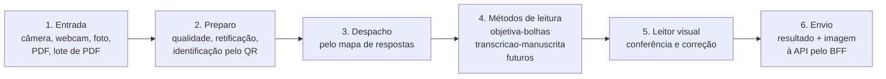

# 079 — Leitor360: motor de leitura de provas — Planejamento

**Implementação:** Candidata
**Etapa:** Candidata
**Conforme princípios:** versão 11
**Posição no plano mestre:** fora das ondas (candidata; aguarda priorização do responsável)
**Natureza:** evolução de existente
**Origem:** surgiu na conversa de planejamento do responsável em 2026-11-11 (leitura no aparelho do usuário)
**Atualizado em:** 2026-11-11, por lucasgenial

> Escreva este documento no padrão ASD-STE100 moderado (AGENTS.md): uma ideia por frase, voz ativa, frases curtas.

Este planejamento é completo, mas a funcionalidade é candidata. Nada pode ser executado antes da priorização e da aprovação deste documento, do [casos-de-uso.md](casos-de-uso.md) e dos mockups (subfase 0.1).

Neste documento, "(proposta)" junto de um número significa: proposta do planejamento, a confirmar pelo responsável na 0.1. Os números sem essa marca vêm do código atual ou de uma norma citada.

Termos usados neste documento (um termo por conceito):

| Termo | Significado |
|---|---|
| Leitor360 | O motor de leitura de provas do Gabarito360. Roda no aparelho do usuário. |
| Método de leitura | Um módulo que lê um tipo de região de resposta. Exemplos: `objetiva-bolhas`, `transcricao-manuscrita`. |
| Mapa de respostas | O documento versionado que diz, para cada página de uma prova, onde está cada região de resposta, qual é o tipo e qual método de leitura a lê. |
| Leitor visual | A tela de conferência e correção da leitura, no estilo de um aplicativo de digitalização. |
| Conjunto de referência | O conjunto de imagens e PDFs com o resultado esperado. Cada folha tem a verdade anotada por pessoas e o instantâneo do servidor (§6.9). |
| Paridade | Igualdade entre o resultado de um núcleo e o instantâneo do servidor. É o portão de publicação: 100% das folhas. |
| Acerto | Igualdade entre o resultado de um núcleo e a verdade anotada. É métrica de relatório, sem portão de 100%. |
| Núcleo de leitura | O código de visão computacional que o Leitor360 executa no aparelho (decisão D-4). |
| Versão do motor | O campo `motor_versao`: a versão do Leitor360 e dos limiares. O núcleo e as bibliotecas ficam no campo separado `nucleo` (§6.6). |

## 1. Objetivo

O Leitor360 é o motor de leitura de provas do Gabarito360. Ele recebe a imagem de uma folha, de qualquer entrada. Ele descobre a prova e a página. Depois, ele consulta o mapa de respostas. Para cada região, ele aplica o método de leitura do tipo dela. Cada região sai com um nível de confiança. O usuário confere e corrige o resultado no leitor visual. Depois, o resultado e a imagem vão ao servidor. O servidor guarda, confere e calcula a nota.

Hoje toda leitura roda no servidor. O `ProcessarCartaoJob` executa o `ler_cartao.py` por processo. Isso concentra o custo de CPU no servidor e atrasa o retorno ao professor. A leitura atual também não atende provas abertas, mistas nem provas em que a página é o gabarito.

## 2. Escopo

**Inclui:**

- Núcleo de leitura no navegador (celular e computador), com paridade de 100% com o instantâneo do servidor no conjunto de referência.
- Arquitetura em camadas: entrada, preparo, despacho, métodos de leitura, leitor visual, envio.
- Registro de métodos de leitura plugáveis, com o contrato de entrada e saída de um método.
- Método `objetiva-bolhas` (portado da leitura atual).
- Método `transcricao-manuscrita` como consumidor do runtime e do modelo da FN-080. O Leitor360 integra o método, o leitor visual e o armazenamento da transcrição.
- Barreira de qualidade e identificação por QR no aparelho, com os mesmos códigos da leitura atual (`omr-qualidade-1`).
- Leitor visual: destaques, correção, salvar, modal Continuar ou Encerrar e resumo do lote. Ele reaproveita a revisão da FN-046.
- Entradas: câmera do celular, webcam do computador, foto de arquivo, PDF de uma folha e lote de PDFs digitalizados.
- Perfil de capacidade do aparelho. Esta FN é a dona da detecção (§6.3). A FN-080 fornece os requisitos mínimos do modelo.
- Contrato do mapa de respostas, versão 1, derivado do cartão atual (N questões, K alternativas, `layout.grade()`).
- Contrato de envio do resultado e da imagem à API, conferência no servidor e trilha nas tentativas.
- Conjunto de referência, linha de base da leitura atual e métricas de leitura.
- Leitura de prova mista e de prova em que a página é o gabarito, quando a FN-043 produzir o mapa de respostas.

**Não inclui:**

- Criação do mapa de respostas na elaboração da prova, questões discursivas, formatos misto e digital e marcações na página da prova → [FN-043](../043-editor-provas-questoes/planejamento.md). A FN-043 produz o mapa de respostas. O Leitor360 consome.
- Especializar, comprimir, empacotar e distribuir o modelo de IA local (Qwen), o runtime de IA no aparelho e a medição do modelo → [FN-080](../080-ia-local-transcricao/planejamento.md) (candidata).
- Correção automática de respostas abertas. O método de transcrição só lê. Nenhuma FN cobre a correção por IA hoje.
- Aplicativo nativo Android e iOS e uso sem conexão completo → [FN-010](../010-app-mobile/planejamento.md) (adiada; offline em 10.3). O Leitor360 define o contrato que o app nativo vai seguir.
- Ajuste dos limiares de ambiguidade (R3) → [FN-046](../046-revisao-leituras/planejamento.md) subfase 1.2. O Leitor360 fornece as métricas (subfase 8.1).
- Barreira de qualidade no servidor, tentativas numeradas e histórico imutável → [FN-047](../047-omr-qualidade-resultado/planejamento.md). O Leitor360 grava nesses registros e não cria registros paralelos.
- Leitura de cartões de terceiros → [FN-048](../048-omr-driver-externo/planejamento.md). A FN-048 decide se o layout de terceiros vira método no aparelho, driver no servidor ou os dois. Ela também decide se usa o mapa de respostas, com origem própria. A barreira atual exige os 4 marcadores do cartão nativo.
- Resultados, relatórios e PDFs → [FN-049](../049-relatorios-resultados/planejamento.md).
- Permissões e créditos de IA (cobrança por uso) → sem FN hoje. Decisão D-9 e risco na seção 8.

## 3. Fontes de verdade

- Regra do mockup: [ADR-0056](../../decisoes/0056-app-atual-como-referencia-visual.md). A referência visual é o app atual em `apps/web` (views, componentes e CSS). O mockup novo é feito sobre a casca, os componentes e o CSS reais de `apps/web`. `mockups/` e `style-system/` são históricos, só para consultar escopo e textos originais.
- ⚠ **Não existe mockup aprovado do Leitor360.** Nenhuma tela desta funcionalidade entra em código antes do mockup aprovado e da revisão de UI/UX ([ADR-0020](../../decisoes/0020-revisao-de-ui-ux-por-especialista.md)).
- Mockup navegável preliminar: `mockups/leitor360.html` (FN-079 0.1, aguarda aprovação do responsável e revisão ui-ux). Ele usa o CSS real do app e está sendo refeito sobre a casca, os componentes e o CSS reais de `apps/web` (ADR-0056).
- Telas atuais relevantes (referência visual, ADR-0056):
  - acompanhamento da correção (web `correcao.show`, card `#camera`, `correcao/_camera.blade.php`) e modo do aplicador (`correcao/camera.blade.php`): ponto de entrada. O card de câmera muda na 4.1 (§7);
  - revisão (web `correcao.revisao`, `correcao/_documento` e `_leitura-questoes`) e `leitor-cartao.js`: base do leitor visual.
- Mockups históricos, só para escopo e textos: `mockups/acompanhar-correcao.html`, `acompanhar-correcao-turma.html`, `resultado.html`, `resultado-dinamico.html`, `criar-prova.html` e `gabarito.html`.
- Telas e modais a mockar: lista única no §7. O [casos-de-uso.md](casos-de-uso.md) cita esta lista.
- Interface: [09 Interface e design system](../../arquitetura/09-interface-e-design-system.md) e o CSS de `apps/web/public/css/`.
- Arquitetura: [01 Contexto e containers](../../arquitetura/01-contexto-e-containers.md), [03 Modelo de dados](../../arquitetura/03-modelo-de-dados.md), [05 Contratos da API e do Web](../../arquitetura/05-contratos-api-web.md), [06 OMR e documentos](../../arquitetura/06-omr-e-documentos.md), [11 Segurança e privacidade](../../arquitetura/11-seguranca-e-privacidade.md), [12 Desempenho](../../arquitetura/12-desempenho.md), [13 Infraestrutura](../../arquitetura/13-infraestrutura-e-ambientes.md).
- Código atual (descreve o que existe hoje): `apps/api/omr/ler_cartao.py`, `qualidade.py`, `layout.py`; `apps/api/app/Services/Omr/` (`FilaCartoes`, `GravadorLeituras`, `HistoricoCartao`, `ImagensCartao`, `CalculadoraNota`); `apps/api/app/Jobs/ProcessarCartaoJob.php`; `apps/web/public/js/correcao-camera.js`, `cartoes-fila.js`, `correcao-revisao.js`, `leitor-cartao.js`.
- Casos de uso: [casos-de-uso.md](casos-de-uso.md) (UC-079-01 a UC-079-25).
- Perfis e permissões: [04 Identidade, acesso e permissões](../../arquitetura/04-identidade-acesso-e-permissoes.md); código em `apps/api/app/Support/CatalogoPermissoes.php`.

## 4. Dependências

| Depende de | Por quê | Situação |
|---|---|---|
| FN-045 omr-correcao | Leitura atual, cartões, QR, layout e nota. É a referência de paridade. | Concluída (com ressalva: teste com cartão impresso real pendente) |
| FN-046 revisao-leituras | Revisão questão a questão, recorte e leitor PDF lateral, reaproveitados no leitor visual. R3 recebe as métricas. | Parcial |
| FN-047 omr-qualidade-resultado | Barreira de qualidade (`omr-qualidade-1`), tentativas e eventos encadeados por hash | Em homologação |
| FN-002 base-operacao (B6) | Fila, envio idempotente por UUID e polling | Concluída |
| FN-018 seguranca-urls-sessao | UR4 no BFF; imagens só por fetch autenticado | Em homologação |
| FN-012 permissoes-motor | Chaves `cartao.enviar`, `correcao.*`; chave nova, se D-6 ou D-9 exigirem | Concluída |
| FN-077 desempenho | Medição da API com 1000 usuários simultâneos | Parcial |
| FN-062 lgpd-inventario-retencao | Inventário e retenção de imagens, transcrições e recortes | Parcial |
| FN-080 IA local de transcrição | Fornece o modelo e o runtime do método `transcricao-manuscrita`. Bloqueia só as subfases 6.x. | Candidata |
| FN-043 editor-provas-questoes | Usa o contrato do mapa de respostas v1 (subfase 5.1) e produz os mapas de provas mistas e de provas em que a página é o gabarito. Bloqueia só as subfases 7.x. | Candidata |

**Funcionalidades que dependem desta:**

- FN-043: usa o contrato do mapa de respostas (subfase 5.1) para produzir mapas que o Leitor360 lê.
- FN-080: o método `transcricao-manuscrita` é o único consumidor do modelo. A FN-080 usa o perfil de capacidade do §6.3.
- FN-010: o app nativo segue o mesmo núcleo, o mesmo contrato de envio e o mesmo conjunto de referência.
- FN-048: decide a forma do layout de terceiros (§2).
- FN-046 (R3): usa as métricas da subfase 8.1.

## 5. Fases e subfases

Todas as subfases cobrem os casos de uso indicados. Os números desta tabela são propostas do planejamento, a confirmar pelo responsável na 0.1, exceto:

- 50 ms: definição de tarefa longa da Long Tasks API, medida com `PerformanceObserver` do tipo `longtask`;
- N de 1 a 100 e K de 3 a 5: modelo de dados atual;
- 0,90, 0,55 e 0,08: limiares do código atual.

Cada subfase registra na coluna Evidência: o teste ou script da CI (caminho e job), o relatório versionado em `docs/funcionalidades/079-leitor360/evidencias/` (texto, sem print) e o PR. Evidência prevista:

| Subfases | Evidência prevista |
|---|---|
| 0.2 | Relatório da linha de base e manifesto do conjunto |
| 1.1, 2.2, 2.3, 3.4, 5.1, 7.2, 8.2 | Job `paridade-leitor` com o resumo por categoria |
| 1.2, 3.5 | Relatório de tarefas longas e de memória via Playwright e CDP |
| 1.3 | Tabela aparelho × resultado do perfil |
| 2.1, 2.4, 3.x | Conferência por texto (o quê, onde, tema, largura, resultado) e revisão de UI/UX |
| 4.1 | Testes Feature da API e relatório de 1000 usuários |
| 4.2 | Testes Feature da política D-1 |
| 6.x | Relatório da FN-080 e log de rede do Playwright |

Os portões das decisões pendentes estão no §8.

| Subfase | Entrega | Critério de pronto | Status | Evidência |
|---|---|---|---|---|
| 0.1 | Planejamento, casos de uso e mockups das telas e modais do §7 | O responsável aprova o `planejamento.md`, o `casos-de-uso.md` e os mockups das telas e modais do §7 (desktop e celular). As telas 9 e 10 podem esperar a FN-043 e a FN-080. A D-6 está decidida antes do mockup do leitor visual; sem a decisão, o mockup traz as duas variantes do aplicador. O responsável confirma os números marcados como proposta. A revisão de UI/UX está registrada por texto. | Pendente | |
| 0.2 | Conjunto de referência e linha de base da leitura atual no servidor (UC-079-24, UC-079-25) | A D-13 está decidida. O conjunto tem o tamanho aprovado. Proposta: pelo menos 300 folhas (150 fotos de celular, 50 de webcam e 100 páginas de PDF digitalizado a 200 e 300 DPI) e pelo menos 10 exemplos de cada categoria do §6.9. A anotação segue o processo do §6.9, item 8. O manifesto está versionado. Um relatório registra, para a leitura atual: acerto por questão e por categoria, taxa de revisão, falsos "lido" e tempo por folha (p50, p95) na VM de homologação. | Pendente | |
| 1.1 | Prova de viabilidade do núcleo de leitura no navegador (D-4, D-5) (UC-079-10, UC-079-24) | O núcleo escolhido tem paridade de 100% com o instantâneo do servidor: alternativa, estado, código da barreira e QR idênticos em cada questão; diferença de confiança até 0,01 (proposta). Na CI, o job `paridade-leitor` roda os três alvos do §6.9, item 4. Firefox, Safari iOS e Chrome Android têm o registro por texto do §6.9, item 4. As versões de OpenCV e NumPy estão registradas. | Pendente | |
| 1.2 | Empacotamento do núcleo: Web Worker, carregamento sob demanda, cache, manifesto e versão do motor (UC-079-02, UC-079-10) | A leitura de uma folha não gera tarefa longa (acima de 50 ms) na thread principal. O núcleo baixa uma vez por versão e fica em cache. O Worker confere o sha256 de cada arquivo (§6.4, regra 7). O orçamento de download (definido na 1.1) é respeitado. A leitura de um cartão de 45 questões cumpre a meta do §6.10, item 5. A versão do motor aparece no resultado. | Pendente | |
| 1.3 | Perfil de capacidade do aparelho (UC-079-02, UC-079-23) | Numa matriz de pelo menos 8 aparelhos de teste (proposta), com celulares e computadores novos e antigos, o perfil classifica cada par entrada × método conforme a tabela do §6.3, sem erro. | Pendente | |
| 2.1 | Leitor visual para objetivas, com abertura pela prova e modo do aplicador (UC-079-01, UC-079-10, UC-079-14, UC-079-15, UC-079-17) | A D-6 e a D-11 estão decididas. Os critérios de aceite do UC-079-01, UC-079-14, UC-079-15 e UC-079-17 passam. A revisão de UI/UX registra a aprovação por texto. O código novo não usa `alert()` (§7). | Pendente | |
| 2.2 | Barreira de qualidade no aparelho (UC-079-08) | No conjunto de referência, a decisão (aprovada ou recusada) e o código de recusa têm paridade de 100%. | Pendente | |
| 2.3 | Identificação pelo QR no aparelho (UC-079-09) | No conjunto de referência, prova, aluno, N, K e língua têm paridade de 100%. QR de outra prova e folha sem QR seguem o caso de uso. A vinculação manual pelo leitor funciona, e o aplicador não vincula. | Pendente | |
| 2.4 | Resumo do lote ao encerrar (UC-079-18) | Antes da 4.1: os números do resumo são iguais aos estados da fila local, conferidos por teste `node --test` com fila simulada. Depois da 4.1: um teste de ponta a ponta compara o resumo com `GET .../envios/{chave}` de cada folha. | Pendente | |
| 3.1 | Captura pela câmera do celular, reaproveitando `correcao-camera.js` (UC-079-03) | A captura atual (guias, disparo automático, lanterna, redução a 2400 px) abre a folha no leitor visual. Regressão: os testes da lista do §6.6 ("Testes de regressão") passam sem alteração. | Pendente | |
| 3.2 | Captura pela webcam do computador (UC-079-04) | A captura funciona em HTTPS. O relatório define a resolução mínima por faixa de N (≤ 20, ≤ 45, ≤ 100) como a menor resolução com paridade e acerto iguais aos do subconjunto de celular. Abaixo do mínimo, o aviso de capacidade aparece. | Pendente | |
| 3.3 | Envio de fotos de arquivo, inclusive HEIC (UC-079-05) | Fotos JPEG, PNG, WEBP e HEIC abrem no leitor visual. O HEIC usa a biblioteca local `heic-to-1.6.7.js` (existe). Cada formato tem pelo menos 5 folhas no conjunto de referência (proposta), com paridade de 100%. | Pendente | |
| 3.4 | Envio do PDF de uma folha (UC-079-06) | O PDF.js local renderiza a página entre 200 e 300 DPI, com as regras do §6.5. A leitura do PDF digitalizado do conjunto de referência tem paridade de 100%. | Pendente | |
| 3.5 | Lote de PDFs digitalizados com fila pausável (UC-079-07) | Com os lotes de 40 e 200 páginas, no computador de referência: nenhuma tarefa longa acima de 50 ms na thread principal; o pico de memória com 200 páginas fica até 1,2 × o pico com 40 páginas (proposta), medido via CDP. Pausar, retomar e recarregar a página não perdem nem duplicam folhas nem `envio_id`. | Pendente | |
| 4.1 | Contrato de envio do resultado e da imagem (API e BFF) (UC-079-19, UC-079-21, UC-079-22) | A D-1, a D-7, a D-8 e a D-12 estão decididas. A API segue o §6.6 inteiro. Os testes Feature do §6.6 ("Testes do contrato") passam. Os testes de regressão do §6.6 passam sem alteração. A rota foi medida com 1000 usuários simultâneos (§6.10). A revisão de segurança aprova. | Pendente | |
| 4.2 | Conferência no servidor e tratamento de divergência, conforme D-1 (UC-079-20) | A política escolhida em D-1 está implementada e testada. A amostra é sorteada só no servidor. Toda divergência fica registrada e visível para quem tem `correcao.acompanhar`. | Pendente | |
| 4.3 | Atendimento ao aparelho sem capacidade, conforme D-2 e D-3 (UC-079-23) | O aparelho sem capacidade segue a opção decidida. Com a opção "servidor lê", o fluxo atual continua idêntico (envio só da imagem). Os testes de regressão do §6.6 passam sem alteração. | Pendente | |
| 5.1 | Mapa de respostas v1 derivado do cartão atual e preparado para a FN-043 (UC-079-10, UC-079-12) | Para todo N de 1 a 100 e K de 3 a 5, um teste compara `layout.bolinhas()`, `ImagensCartao::recorte()` e o mapa derivado. Ele roda num job com Python e PHP (hoje o job `testes` não instala OpenCV). O despacho lê pelo mapa com paridade de 100%. O mapa é versionado e imutável depois da aplicação. Os testes do §6.2, regra 6, passam. | Pendente | |
| 6.1 | Método `transcricao-manuscrita` (depende da FN-080) (UC-079-11) | A D-9 está decidida. O método segue a interface do §6.1. Os critérios de qualidade da transcrição vêm da FN-080. O teste de rede do §6.8 passa: nenhum dado sai do aparelho para outra origem. | Pendente | |
| 6.2 | Correção da transcrição no leitor visual e armazenamento dos trechos com o recorte (UC-079-16) | Antes de começar: os itens do §6.8, regra 12, estão cumpridos. Imagem e texto aparecem lado a lado. Os trechos corrigidos e o recorte vão ao servidor, com sha256 do recorte, num disco privado (§6.7). A saída escapa o texto (§6.8, regra 11). | Pendente | |
| 7.1 | Prova mista, com despacho de várias regiões e métodos pelo mapa (depende da FN-043) (UC-079-12) | Numa prova mista do conjunto de referência: paridade de 100% nas objetivas e transcrição dentro das metas da FN-080 nas abertas. | Pendente | |
| 7.2 | Prova em que a página é o gabarito, com várias páginas (depende da FN-043) (UC-079-13) | A D-10 está decidida. Uma prova de várias páginas do conjunto de referência é identificada página a página, com paridade de 100% nas objetivas. | Pendente | |
| 8.1 | Métricas de leitura (UC-079-25) | A API registra, por versão do motor: taxa de revisão, correções do usuário por estado e divergências aparelho × servidor. Um teste valida o esquema e recusa os campos proibidos do §6.8, regra 13. | Pendente | |
| 8.2 | Validação contínua do motor e apoio ao ajuste de limiares com a FN-046 (R3) (UC-079-24, UC-079-25) | A CI publica uma versão nova do motor só com paridade de 100% e sem queda de acerto em nenhuma categoria (§6.9). Uma proposta de limiar novo usa as métricas da 8.1. | Pendente | |

Ordem de execução: 0.1, 0.2, 1.1, 1.2, 1.3, 2.1 a 2.4, 3.1 a 3.5, 4.1 a 4.3, 5.1, 8.1, 8.2. As subfases 6.x e 7.x esperam a FN-080 e a FN-043. Até a 5.1, o despacho tem um só método e usa N e K do QR, como a leitura atual.

⚠ A subfase 4.1 é a primeira que altera o fluxo de produção. Até ela, o Leitor360 pode existir na homologação sem mudar o envio atual.

## 6. Contrato técnico (proporcional ao risco)

Tudo nesta seção é **proposta**. Nada aqui existe no código hoje, exceto o que está marcado como "existe".

### 6.1 Arquitetura em camadas do motor



| Camada | Responsabilidade | Executa em | Reaproveita |
|---|---|---|---|
| 1. Entrada | Obter uma imagem por página. Converter HEIC e renderizar PDF. | Thread principal (captura) e Web Worker (PDF) | `correcao-camera.js`, `heic-to-1.6.7.js`, PDF.js 6.5.438 (existem) |
| 2. Preparo | Barreira de qualidade, retificação pelos 4 marcadores, normalização do fundo, leitura do QR | Web Worker, no núcleo de leitura | `qualidade.py`, `ler_cartao.py` (existem) |
| 3. Despacho | Escolher o mapa de respostas pela prova e pela página. Para cada região, chamar o método de leitura registrado. | Web Worker | — |
| 4. Métodos de leitura | Ler uma região e devolver valor, confiança, estado e evidência | Web Worker (objetivas); runtime da FN-080 (transcrição) | `decidir()` e `preench()` de `ler_cartao.py` (existem) |
| 5. Leitor visual | Mostrar a folha, os destaques e a lista de pendências. Receber correções. Salvar. | Thread principal | `correcao-revisao.js`, `leitor-cartao.js` (existem) |
| 6. Envio | Montar o pacote, enviar com chave de idempotência, acompanhar o estado | Thread principal | `cartoes-fila.js` (existe) |

Regras do motor:

1. Nenhuma camada de leitura roda na thread principal. A interface nunca bloqueia.
2. O núcleo de leitura é um só para todas as entradas. A entrada só entrega uma imagem.
3. A nota nunca é calculada no aparelho. O aparelho não recebe o gabarito oficial (`gabarito_questoes`).
4. O motor publica uma versão (`motor_versao`) e cada método publica a sua versão.
5. Recomendação da D-12 (pendente): o núcleo lê sempre os bytes do arquivo que vai ao servidor. Ele decodifica esses bytes com `cv2.imdecode` dentro do núcleo, nunca com canvas. O `imagem_sha256` é calculado sobre esses mesmos bytes. A imagem enviada é a original da captura, ou a página renderizada do PDF, antes da retificação. A orientação EXIF é aplicada antes da codificação final. O arquivo enviado não tem tag de orientação.

**Interface de um método de leitura:**

| Campo | Direção | Tipo | Descrição |
|---|---|---|---|
| `imagem` | entrada | matriz em tons de cinza, retificada a 8 px/mm (valor atual de `PX`) | A página já endireitada pelo preparo |
| `regiao` | entrada | objeto do mapa de respostas | Identificador, tipo, geometria em mm, opções e, na região aberta, `tipo_esperado` |
| `parametros` | entrada | objeto | Limiares do método (versão incluída). Hoje: `MARCA` 0,55, `BRANCO_SEGURO` 0,08. |
| `valor` | saída | letra, nulo ou lista de trechos | Objetiva: letra (`A`–`E`) ou nulo. Transcrição: lista de trechos (ver abaixo). |
| `confianca` | saída | número de 0 a 1 | Objetivas: as fórmulas atuais de `decidir()`. Uma marcada: 0,5 + (f1 − f2). Dupla: 0. Nenhuma marcada: 1 − f1. |
| `estado` | saída | `lido`, `branco`, `dupla`, `fraca`, `nao_lido` | Base dos destaques do leitor visual |
| `evidencia` | saída | objeto | Retângulo do recorte em mm; frações por opção (`alternativas_detectadas`); para transcrição, o recorte da imagem |
| `metodo` e `metodo_versao` | saída | texto | Rastreabilidade |

Para o método `transcricao-manuscrita`, `valor` é a lista de trechos definida na [FN-080 §6.1](../080-ia-local-transcricao/planejamento.md). A `confianca` da região é a menor confiança entre os trechos. Desenho e ilegível são tipos de trecho, não estados. A região aberta do mapa traz `tipo_esperado` (`texto`, `formula`, `desenho` ou `misto`). Esta seção é dona da interface do método. A FN-080 é dona do conteúdo do trecho.

Correspondência com a saída atual de `ler_cartao.py`:

| Saída atual | Estado novo |
|---|---|
| Uma marcada e `confianca` ≥ 0,90 | `lido` |
| Uma marcada e `confianca` < 0,90 | `fraca` |
| `multiplas_marcacoes` = verdadeiro | `dupla` |
| Nenhuma marcada e maior fração ≥ 0,08 | `fraca` |
| Nenhuma marcada e maior fração < 0,08 | `branco` |
| Região fora da imagem, folha sem orientação ou erro do método | `nao_lido` |

O limite de 0,90 vem de `GravadorLeituras` (existe). Ele decide hoje o que vai para revisão. No leitor visual, `dupla`, `fraca` e `nao_lido` são pendências. `branco` é aviso e não vai para a revisão (UC-079-14).

**Registro de métodos:** um mapa `tipo de região → método`, com versão. O despacho não conhece os métodos por nome no código. Métodos previstos:

| Método | Tipo de região | Situação |
|---|---|---|
| `objetiva-bolhas` | `objetiva` | Portado da leitura atual (subfase 1.1) |
| `transcricao-manuscrita` | `aberta` | Depende da FN-080 (subfase 6.1) |
| Layout de terceiros | conforme a FN-048 | Futuro; a FN-048 decide a forma (§2) |
| Numérica, verdadeiro ou falso | a definir na FN-043 | Futuro |

Um método novo entra sem mudar o leitor visual nem o despacho. Ele só precisa passar no conjunto de referência.

### 6.2 Mapa de respostas v1

O mapa de respostas é o contrato entre a criação da prova (FN-043) e a leitura (Leitor360). Hoje ele não existe. Hoje, a geometria vem de N, K e `layout.grade()`.

Estrutura proposta:

```json
{
  "formato": "g360-mapa-respostas",
  "versao_formato": 1,
  "prova_id": 123,
  "versao": 1,
  "origem": "derivado_cartao",
  "layout": "layout-v1",
  "sha256": "…",
  "paginas": [
    {
      "numero": 1,
      "identificacao": { "qr": "G360|P123|A{aluno}|N20|K5|L0", "marcadores": "FIDUCIALS" },
      "regioes": [
        {
          "id": "q1",
          "numero_questao": 1,
          "tipo": "objetiva",
          "metodo": "objetiva-bolhas",
          "geometria": { "unidade": "mm", "opcoes": [ { "valor": "A", "x": 0, "y": 0, "r": 2.6 } ] },
          "opcoes": ["A", "B", "C", "D", "E"]
        }
      ]
    }
  ]
}
```

Regras:

1. **Origem `derivado_cartao` (subfase 5.1):** a API gera o mapa a partir de N, K e da opção de língua, com a mesma geometria de `layout.bolinhas()` e `layout.grade()`. Uma página, regiões objetivas, mais a região de língua quando `L` = 1.
2. **Origem `fn043` (subfases 7.x):** a FN-043 gera o mapa na criação da prova. Ela inclui regiões abertas (com `tipo_esperado`), várias páginas e a página da prova como gabarito.
3. O QR continua a mandar no layout impresso, como hoje. Se o QR e o mapa discordarem em N ou K, o motor recusa com `layout_divergente` (código já usado por `ProcessarCartaoJob`).
4. O mapa é versionado. Uma mudança gera versão nova.
5. O mapa fica imutável depois da aplicação: a partir do primeiro cartão recebido ou da data de aplicação, o que vier primeiro. A API recusa a alteração.
6. O mapa segue um esquema com lista positiva de campos. A API monta o mapa sem ler `gabarito_questoes`. Um teste garante que o JSON e o sha256 do mapa não mudam quando o gabarito muda. O teste também garante que o mapa não tem `alternativa` correta, `peso`, `anulada` nem `alternativa_espanhol`. Os mapas da FN-043 seguem o mesmo esquema e não trazem marcação de exemplo nem resposta esperada.
7. O resultado do aparelho cita `mapa_versao` e o `sha256` do mapa.
8. O mapa de outra prova (UC-079-09, 2a) só é entregue depois de `Escopo::prova`, mesma escola e, para o aplicador, `data_aplicacao` = hoje.

⚠ Hoje a geometria existe em dois lugares: `layout.py` (Python) e `ImagensCartao::recorte()` (PHP). O mapa de respostas passa a ser a fonte para o recorte também. A subfase 5.1 verifica que os três coincidem.

### 6.3 Perfil de capacidade do aparelho

O Leitor360 detecta as capacidades ao abrir (UC-079-02) e escolhe o que oferecer. Esta seção é a dona da detecção. A FN-080 fornece os requisitos mínimos do modelo (memória, WebGPU ou WASM, tempo) como entrada deste perfil.

| Capacidade | Como detectar | Uso |
|---|---|---|
| Contexto seguro | `window.isSecureContext` | Câmera e webcam exigem HTTPS |
| Câmera traseira | `navigator.mediaDevices.enumerateDevices()` e `facingMode` | Captura no celular e no tablet |
| Webcam e resolução real | `getUserMedia` e `MediaStreamTrack.getSettings()` | Captura no computador |
| WebAssembly e SIMD | `WebAssembly.validate` com um módulo de teste | Núcleo de leitura |
| Web Worker e `OffscreenCanvas` | Detecção de recurso | Leitura e PDF fora da thread principal |
| Memória aproximada | `navigator.deviceMemory` (só Chromium; nos outros, desconhecida) | Lote de PDF e IA |
| Núcleos de CPU | `navigator.hardwareConcurrency` | Paralelismo do lote |
| WebGPU | `navigator.gpu` | Runtime de IA (FN-080) |
| Espaço para cache | `navigator.storage.estimate()` | Cache do núcleo e do modelo |
| Desempenho medido | Leitura cronometrada de uma folha sintética embutida | Decisão final; vale mais que os sinais acima |

As entradas oferecidas seguem a capacidade detectada, não a largura da tela.

Tabela aparelho × entrada × método (proposta; a 1.3 confirma por medição):

| Aparelho | Entrada | `objetiva-bolhas` | `transcricao-manuscrita` |
|---|---|---|---|
| Celular recente (navegador) | Câmera | Disponível | Conforme FN-080 |
| Celular recente | Foto e PDF de uma folha | Disponível | Conforme FN-080 |
| Celular recente | Lote de PDF | Degradado: lote pequeno, sem paralelismo | Indisponível no lote |
| Celular antigo ou sem WebAssembly | Qualquer | Indisponível no aparelho; segue D-2 | Indisponível; segue D-2 |
| Computador | Webcam com resolução suficiente | Disponível | Conforme FN-080 |
| Computador | Webcam abaixo do mínimo (3.2) | Degradado: aviso e sugestão de foto ou PDF | Indisponível |
| Computador | Foto, PDF e lote de PDF | Disponível | Conforme FN-080 |
| Computador fraco | Lote de PDF | Degradado; segue D-3 | Indisponível |
| App nativo (FN-010) | Todas | Disponível (mesmo núcleo, D-4) | Disponível (FN-080) |

"Degradado" significa: funciona com limite e aviso. "Indisponível" significa: o Leitor360 não oferece. O que acontece depois segue D-2.

### 6.4 Núcleo de leitura (decisão D-4)

| Critério | (a) Pyodide com `ler_cartao.py` | (b) OpenCV.js reescrito em JavaScript | (c) Núcleo C++ compilado para WebAssembly e para o app nativo |
|---|---|---|---|
| Paridade com o servidor | Alta: o mesmo código Python roda nos dois lados | Média: reescrita; risco de diferença numérica | Alta, se o servidor também usar o núcleo C++ |
| Esforço inicial | Baixo | Médio | Alto |
| Peso do download | Alto: Pyodide, NumPy e OpenCV (ordem de dezenas de MB; a medir na 1.1) | Médio: OpenCV.js completo é grande; uma compilação reduzida é menor | Baixo: só as funções usadas |
| Partida a frio | Lenta (carregar o interpretador) | Média | Rápida |
| Reuso no app nativo (FN-010) | Fraco: Python no app é incomum | Fraco: exige outro caminho no nativo | Forte: o mesmo núcleo |
| Manutenção | Um código (Python) | Dois códigos (Python no servidor, JavaScript no aparelho) | Um código (C++), mas o servidor muda |
| Versões (D-5) | Depende do que o Pyodide empacota | Depende da compilação do OpenCV.js | Controle total |

**Recomendação:** começar com (a) Pyodide, travado pelo conjunto de referência. Motivo: é o caminho mais curto para a paridade de 100%. Ele não reescreve a lógica validada. Reavaliar (c) quando a FN-010 for retomada. Reavaliar também se o peso medido na 1.1 passar do orçamento. O conjunto de referência torna a troca segura: qualquer núcleo novo precisa da mesma paridade.

Regras de carregamento:

1. O núcleo carrega sob demanda, só quando o usuário abre o Leitor360. Nenhuma outra tela baixa o núcleo.
2. O núcleo fica em cache por versão (Cache Storage do navegador). Uma versão nova invalida a anterior.
3. Todos os arquivos do núcleo e do modelo (`.js`, `.wasm`, pacotes Python, pesos) vêm da origem do Gabarito360. É proibido baixar em tempo de execução de CDN, PyPI ou Hugging Face. O Pyodide usa `indexURL` local e `lockFileURL` próprio. O `micropip` fica desativado. No runtime de IA, `allowRemoteModels` (ou equivalente) fica falso.
4. O núcleo roda num Web Worker dedicado. A thread principal só recebe mensagens de progresso e resultado.
5. Enquanto o núcleo carrega, as entradas ficam liberadas. A folha capturada entra na fila com o estado **Aguardando o leitor**. A leitura começa quando o núcleo fica pronto (FN-076, UC-079-02).
6. O código do núcleo e do Worker fica em arquivos externos ([ADR-0023](../../decisoes/0023-javascript-em-arquivos-externos.md)).
7. Cada versão publica um manifesto com o caminho, o tamanho e o sha256 de cada arquivo. `GET v1/leitor/versoes` devolve o sha256 do manifesto vigente. O Worker confere o sha256 de cada arquivo com `crypto.subtle.digest` antes de `WebAssembly.instantiate` ou de carregar o modelo. Ele confere também ao ler do cache. Se diferir, o Worker apaga o arquivo e não executa.
8. O build do núcleo e do modelo fixa versões e confere o hash das origens. Ele gera uma lista de componentes (SBOM). O modelo usa formato sem código executável (ONNX, GGUF ou safetensors), nunca pickle.
9. A CSP com `'wasm-unsafe-eval'` vale só para a rota do Leitor360, com `script-src 'self'`, `worker-src 'self'` e `connect-src 'self'`. Ela não afrouxa as outras telas. Se o núcleo escolhido exigir `'unsafe-eval'`, isso vira decisão do responsável e entra na D-4.
10. A versão retirada (UC-079-24) sai do manifesto e do cache na próxima abertura.

⚠ Não encontrei cabeçalho Content-Security-Policy no repositório (`apps/web`, `deploy/nginx`, `infra`). Só há menção nas prévias. A regra 9 cria a CSP da rota do Leitor360. Confirmar na 1.1 o que o núcleo escolhido exige.

### 6.5 PDF e lote

1. O PDF.js local (`apps/web/public/js/libs/pdfjs-6.5.438`, existe) renderiza cada página num Web Worker.
2. O PDF.js roda com `isEvalSupported: false` e sem scripts de PDF. Cada arquivo tem limite de páginas e de tamanho (a definir na 1.2). A versão local acompanha os avisos de segurança do projeto PDF.js.
3. A resolução de renderização fica entre 200 e 300 DPI. Uma página A4 a 300 DPI tem cerca de 2480 × 3508 pixels. A 1.1 escolhe o valor pela paridade.
4. O lote processa uma página por vez por Worker. Cada página renderizada é liberada depois da leitura.
5. O número de Workers paralelos segue `hardwareConcurrency` e a memória, com teto definido na 1.2.
6. A fila do lote é pausável. Cada página tem um estado: na fila, aguardando o leitor, lendo, aguardando conferência, salva, enviada, recusada.
7. Recarregar a página mantém a lista de páginas e as chaves de envio, sem imagem (§6.8, regra 5). Ao fechar a aba, o sistema pede os arquivos de novo. A API recusa como repetida a página já recebida, pela chave de envio derivada do sha256 da página (proposta, a validar na 3.5).
8. Um lote fixa a versão do motor quando começa. Se essa versão sair da lista aceita, o lote segue a regra de versão do §6.6.
9. O QR de cada página identifica prova, aluno e página. Página sem QR fica pendente para vínculo manual, como hoje.
10. Limite de entrada proposto: o mesmo de hoje para cada imagem enviada (10 MB por imagem, `image|max:10240`). O PDF de entrada não vai ao servidor. Vai uma imagem por página.

### 6.6 API proposta

⚠ Todas as rotas e campos abaixo são **novos** e **propostos**. Hoje a rota de envio aceita só imagem (`imagem: required|image|max:10240`), e não aceita PDF nem resultado.

**Decisão proposta:** estender a rota atual `POST v1/provas/{id}/cartoes` com um campo opcional `leitura`. Assim, o envio mantém a mesma chave de idempotência, o mesmo lock por chave (`FilaCartoes::receber`), o mesmo registro em `cartao_envios` e a mesma regra de tentativas. Sem o campo `leitura`, a rota funciona como hoje (D-2).

Fluxo: navegador → Web (BFF, rota `correcao.upload`, com UR4) → API. O navegador nunca fala com a API.

Corpo (multipart):

| Campo | Tipo | Regra |
|---|---|---|
| `imagem` | arquivo de imagem | Obrigatório, como hoje. Qual imagem vai depende da D-12. Recomendação: sempre a original da captura, ou a página renderizada do PDF, com EXIF aplicado e sem tag de orientação (§6.1, regra 5). |
| `envio_id` | UUID | Como hoje. Gerado no aparelho por folha. Garante idempotência. |
| `aluno_id` | inteiro | Opcional. Como hoje. É só indício: o servidor decide pelo QR (item 2d). |
| `leitura` | JSON | Opcional e novo. Estrutura abaixo. |

Estrutura de `leitura`:

| Campo | Descrição |
|---|---|
| `motor_versao` | Versão do Leitor360 e dos limiares |
| `nucleo` | Núcleo e versões (por exemplo, Pyodide, OpenCV, NumPy) |
| `mapa` | `versao` e `sha256` do mapa de respostas, ou `derivado` com N, K e `layout-v1` |
| `imagem_sha256` | Hash da imagem enviada, calculado no aparelho. Garante só a integridade do transporte. |
| `qr` | Texto lido do QR |
| `qualidade` | Resultado da barreira no aparelho, com a versão (`omr-qualidade-1`) |
| `lingua` | Língua marcada, quando a prova tem opção de língua |
| `regioes[]` | Por região: `regiao`, `metodo`, `metodo_versao`, `valor`, `confianca`, `estado`, `detectadas` |
| `correcoes[]` | Por correção do usuário no leitor visual: `regiao`, `valor_lido`, `valor_final`, `momento` (informativo) |
| `aparelho` | Classe enumerada do perfil de capacidade. Nunca o user-agent nem um identificador do aparelho. |

Validação de `leitura`: a API usa esquema estrito. Tamanho máximo de 256 KB (proposta). Campos desconhecidos são recusados. `regioes[]` tem o mesmo conjunto de ids do mapa, sem repetição. `estado` e `valor` são enumerados. `confianca` fica entre 0 e 1.

O que a API faz:

1. Valida o corpo e a permissão (`cartao.enviar`), como hoje. Recusa campos proibidos (`nota`, `acertos`), como hoje. A API grava em `cartao_envios` o sha256 da imagem e o sha256 canônico de `leitura`. Um reenvio com a mesma chave e o mesmo conteúdo devolve o envio existente. Com a mesma chave e conteúdo diferente, a API responde 409 `chave_reutilizada` e não altera nada.
2. Confere o sha256 da imagem recebida contra `imagem_sha256`. Se diferir, recusa com 422 `imagem_divergente`.
   - 2a. A API classifica o envio pela permissão do ator, não pelo perfil. Se o ator não tem `correcao.alterar`, a API trata `leitura` só como indício. O servidor relê a folha **sempre**, e as respostas gravadas vêm da releitura. `correcoes[]` desse ator é recusado com 403.
   - 2b. Para todo ator, a API recalcula `estado` e `confianca` de cada região a partir de `detectadas` (frações por opção), com os limiares da versão do motor. Se não coincidir, recusa com 422 `leitura_inconsistente` e registra o evento.
   - 2c. Uma região com valor diferente da leitura original do motor só é aceita como item de `correcoes[]`, nunca em `regioes[]`.
   - 2d. A API decodifica o QR da imagem recebida, com a mesma biblioteca do servidor, em toda folha com `leitura`. Prova, aluno, N, K e L vêm do QR decodificado no servidor. Se diferirem de `leitura.qr` ou de `aluno_id`, a API recusa com 422 `identificacao_divergente`. A folha sem QR segue a vinculação manual (`correcao.alterar`).
3. Confere a versão do motor contra a lista de versões aceitas (regra de versão abaixo). Versão fora da lista: 422 `motor_desatualizado`. A API não grava `leitura`.
4. Confere o mapa (versão e sha256) contra o mapa vigente da prova. Mapa divergente: recusa com `layout_divergente`.
5. Guarda a imagem em `cartoes/espacos/{espaço}/{prova}`, como hoje.
6. Grava as respostas em `cartao_respostas` a partir de `regioes[]`, depois de aplicar a política D-1.
7. Registra as `correcoes[]` como revisões do usuário, com autor e vínculo da sessão. Só aceita correções de quem tem `correcao.alterar` (ver D-6).
8. **Calcula a nota no servidor** (`CalculadoraNota`, existe). A nota nunca vem do aparelho.
9. Aplica a regra de tentativas: aluno com leitura vigente gera proposta de tentativa (`HistoricoCartao::propor`, existe).
10. Registra a origem e as versões (§6.7) e um evento na tentativa (§6.11).
11. Responde 202 com o estado do envio, como hoje. A consulta `GET .../cartoes/envios/{chave}` continua.

Revalidação na gravação: a gravação das respostas, das correções e da nota ocorre numa transação. Ela revalida, de novo:

- vínculo ativo e o mesmo `vinculo_id` do envio;
- `cartao.enviar` e, para correções, `correcao.alterar`;
- `Correcao::bloqueio`;
- escopo do aluno;
- para o aplicador, `data_aplicacao` = hoje.

Se qualquer item falhar, o envio fica `recusado` e nada é gravado. O autor é sempre o usuário da sessão. O momento gravado é o do servidor. `correcoes[].momento` fica só como informação, no evento da tentativa.

Regra de versão do motor:

1. A lista de versões aceitas tem a vigente e a anterior, por uma janela de 7 dias (proposta).
2. Uma versão dentro da janela é aceita.
3. Uma versão retirada por defeito sai da lista na hora.
4. Com versão fora da lista, a API responde 422 `motor_desatualizado`. O cliente relê a folha com a versão vigente, sem nova ação do usuário. Ele reenvia com a mesma `envio_id`. A versão nunca é "ignorada" com leitura silenciosa no servidor.
5. Se a versão de um lote sair da lista, o lote pausa, baixa a vigente e relê as folhas salvas e ainda não enviadas.
6. As correções do usuário são mantidas quando a nova leitura da questão tem o mesmo valor. Quando o valor muda, a questão volta a ser pendência.

Compatibilidade:

- Sem `leitura`, o servidor lê como hoje (`ProcessarCartaoJob`). O fluxo atual não muda.
- A barreira de qualidade do servidor roda sempre que o servidor relê. Fora da amostra da D-1, roda ao menos a checagem de dimensões, tipo e decodificação da imagem, no PHP.
- Correção fechada e permissão revogada continuam a recusar o envio (`App\Support\Correcao`).
- A transcrição original da IA vai no envio (`cartao.enviar`). A transcrição conferida só vai pela rota `transcricoes`, com `correcao.alterar`, escopo por `ContextoCorrecao::cartoes` e recusa com a correção fechada.

Erros novos propostos:

| Situação | Código | `codigo` no corpo |
|---|---|---|
| Hash da imagem diferente do informado | 422 | `imagem_divergente` |
| Mapa de respostas diferente do vigente | 422 | `layout_divergente` (já existe no job) |
| Resultado com região desconhecida, repetida ou com número de regiões diferente do mapa | 422 | `regiao_desconhecida` |
| Versão do motor fora da lista aceita | 422 | `motor_desatualizado` |
| `estado` ou `confianca` diferente do recalculado a partir de `detectadas` | 422 | `leitura_inconsistente` |
| QR ou aluno diferente do QR decodificado no servidor | 422 | `identificacao_divergente` |
| Mesma chave de envio com conteúdo diferente | 409 | `chave_reutilizada` |
| Correção sem `correcao.alterar` | 403 | — |

Testes do contrato (critério da 4.1):

1. Recusam com 422: `valor` fora das K alternativas; `confianca` fora de 0 a 1; `estado` fora da lista; região repetida ou desconhecida; número de regiões diferente do mapa; campo `nota` ou `acertos` no corpo; `imagem_sha256` divergente; `detectadas` incoerente com `estado`; QR divergente.
2. Autorização: aplicador com `correcoes[]` recebe 403. Usuário de outra escola recebe 403 ou 404, como hoje. `envio_id` reusada em outra prova recebe 409. Mesma `envio_id` com outro conteúdo recebe 409.
3. A amostra da D-1 é sorteada só no servidor. Um teste prova que nenhum campo do cliente muda a escolha.
4. Uma correção fechada entre o envio e a gravação recusa a gravação (teste com fechamento concorrente).
5. Duas folhas do mesmo aluno enviadas ao mesmo tempo criam uma leitura vigente e uma proposta de tentativa, nunca duas leituras vigentes (teste de concorrência no MariaDB).
6. Um envio sem `leitura` despacha `ProcessarCartaoJob` e grava `origem_leitura = servidor`.

Testes de regressão (critério da 3.1, 4.1 e 4.3): passam sem alteração `CartoesFilaTest`, `QualidadeCartaoTest`, `LeiturasEmLoteTest`, `ImagensCartaoTest`, `ProgressoCorrecaoTest`, `CartoesEspacosTest`, `FilaVinculoTest`, `scripts/tests/cartoes-fila.test.mjs`, `scripts/tests/preparo-foto-*.test.mjs`, `scripts/tests/test_qualidade_omr.py` e `scripts/auditoria/revisao-modal.mjs`.

Novas rotas propostas (5.1 e 6.2):

| Rota | Uso | Permissão |
|---|---|---|
| `GET v1/provas/{id}/mapa-respostas` | O Leitor360 baixa o mapa vigente. Resposta sem gabarito (§6.2, regra 6). | `cartao.enviar` ou `correcao.acompanhar` |
| `GET v1/leitor/versoes` | Versões aceitas do motor e do núcleo e sha256 do manifesto vigente | Autenticado |
| `POST v1/cartoes/{id}/transcricoes` | Grava a transcrição conferida e o recorte (6.2) | `correcao.alterar` |

### 6.7 Dados

Migrations aditivas propostas. Nenhuma migration altera ou apaga gabaritos, questões, cartões, respostas, notas ou imagens ([ADR-0016](../../decisoes/0016-homologacao-isolada-adr-h1.md)). Cada migration tem `down()` que remove só o que ela criou.

| Migration proposta | Conteúdo | Subfase |
|---|---|---|
| `cartoes`: colunas novas | `origem_leitura` (`servidor` ou `aparelho`, padrão `servidor`), `motor_versao` (nulo), `mapa_respostas_id` (nulo) | 4.1 |
| `cartao_envios`: colunas novas | `origem_leitura`, `motor_versao`, `imagem_sha256_cliente`, `leitura_sha256` | 4.1 |
| `cartao_respostas`: colunas novas | `estado_leitura` (`lido`, `branco`, `dupla`, `fraca`, `nao_lido`), `corrigida_no_aparelho` (booleano) | 4.1 |
| `leitura_divergencias` (nova) | `cartao_id`, `numero_questao`, valor do aparelho, valor do servidor, situação, quem resolveu | 4.2, se D-1 exigir |
| `mapas_respostas` (nova) | `prova_id`, `versao`, `origem`, `conteudo` (JSON), `sha256`, `imutavel_desde`; único por (`prova_id`, `versao`) | 5.1 |
| `cartao_transcricoes` (nova) | `cartao_id`, `regiao`, `trechos` (JSON no formato da FN-080 §6.1), `confianca`, `metodo_versao`, `origem` (`aparelho`), situação "não verificada no servidor", caminho e sha256 do recorte, autor e momento da correção | 6.2 |

Dados existentes:

1. Cartões antigos ficam com `origem_leitura` = `servidor`. Nenhum dado é recalculado.
2. Os mapas derivados são gerados sob demanda para provas existentes. Uma prova já aplicada recebe a versão 1 e fica imutável.
3. A publicação segue o roteiro de `docs/operacao/`: backup, migração ensaiada e comparação antes e depois.

O resultado bruto recebido do aparelho fica no evento da tentativa (instantâneo cifrado, existe), e não numa coluna de texto livre.

Recortes e transcrições ficam num disco privado, sem link público. Eles são lidos só pela rota autenticada, com `no-store` e `correcao.acompanhar`. Nenhum arquivo novo desta FN usa o disco `public`. Hoje `FilaCartoes` grava as fotos no disco `public` (`config/filesystems.php`, `visibility public`).

### 6.8 Autorização e LGPD

| Perfil | Abrir o Leitor360 | Ver marcações lidas | Corrigir no leitor visual | Ver gabarito ou nota |
|---|---|---|---|---|
| ADM, DIR, COO, PRO | Sim (`cartao.enviar`) | Sim | Sim (`correcao.alterar`) | Não no Leitor360; nota só nas telas de resultado |
| NUC | Não (sem `cartao.enviar`) | — | — | — |
| APL (aplicador) | Sim, só em prova com `data_aplicacao` = hoje, como hoje | Depende de D-6 | Não (sem `correcao.alterar`) | Não |

A tabela mostra o padrão dos perfis. As permissões são por usuário. A API decide pela permissão do ator, não pelo perfil (§6.6, item 2a).

Regras:

1. A API revalida permissão, escopo e vínculo em cada envio e na gravação (§6.6). Uma permissão revogada durante a sessão recusa os envios seguintes (UC-079-22). O lote para e mostra quais folhas não foram enviadas.
2. Correção fechada recusa o envio para quem não tem `correcao.reabrir`, como hoje.
3. O aparelho não recebe o gabarito oficial. O mapa de respostas não contém a resposta correta (§6.2, regra 6).
4. Nenhuma imagem, recorte, resposta, transcrição, nome ou lista de alunos é gravada em armazenamento do navegador: IndexedDB, Cache Storage, `localStorage`, `sessionStorage`, OPFS ou o sistema de arquivos do Pyodide fora da memória (só MEMFS, com `unlink` depois de ler). O Cache Storage guarda só os arquivos do manifesto do núcleo e do modelo.
5. O `sessionStorage` guarda só a chave de envio, o estado e o sha256 da página. Ele não guarda aluno, respostas nem QR. Hoje `cartoes-fila.js` já guarda só chaves e estados de envio.
6. Se houver Service Worker, ele usa lista positiva de URLs do manifesto. Ele nunca intercepta nem guarda rotas da API, do BFF, de imagens ou do mapa.
7. A página do Leitor360 usa `Cache-Control: no-store` e revoga toda URL `blob:` depois do uso. O leitor apaga a memória (imagens, buffers, recortes) e encerra os Workers nestes casos: envio concluído, Encerrar, 401/403/419, logout em outra aba (`BroadcastChannel`), troca de vínculo e inatividade de 15 minutos (proposta).
8. A IA local (FN-080) roda só no aparelho. Nenhuma imagem, texto ou recorte vai a terceiros.
9. As imagens e os recortes no servidor seguem a mesma proteção atual: rota autenticada, `no-store`, só `correcao.acompanhar`, nunca aplicador.
10. A retenção de transcrições e recortes segue a FN-062. Hoje não existe expurgo no código.
11. A transcrição é texto não confiável. Ela é escapada em toda saída (Blade `{{ }}`, `textContent`). A fórmula é renderizada com KaTeX (ou equivalente) com `trust: false` e sem HTML. A API limita o tamanho por região a 20.000 caracteres (proposta) e recusa caracteres de controle. A transcrição tem `origem = aparelho` e o status "não verificada no servidor". Ela nunca entra em nota nem em correção automática futura sem conferência humana registrada.
12. Antes da subfase 6.2:
    - o inventário ([11 Segurança e privacidade](../../arquitetura/11-seguranca-e-privacidade.md), O07) inclui transcrições, recortes e a leitura bruta guardada nos eventos;
    - o relatório de impacto (RL13) cobre a transcrição de manuscritos de menores;
    - a exportação e a eliminação por titular (L4) alcançam `cartao_transcricoes`, os recortes e os eventos;
    - a retenção segue o contrato da instituição.
13. As métricas (8.1) não guardam `cartao_id`, `aluno_id`, `envio_id`, chave de envio, QR, sha256 da imagem nem horário exato (só o dia). Elas são agregadas por versão do motor, classe de aparelho e entrada. Um teste confere a ausência desses campos.

Verificações (Playwright):

1. Durante a leitura e a transcrição de uma folha do conjunto, todas as requisições de rede vão para a origem do Gabarito360. Uma requisição a outra origem reprova.
2. Depois do envio confirmado, `caches.keys()`, `indexedDB.databases()`, `localStorage` e `sessionStorage` não contêm imagem nem recorte.
3. Depois de Encerrar, de logout ou de 403, a inspeção de IndexedDB, Cache Storage, OPFS, `sessionStorage` e Service Worker não encontra imagem, recorte, resposta nem nome de aluno. A conferência é registrada por texto, no Chrome e no Firefox.

### 6.9 Conjunto de referência

1. Cada folha tem: a imagem ou o PDF, o mapa de respostas, a categoria e os dois resultados do item 6.
2. Categorias mínimas: foto boa; pouca luz; sombra; rotação; EXIF de 90°, 180° e 270°; perspectiva forte; dobra; folha amassada; caneta azul; caneta preta; lápis; rasura; marcação dupla; marcação fraca; em branco; QR danificado; QR sem o prefixo `G360`; folha de outra prova; folha sem QR; verso em branco de scanner; 10, 20, 45, 90 e 100 questões; K = 3, 4 e 5; com e sem língua; webcam 720p e 1080p; PDF a 200 e a 300 DPI; JPEG, PNG, WEBP e HEIC.
3. As folhas de objetivas são preenchidas pela equipe, com alunos fictícios. Nenhuma folha de aluno real entra nesse conjunto. O conjunto de manuscritos pertence à FN-080. Ele tem regras próprias de consentimento e não roda em runner de terceiros. A avaliação dele roda em ambiente controlado pelo responsável (UC-080-08), com relatório por texto.
4. Na CI, o job `paridade-leitor` roda o conjunto inteiro em três alvos: servidor (`ler_cartao.py` nativo), núcleo em Node (a mesma compilação WASM do navegador) e núcleo no Chrome headless via Playwright. Qualquer diferença reprova. Firefox, Safari iOS e Chrome Android rodam fora da CI, a cada versão do motor, com uma página de autoteste. A página lê o conjunto e devolve o resumo. O resultado é registrado por texto: aparelho, navegador e versão, versão do conjunto, total de folhas, diferenças. Uma versão sem esse registro nos 4 navegadores não é publicada.
5. O conjunto é versionado. Uma folha nova não muda o resultado esperado das antigas.
6. O conjunto guarda dois resultados por folha:
   - (a) **Verdade anotada:** a alternativa que o aluno quis marcar e a categoria, anotadas por pessoas.
   - (b) **Instantâneo do servidor:** a saída de `ler_cartao.py` (alternativa, estado, confiança e código da barreira), gerada pela versão de referência do servidor e versionada.

   A **paridade** compara o núcleo do aparelho com (b). A meta é 100% das folhas, com alternativa, estado, código da barreira e QR idênticos em cada questão e |Δconfiança| ≤ 0,01 (proposta). O **acerto** compara qualquer núcleo com (a). Ele é métrica de relatório e não é portão de 100%. Uma versão nova não pode ter acerto menor que a vigente em nenhuma categoria.
7. Armazenamento (D-13): o conjunto fica fora do Git, num armazenamento privado do responsável. O Git versiona só o manifesto `omr/referencia/manifesto.json`: id da folha, sha256 do arquivo, categoria, verdade anotada, instantâneo do servidor e versão do conjunto. A CI baixa o conjunto por um meio autenticado, pela versão do manifesto. Ela confere cada sha256 antes de rodar. Uma folha com sha256 diferente reprova a execução. A CI não publica as imagens como artifact. O conjunto não pode ser guardado como imagem no Git: o `verificar_imagens.py` reprova. Uma exceção ao [ADR-0049](../../decisoes/0049-sem-prints-da-aplicacao.md) exige autorização expressa do responsável.
8. Anotação: duas pessoas anotam cada folha sem ver a anotação da outra. Os nomes ficam no manifesto como papéis, sem dado pessoal. Uma divergência vai para uma terceira pessoa (o responsável). Se a dúvida continuar, a folha recebe a categoria `ambígua por natureza`. Ela fica fora do cálculo de acerto, mas continua na paridade.

### 6.10 Desempenho

1. O custo de CPU da leitura sai do servidor e vai para o aparelho. O servidor passa a receber, validar e gravar. Os envios de quem não tem `correcao.alterar` são sempre relidos no servidor (§6.6, item 2a).
2. A rota de envio com `leitura` é medida com 1000 usuários simultâneos ([ADR-0052](../../decisoes/0052-medicao-com-1000-usuarios-simultaneos.md)), sem simulação, na subfase 4.1. A medição usa dados fictícios e um espaço de teste.
3. A medição compara: envio atual (servidor lê) e envio com `leitura`. O relatório traz média, p50, p95, p99, pedidos por segundo, erros e CPU e memória da VM.
4. ⚠ O [12 Desempenho](../../arquitetura/12-desempenho.md) (Padrão de carga, item 5) diz que a carga é só de leitura. O envio de cartão escreve. A medição exige um espaço de teste isolado e a decisão do responsável.
5. Orçamento do núcleo: definido na 1.1 a partir da medição. Meta inicial (proposta): primeira leitura pronta em até 10 segundos numa rede 4G; leitura de uma folha de 45 questões em até 2 segundos num celular intermediário.
6. A rota `GET v1/provas/{id}/mapa-respostas` pode ter cache técnico por `prova_id` e versão, porque o mapa é imutável depois da aplicação. O cache não tem autoridade de acesso ([ADR-0046](../../decisoes/0046-fundamentos-de-desempenho-adr-195.md)).

### 6.11 Integridade e auditoria

O resultado vem do cliente. Por isso, o servidor não confia nele sem verificação. Estas medidas garantem a confiança:

1. A imagem sempre vai ao servidor. O servidor pode reler qualquer folha com o mesmo núcleo (paridade garantida pelo conjunto de referência).
2. O servidor guarda o sha256 da imagem, a versão do motor e a versão do mapa. O sha256 calculado no aparelho garante só a integridade do transporte. Ele não prova que a leitura corresponde à imagem. A prova vem da releitura no servidor (D-1).
3. A nota é calculada só no servidor. O aparelho não conhece o gabarito.
4. Toda correção do usuário no leitor visual vira um registro com o autor e o vínculo da sessão e o momento do servidor.
5. A política D-1 define quando o servidor relê. Uma divergência nunca é resolvida em silêncio.
6. Cada envio com `leitura` gera um evento em `cartao_tentativa_eventos` (append-only, encadeado por hash: colunas `sha256` e `anterior_sha256`, existe). O evento guarda a origem, as versões e o resultado bruto.
7. A API aceita só versões do motor da lista vigente (§6.6, regra de versão). Uma versão retirada deixa de ser aceita na hora.
8. Um resultado adulterado no cliente não muda a nota sem deixar rastro. A releitura (amostra ou total, D-1), a releitura obrigatória de quem não tem `correcao.alterar` e a contestação mostram a diferença.
9. Recomendação da D-12 (pendente): o aparelho envia sempre a imagem **original** da captura (ou a página renderizada do PDF), nunca só a retificada. A retificação é refeita no servidor na releitura.

## 7. Interface

O app é responsivo ([ADR-0057](../../decisoes/0057-app-responsivo-em-todas-as-faixas.md)). Cada tela e cada modal do Leitor360 é conferido nas larguras 320, 360, 390, 720, 768, 1024, 1280, 1440, 1920, 2560 e 3840 px, nos temas claro e escuro, com registro por texto. O mockup tem seletor de aparelho com essas larguras.

Não há desenho aprovado neste documento. As telas abaixo precisam de mockup aprovado e revisão de UI/UX antes de código.

Mockup navegável preliminar: `mockups/leitor360.html` (FN-079 0.1, aguarda aprovação do responsável e revisão ui-ux). Ele usa o CSS real do app.

Regra do mockup ([ADR-0056](../../decisoes/0056-app-atual-como-referencia-visual.md)): cada tela abaixo é mockada sobre a casca, os componentes e o CSS reais de `apps/web`. O mockup preliminar está sendo refeito assim. `mockups/` e `style-system/` não são referência visual.

**Telas e modais a mockar (fonte única; o casos-de-uso.md cita esta lista):**

| # | Tela | Estados a mockar | Desktop (≥ 1100 px) | Celular (≤ 767 px) |
|---|---|---|---|---|
| 1 | Escolha da entrada (card "Ler folhas") | Entradas por capacidade; entrada indisponível com motivo; correção fechada; prova não publicada; aplicador sem prova no dia | Sim | Sim |
| 2 | Preparando o leitor | Barra "Preparando o leitor… 45%" (`role="status"`); aviso de primeira vez; falha no download; cache bloqueado | Sim | Sim |
| 3 | Câmera no celular | Guias; folha detectada; disparo; lendo no aparelho; recusa da barreira sobre o vídeo; lanterna; permissão negada; câmera em uso; sem conexão segura | — | Tela cheia (`.cam-tela`, existe) |
| 4 | Webcam | Permissão; pré-visualização com guias e resolução obtida; resolução baixa; sem webcam; vídeo à esquerda e leitor da última folha à direita | Sim | — |
| 5 | Fila de folhas (fotos e PDF) | Seleção; arrastar e soltar; arquivo inválido; foto repetida; aguardando o leitor; recusada; erro | Sim | Sim |
| 6 | Lote | Na fila; lendo; aguardando conferência; pausado; erro numa página; abas **Sem pendências**, **Para conferir** e **Recusadas** com contagem; concluído | Sim | Sim |
| 7 | Leitor visual | Carregando o núcleo; aguardando o leitor; lendo; leitura com pendências (marcação dupla, marcação fraca, não lida) e avisos (em branco); sem pendências; corrigindo uma questão; transcrevendo; aluno não identificado; erro de leitura; folha recusada pela barreira; folha salva só para leitura; sem conexão (faixa fixa "Sem conexão. As folhas serão enviadas quando a conexão voltar.", `role="status"`); acesso alterado (UC-079-22); variantes do aplicador conforme D-6 | Folha ao lado do painel (`minmax(0,1.2fr) minmax(310px,1fr)`) | Folha em tela cheia; lista e bloco "corrigir" na gaveta inferior |
| 8 | Escolher aluno | Busca por nome ou matrícula; sem resultado; aplicador sem vinculação | Sim | Sim |
| 9 | Páginas do aluno (FN-043) | Página esperada; falta página; completo | Sim | Sim |
| 10 | Conferir transcrição (FN-080) | Recorte e texto lado a lado; trecho de baixa confiança; ilegível; fórmula | Recorte à esquerda | Recorte em cima, teclado sem cobrir |
| 11 | Resumo do lote | Totais; folhas com pendência; folhas recusadas; sem aluno; páginas faltando; envio pendente; aplicador; vazio | Sim | Sim |
| 12 | Aparelho sem capacidade | Sem capacidade; capacidade degradada; opção conforme D-2 | Sim | Sim |
| 13 | Rótulo "Divergência aparelho × servidor" na revisão atual (`correcao.revisao`) | Com e sem decisão do usuário | Sim | Sim |
| 14 | Acompanhamento da correção (`correcao.show`) com o card "Ler folhas" | Card novo no lugar de **Fotografar cartões** e **Enviar fotos da galeria** | Sim | Sim |

Modais (da aplicação, nunca diálogo nativo): Folha salva (com e sem aluno identificado); Salvar com pendências?; Salvar N folhas sem pendências?; Esta folha é de outra prova; Este aluno já tem leitura (e a versão do aplicador); Esta página já foi lida; Este PDF tem N páginas; Cancelar o lote?; Descartar a edição?; Correção fechada; Sair do leitor?

As telas 9 e 10 podem esperar a FN-043 e a FN-080.

Layout pela régua do [09](../../arquitetura/09-interface-e-design-system.md):

- até 767 px: folha em tela cheia e gaveta inferior; navegação inferior oculta no leitor;
- de 768 a 1099 px: folha em cima e lista embaixo, sem gaveta;
- a partir de 1100 px: painel lateral como na revisão atual (`app.css`).

Transição do card atual: até a subfase 4.1, o card atual de câmera continua igual na produção, e **Ler folhas** existe só na homologação. Na 4.1, **Ler folhas** substitui os botões **Fotografar cartões** e **Enviar fotos da galeria** no card `#camera` do acompanhamento e na tela do aplicador (`correcao/camera.blade.php`). A orientação de captura fica na ajuda contextual do título do card ([ADR-0028](../../decisoes/0028-ajuda-contextual-no-titulo-de-cards.md)), sem o `<details>` "Saiba mais".

Saída do leitor: o leitor tem o botão **Sair do leitor** no topo, com nome acessível. Com folhas salvas e não enviadas, ele abre o modal "Sair do leitor?" com o texto "4 folhas ainda não foram enviadas. Se sair agora, elas serão descartadas." e os botões **Continuar no leitor** (principal) e **Sair mesmo assim**. O botão Voltar do sistema abre o mesmo modal. O aviso nativo `beforeunload` vale só para fechar a aba, porque o navegador não permite modal próprio nesse caso.

Regras de interface: valem as regras de interface do [AGENTS.md](../../../AGENTS.md#interface). Destaque para o [ADR-0025](../../decisoes/0025-confirmacoes-em-modal-e-acoes-de-turma.md): todos os modais acima são da aplicação, nunca `confirm`, `alert` ou `prompt`. O reaproveitamento não herda os `alert()` de `correcao-revisao.js` (l.196, l.203) nem de `correcao-camera.js` (l.52). Os erros aparecem em `x-aviso` junto aos controles, com `role="alert"`. As ocorrências atuais entram na linha de base ([ADR-0053](../../decisoes/0053-principios-executaveis-e-mutaveis.md)) até a correção. Conferências visuais são por texto, sem prints ([ADR-0049](../../decisoes/0049-sem-prints-da-aplicacao.md)).

Acessibilidade:

1. A sobreposição na imagem é decorativa (`aria-hidden`). A lista de questões é o equivalente acessível, com estado em texto.
2. Cada destaque tem rótulo, ícone e forma própria. A cor usa tokens da paleta, com contraste de 3:1 sobre papel branco e no tema escuro.
3. O contador e o resultado de cada correção são anunciados em `role="status"` ("Questão 7: B. Faltam 2.").
4. O zoom tem botões + e − e teclado, além de pinça e roda.
5. A câmera em tela cheia prende o foco, fecha com Esc e anuncia a dica em `aria-live="polite"`, no máximo uma vez a cada 2 s.
6. O progresso do lote é anunciado a cada 10%, e não a cada página.
7. Alvos de toque de 44 px, inclusive A–E a 360 px.
8. `prefers-reduced-motion` desliga o anel de captura e as transições da gaveta.

Gates: consulta prévia ao agente de UI/UX na 0.1 e revisão final em cada subfase com tela (2.1 a 2.4, 3.1 a 3.5, 6.2, 7.x). O implementador não aprova a própria tela.

## 8. Riscos e decisões pendentes do responsável

| Item | Opções | Recomendação | Decisão |
|---|---|---|---|
| D-1 Palavra final quando aparelho e servidor discordam | (a) O servidor relê toda folha e prevalece; (b) o servidor relê uma amostra e a divergência vai para revisão; (c) o servidor relê só em contestação | (b) no início, com amostra alta: 10% (proposta) e toda folha com correção do usuário. As métricas da 8.1 reduzem a amostra depois. A amostra nunca é menor que 100% para envios de quem não tem `correcao.alterar`. O resultado conferido pelo usuário prevalece. A divergência vira pendência de revisão, nunca troca silenciosa. A opção (a) anula o ganho de custo. | Pendente |
| D-2 Aparelho sem capacidade de leitura ou de IA (decisão única; a FN-080 segue esta) | (a) O servidor lê (fluxo atual); (b) indisponível, com aviso; (c) transcrição manual pelo professor no leitor visual | Objetivas: (a), porque o fluxo atual já existe e não custa nada novo. Transcrição: (b) ou (c), porque não há leitura de IA no servidor. | Pendente |
| D-3 Lote de PDFs em computador fraco | (a) Navegador, com limite e aviso; (b) servidor lê o lote | (a), com limite de páginas por lote definido na 1.2. Acima do limite, (b) pelo fluxo atual, página a página. | Pendente |
| D-4 Núcleo de leitura | (a) Pyodide com `ler_cartao.py`; (b) OpenCV.js reescrito; (c) C++ compilado para WebAssembly e nativo | (a), travado pelo conjunto de referência. Reavaliar (c) quando a FN-010 voltar (§6.4). Se o núcleo exigir `'unsafe-eval'` na CSP, o responsável decide aqui. | Pendente |
| D-5 Versões de OpenCV e NumPy | O servidor exige `opencv-python-headless>=5.0.0.93` e `numpy>=2.5.4` (`apps/api/omr/requirements.txt`). Opções: (a) aceitar versões diferentes no aparelho com paridade provada pelo conjunto de referência; (b) fixar a mesma versão nos dois lados | (a), com as versões registradas no resultado. ⚠ Não confirmei se o Pyodide empacota OpenCV 5 nem NumPy 2.5.4. Também está a confirmar se o `QRCodeDetector` está na compilação do Pyodide. | Pendente |
| D-6 O que o aplicador vê | (a) Só captura, como hoje; (b) vê as marcações lidas para refazer a captura, sem corrigir; (c) vê e corrige | (b). O aplicador vê só a folha atual, antes de salvar. Ele não navega para folhas anteriores, não reabre folha salva e não vê leitura vinda do servidor. Ele não corrige (não tem `correcao.alterar`). Ele nunca vê gabarito, nota ou imagem de outros envios. O mapa e a resposta de envio a ele não trazem nome de outros alunos além do identificado pelo QR. A decisão vira ADR e entra no 04 como regra da chave `cartao.enviar` para APL. | Pendente |
| D-7 Fila local sem conexão | (a) Não aceitar; (b) fila só com chaves; imagem e resultado só em memória, enquanto a aba está aberta; (c) fila persistente com imagem (offline completo, FN-010 10.3) | (b): reenvio na mesma aba quando a conexão volta. (c) fica para a FN-010, com avaliação de LGPD. | Pendente |
| D-8 Retenção de imagens no aparelho | (a) Nada persistido, só memória; (b) persistido cifrado até o envio; (c) persistido por prazo | (a), com as regras 4 a 7 do §6.8. Nenhuma imagem de aluno persiste no navegador, sobretudo no computador compartilhado da escola. | Pendente |
| D-9 Permissão e créditos da transcrição por IA | (a) Chave nova `leitura.transcrever`, sem crédito, porque a IA roda no aparelho; (b) chave nova e consumo de crédito, como as funcionalidades de IA do plano de cobrança; (c) sem chave nova, usar `correcao.alterar` | (a) agora. Reavaliar o crédito na FN-080, porque o custo da IA local fica no aparelho e não no servidor. | Pendente |
| D-10 Página da folha no QR | O QR atual (`G360\|P\|A\|N\|K\|L`) não traz a página. Provas de várias páginas (UC-079-13) precisam dela. (a) Formato novo de QR definido pela FN-043; (b) página deduzida da ordem de captura | (a), com o leitor aceitando os dois formatos de QR | Pendente |
| D-11 Salvar folha com questões não conferidas | (a) Bloquear até conferir tudo; (b) permitir "Salvar com pendências", e as questões vão para a revisão da FN-046 (UC-079-17) | (b), para não bloquear o aplicador nem o lote | Pendente |
| D-12 Imagem enviada ao servidor | (a) A original da captura (ou a página renderizada do PDF), reduzida a 2400 px como hoje, com EXIF aplicado e sem tag de orientação; (b) a página retificada | (a). O núcleo lê exatamente esses bytes com `cv2.imdecode` (§6.1, regra 5). O servidor relê com o mesmo preparo, e a auditoria vê a foto real (§6.11, item 9). Com (b), a releitura não reproduz a leitura original. | Pendente |
| D-13 Local do conjunto de referência | (a) Armazenamento privado na VM do responsável, com acesso autenticado pela CI; (b) artefato privado num serviço externo | (a). O conjunto fica fora do Git; o Git guarda só o manifesto (§6.9, item 7). Com (b), o serviço entra na lista de terceiros do [11](../../arquitetura/11-seguranca-e-privacidade.md). | Pendente |

Portões das decisões por subfase:

| Antes da subfase | Decisões |
|---|---|
| 0.2 | D-13 |
| 1.1 | D-4 e D-5 |
| 2.1 | D-6 e D-11 (a D-6 antes do mockup do leitor visual, ou o mockup traz as duas variantes) |
| 4.1 | D-1, D-7, D-8 e D-12 |
| 4.3 | D-2 e D-3 |
| 6.1 | D-9 |
| 7.2 | D-10 |

A aprovação deste planejamento decide também estas recomendações, ainda não decididas pelo responsável:

- conjunto de referência com paridade de 100% como portão de publicação, e acerto sem queda por categoria;
- destaques do leitor visual (marcação dupla, marcação fraca e não lida como pendência; em branco como aviso);
- resumo do lote ao encerrar;
- transcrição com imagem e texto lado a lado;
- PDF.js em Web Worker;
- identificação do aluno por QR em cada página.

Riscos:

| Risco | Efeito | Tratamento |
|---|---|---|
| ⚠ Divergência de limiares entre a documentação e o código. O [06 OMR e documentos](../../arquitetura/06-omr-e-documentos.md) §3 diz que a faixa 0,30–0,55 decide a ambiguidade. O código usa `BRANCO_SEGURO` 0,08 e confiança < 0,90 (`GravadorLeituras`). A constante `DUVIDA` 0,30 não é usada. | Um núcleo portado pela documentação teria outro resultado | O código é a referência de paridade. Corrigir o 06 na FN-046 (R3) ou nesta FN, com o documento dono |
| Webcam de notebook (comum 720p) | A barreira recusa imagens com o menor lado abaixo de 600 px ou o maior lado abaixo de 900 px (`qualidade.py`). Um quadro de 1280×720 passa nessa regra. ⚠ Inferência a medir na 3.2: a folha ocupa só parte do quadro, e as bolhas podem ficar pequenas demais para a leitura. | Medir na 3.2 com o subconjunto de webcam; definir resolução mínima por faixa de N |
| Peso do núcleo (Pyodide, NumPy, OpenCV) | Primeira abertura lenta em rede móvel; consumo do plano de dados do professor | Carregamento sob demanda, cache por versão, orçamento medido na 1.1; troca para (c) se passar do orçamento |
| Cadeia de suprimento do núcleo e do modelo | Um arquivo trocado executa código no navegador do professor | Origem própria, manifesto com sha256, SBOM e CSP restrita à rota (§6.4, regras 3 e 7 a 10) |
| Aparelhos antigos | Sem WebAssembly, sem memória ou lentos | Perfil de capacidade (1.3) e D-2 |
| Resultado adulterado no cliente | Respostas gravadas sem passar por `correcao.alterar` | Nota só no servidor; releitura obrigatória sem `correcao.alterar`; recálculo do estado; QR decodificado no servidor; releitura por amostra (D-1); eventos encadeados (§6.6 e §6.11) |
| Ausência de conjunto de referência com fotos reais | Hoje só existem folhas sintéticas (`scripts/tests/test_qualidade_omr.py`); FN-045 1.3 pendente | Subfase 0.2 antes de qualquer núcleo |
| Diferença de decodificação entre navegador e servidor | Paridade falha por EXIF ou recodificação, sobretudo no Safari | D-12 e §6.1, regra 5; categorias de EXIF no conjunto |
| Geometria em três lugares (`layout.py`, `ImagensCartao::recorte()`, núcleo do aparelho) | Recorte e leitura desalinhados | Mapa de respostas como fonte única (5.1) |
| Medição de 1000 usuários numa rota de escrita | O [12 Desempenho](../../arquitetura/12-desempenho.md) prevê carga só de leitura | Espaço de teste isolado e decisão do responsável (§6.10) |
| Custo de IA e créditos | Não existe permissão nem crédito de IA; o método de transcrição roda no aparelho, mas a cobrança por uso não está definida | D-9 antes da 6.1 |
| Lote em memória no celular | Aba fechada pelo sistema perde o lote | Chaves por página (§6.5); D-7 |

## 9. Ramos desta entrega

Nenhum.

## 10. Histórico

| Data | Mudança | Por |
|---|---|---|
| 2026-11-11 | Funcionalidade registrada e planejamento escrito a partir das decisões do responsável | lucasgenial |
| 2026-11-11 | Revisão independente (ui-ux, qualidade-testes, seguranca-privacidade, gerente-projetos) aplicada | lucasgenial |
