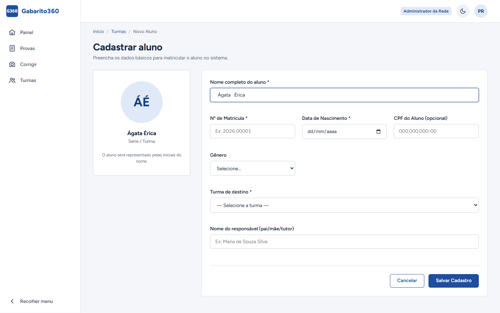
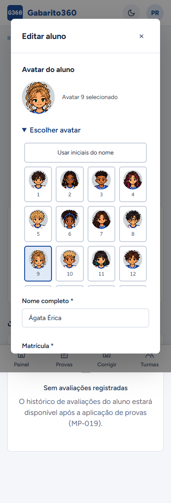
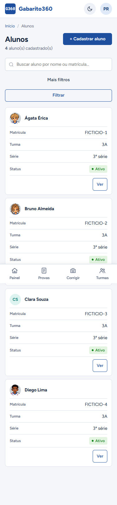
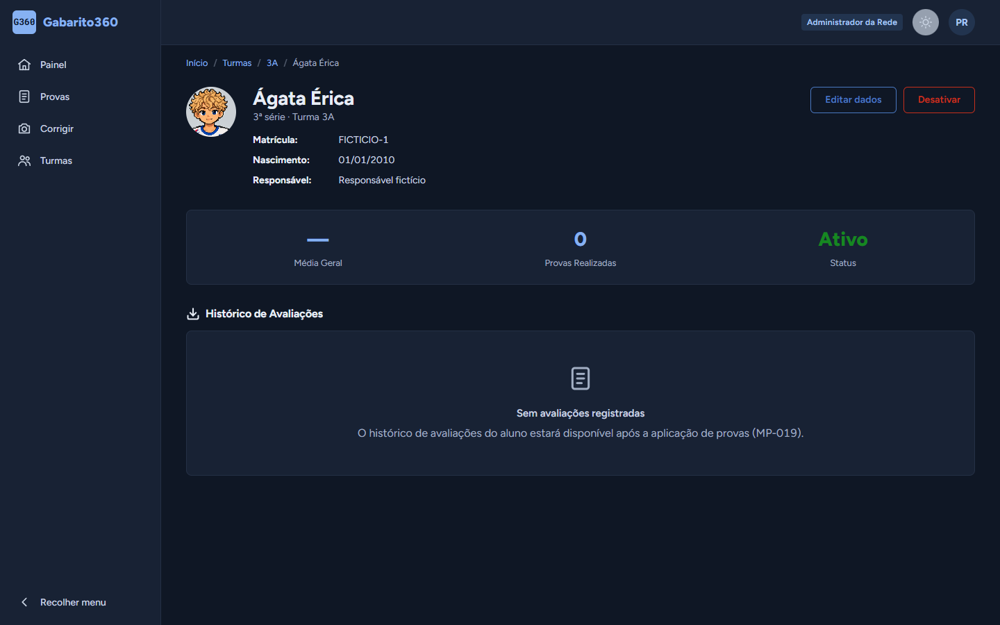
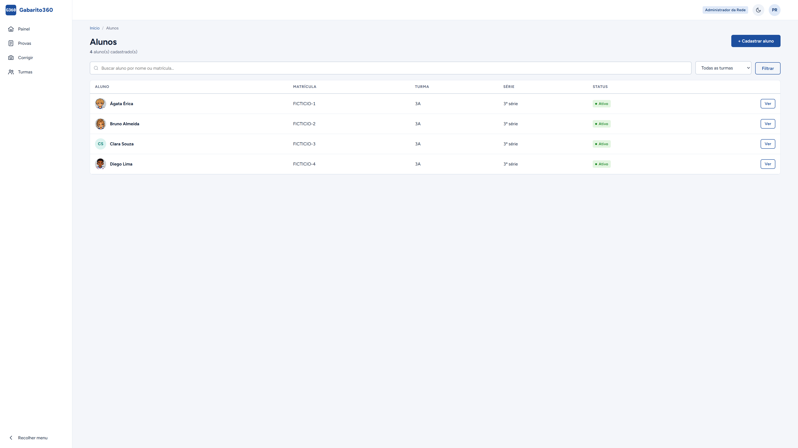

# L6 — Avatares de alunos

Publicado em 31/10/2026 com aprovação do responsável, pelo PR #70. Não houve exclusão de fotos.

## Comportamento

Cadastro, lista, detalhe, turma e painéis de aluno, professor e coordenador usam o mesmo componente de avatar. As iniciais são o padrão; o responsável aprovou uma galeria de 36 personagens em pixel art com farda inspirada na Bahia. Cadastro e edição oferecem seleção, prévia imediata e retorno às iniciais; a escolha só persiste ao salvar o formulário. A cor deriva do ID do aluno e permanece estável após alteração de nome; no cadastro, antes de existir ID, a prévia é azul. Iniciais aceitam acentos e espaços repetidos, com escape HTML e alternativa para nome vazio. As cores usam os tokens dos temas claro e escuro.

API e web rejeitam novos uploads e caminhos de foto no cadastro/edição. O modelo não permite atribuição em massa de `foto_path` e omite o campo nas respostas. A coluna e os arquivos antigos são preservados. A migração aditiva `2026_10_31_000005_adicionar_avatar_alunos.php` cria `avatar_id` nulo por padrão. A API aceita apenas inteiros de 1 a 36 ou nulo. Não há migração destrutiva. Fotos de cartões-resposta não mudam.

## Inventário somente de leitura

Consulta em produção em 31/10/2026, com saída agregada, sem abrir imagens ou divulgar registros:

- Alunos com `foto_path` não vazio: **0**.
- Caminhos distintos: **0**.
- Arquivos no diretório `alunos` do disco público: **0**.
- Referências encontradas nesse diretório: **0**.

O levantamento se limita à coluna e ao diretório utilizados pela aplicação; não representa varredura de backups ou de outros diretórios. Remover a coluna e qualquer arquivo continua dependendo de aprovação específica, backup e nova conferência no momento da execução.

## Validação

- API: 106 testes, 619 asserções. Inclui persistência, mudança, retorno às iniciais, preservação ao omitir o campo, propagação para turma e rejeição de valores fora do catálogo.
- Web: 32 testes, 155 asserções; regressões de 37 opções (iniciais + 36 figuras), recuperação da seleção após erro, encaminhamento do identificador/nulo e rejeição antes de chamar a API; formulário sem upload, iniciais, cor estável e escape HTML.
- MariaDB `gabarito360_teste`, cópia padrão do esquema: cadastro, edição, quatro rejeições de foto/caminho, ocultação do caminho e preservação do legado. Migração aditiva aplicada somente no banco de teste; avatar 36, troca para 1 e retorno a nulo verificados. Dados fictícios em transação revertida; a coluna permanece no banco de teste. Credencial temporária revogada e túnel encerrado.
- Verificação estática de telas: 24 scripts, zero erros.
- Chrome: cadastro, lista, detalhe, turma e três painéis em 320, 375, 768, 1440, 1920 e 3840 px; sem rolagem horizontal nem erros JavaScript. Temas claro/escuro, prévia digitada e modal de edição conferidos. As 36 opções foram selecionadas por clique; retorno às iniciais verificado por teclado.
- A auditoria visual usou renderização Blade e respostas fictícias locais; o roteiro remoto com dados reais não foi executado. Os prints não representam uma publicação em produção.

## Prints com dados fictícios

## Publicação e verificação — 31/10/2026

- PR #70 incorporado no commit `dc9949e3690744b72c5071d919955c09ad2be9b8`. CI do código aprovado após conciliar o quadro com as validações L2 já incorporadas pelo PR #71.
- Backup anterior ao deploy preservado com acesso restrito no CT106 em `/root/gabarito360-recovery/l6-20261031/producao-antes.sql`; restauração isolada conferiu as 40 tabelas. Nenhum arquivo de foto foi apagado.
- Roteiro B5 concluído às 18:11:55 (America/Sao_Paulo). Migração aditiva de `avatar_id` concluída em 26,88 ms; início, login e health responderam HTTP 200 local e público.
- Kernel HTTP da API de produção: cadastro com avatar 36, troca entre 1/9/36, retorno a iniciais, leitura persistida via GET, avatar na turma, rejeição de ID 37 e de foto_path. Conta e registros fictícios em transação revertida; nenhum aluno real alterado.
- Interface: HTML renderizado pelo código publicado no servidor com dados fictícios; CSS, JS e galeria carregados do domínio público com HTTP 200. Seleção 1/9/36 e retorno às iniciais aprovados em Chrome, desktop/celular, sem erro JS ou rolagem lateral. Não foi usado cadastro real nem simulado um envio de formulário autenticado pelo navegador; a persistência foi validada separadamente no kernel da API de produção.
- Nginx, PHP-FPM, Redis, dois workers, timer e sanitizador ativos; nenhum job falho.
- `foto_path` permanece no banco. Exclusão de arquivos ou da coluna continua dependendo de aprovação específica; essa etapa não foi executada.
